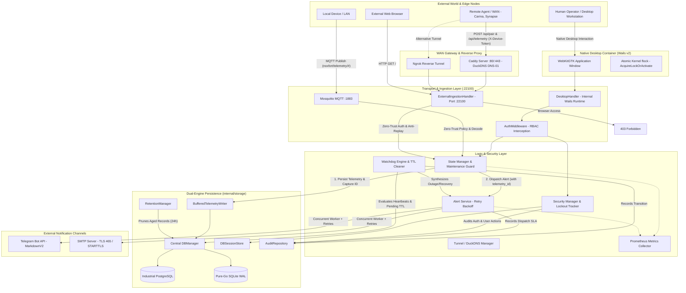
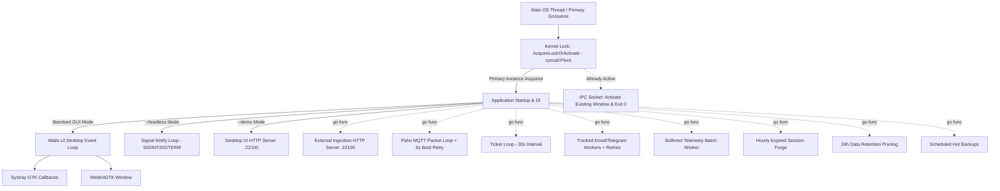

[📚 Documentation Hub](docs/INDEX.md) > **Detailed System Architecture**

---

# 🏗️ Detailed System Architecture: Noxfort Monitor™

This document provides an in-depth architectural overview of **Noxfort Monitor™ v2.0**. It is intended for software engineers, systems architects, and maintainers who need to understand the internal mechanics, **SOLID** patterns, concurrency models, and data flows of the system.

---

## 1. Macro Architectural Philosophy

Noxfort Monitor adheres to a strict **Event-Driven Architecture (EDA)** combined with **SOLID** principles and **Dependency Injection (DI)** assembled at the composition root in [`cmd/server/main.go`](cmd/server/main.go). The system eliminates shared global mutable state and packages with hidden initialization routines.

### System Layers:
1. **Transport & Observability Layer (`internal/transport`, `internal/metrics`)**: Network protocol termination (Authenticated MQTT Broker via Paho on `noxfort/telemetry/#` with `MONITOR_MQTT_STRICT` Zero-Trust policy and live reconnect; public observability endpoints `/healthz`, `/api/health`, and expanded Prometheus `/metrics` exporter; and segregated HTTP handlers: `ExternalIngestionHandler` serving `POST /api/pair` and `POST /api/telemetry` with browser 403 blocking, and `DesktopHandler` serving full authenticated GUI routes inside Wails or `--demo` mode with `ReadHeaderTimeout`/`IdleTimeout` hardening).
2. **Monitor Logic Layer (`internal/monitor`)**: The reactive "brain" (State Manager with Maintenance Mode suppression, Watchdog Engine with expired pairing cleanup, Alert Service with retry backoff and graceful `Shutdown`, EmailChannel with implicit TLS 465 & CRLF header sanitization, TelegramChannel, and Channel Tester).
3. **Security Layer (`internal/security`)**: Persistent SHA-256 hashed session management (`DBSessionStore`), PBKDF2 HMAC-SHA256 password hashing (100,000 iterations), password complexity enforcement, per-account/IP brute-force lockout (`LoginAttemptTracker`), strict Read-Only `OPERATOR` RBAC (`AuthMiddleware` + content-negotiated `forbidden.html` / JSON 403), trusted proxy IP/HTTPS extraction, secret redaction in HTML views, and boot-time `.env` loading & security auditing (`LoadDotEnv`, `ValidateEnvironmentSecurity`).
4. **Remote Access Layer (`internal/tunnel`)**: WAN telemetry ingestion powered by native DuckDNS dynamic updates, containerized Caddy reverse proxy (TLS/SSL ACME DNS-01, `X-Forwarded-*` headers & WSS), and fallback Ngrok reverse tunneling.
5. **Domain Layer (`internal/domain`)**: Universal data structures and decoupled interface contracts (`Device`, `IncomingEvent`, `User`, `AuthAttemptResult`, `SecurityAuditLog`, `AlertDispatchLog`, `DeviceStateTransition`, `BackupMetadata`, `Settings`).
6. **Persistence Layer (`internal/storage`)**: Dynamic dual-engine manager ([`DBManager`](docs/DATABASE.md)), non-blocking hot database snapshotting & validated restore engine ([`BackupManager`](docs/DATABASE.md#9-automated-hot-backups--retention-strategy)), automated age-based pruning ([`RetentionManager`](docs/DATABASE.md#10-automated-data-retention-pruning)), persistent [`DBSessionStore`](docs/SECURITY.md), asynchronous `BufferedTelemetryWriter`, PostgreSQL and SQLite (WAL mode) implementations, dialect adapter, and single-transaction data migrator.
7. **Desktop Interface Layer (`internal/desktop`, `internal/tray`)**: Native runtime in Wails v2 with WebKitGTK and atomic kernel-level file lock (`syscall.Flock`) single-instance enforcement.

---

## 2. Core Subsystems in Detail

### 2.1 The State Manager (`internal/monitor/state.go`)
The `StateManager` is the central event routing hub. It receives Zero-Trust validated payloads from the transport layer (MQTT or HTTP REST) and applies a "Guard, Filter, and Act" pipeline:
* **Maintenance Mode Guard**: Via the optional `DeviceAccessInspector` interface, if the originating device is paused (`Enabled == false`), heartbeat updates, telemetry persistence, and alert dispatches are immediately suppressed.
* **Heartbeat Filtering**: Active devices update their `last_seen` timestamp via `UpdateLastSeen` (10s in-memory write debounce in `DeviceRepository`). The [`KeywordHeartbeatDetector`](internal/monitor/state.go) evaluates the message: if it is at `INFO` level and contains keep-alive keywords ("*system ok*", "*heartbeat*", "*online*", "*ativo*", "*ok*"), processing completes immediately without database incident writes or alert fatigue.
* **Incident Processing & Audit Linkage**: Real operational incidents are persisted via `SaveEventReturningID` (capturing the database `telemetry.id` primary key) and forwarded to `AlertService.TriggerAlertWithTelemetryID` so every alert dispatch log links back to the exact telemetry record.

### 2.2 The Watchdog Engine (`internal/monitor/engine.go`)
While the State Manager processes active incoming events, the `Engine` is responsible for detecting **silent failures** and cleaning up expired onboarding sessions:
* **Concurrency**: Runs in a dedicated goroutine driven by a `time.Ticker` with a default 30-second interval.
* **Expired Pairing Cleanup**: Invokes `CleanupExpiredPending()` on each tick to purge `PENDING` device pairing requests whose 5-minute TTL has expired.
* **Presence Evaluation**: Ignores `PENDING` and paused (`!Enabled`) devices; compares the current timestamp against `LastSeen` for `ACTIVE` devices. If a device fails to report for more than **5 minutes**, the [`SystemStatusTracker`](internal/monitor/tracker.go) flags the transition and synthesizes a `CRITICAL` `System OFFLINE` incident (pre-seeded on boot to prevent restart alert storms).
* **Recovery Detection**: When a previously offline device resumes transmitting, the Engine synthesizes an `INFO` recovery event and records total downtime duration in the audit repository.

### 2.3 Intelligent Alert Routing & Reliability (`internal/monitor/alerts.go`, `email_channel.go`)
The `AlertService` decouples notification business logic from physical transmission through the [`NotificationChannel`](internal/monitor/channel.go) interface:
* **Role-Based Categorization (RBAC)**:
  * **Administrators (`ADMIN`)**: Receive all global incidents.
  * **Technicians (`TECHNICIAN`)**: Receive only alerts in the `HARDWARE` category.
  * **Programmers (`PROGRAMMER`)**: Receive only alerts in the `SOFTWARE` category.
* **Severity Filtering**: Contacts can configure their profiles to exclusively receive `CRITICAL` alerts, suppressing `WARNING` notifications.
* **Asynchronous Dispatch & Retry Backoff**: Each notification to each recipient is dispatched in its own tracked goroutine (`sync.WaitGroup`) with automatic retry backoff (1 initial attempt + 2 retries at `500ms` and `1500ms`), and `Shutdown(ctx)` drains in-flight deliveries cleanly during server exit.
* **SMTP Hardening (`email_channel.go`)**: Sanitizes `\r`/`\n` in headers (`To`, `From`, `Subject`) to block CRLF injection and establishes implicit TLS (`MinVersion: tls.VersionTLS12`) automatically when `SMTPPort == 465`.
* **Delivery Auditing & Metrics**: Every transmission attempt increments `noxfort_alerts_dispatched_total` and persists an [`AlertDispatchLog`](docs/AUDIT_TRAIL.md) entry with `SENT`/`FAILED` status, failure reason, and `telemetry_id`.

### 2.4 Security & Session Subsystem (`internal/security`, `internal/storage/session_repo.go`)
* **Identity & RBAC Management**: [`SecurityManager`](internal/security/security_manager.go) centralizes authentication, self-service/admin password updates, role transitions (safeguarding the superuser and last admin), brute-force unlocking, and IP-attributed security auditing.
* **Persistent Hashed Sessions**: [`DBSessionStore`](internal/storage/session_repo.go) persists sessions in the `sessions` table storing only SHA-256 token hashes (`TTL: 24h`), implements `ReloadableRepository` for DB hot-reloads, and runs hourly expired-session cleanup (`MemorySessionStore` remains available for isolated unit tests).
* **Brute-Force Rate Limiting**: [`LoginAttemptTracker`](internal/security/lockout.go) locks `(username, clientIP)` pairs after 5 failed attempts within 15 minutes for a 5-minute cooldown (`429 Too Many Requests`).
* **Password Isolation & Complexity**: Passwords are hashed using **PBKDF2 HMAC-SHA256** (100,000 iterations, 16-byte random salt, 32-byte key), validated against industrial complexity rules (`password_validator.go`), and excluded from JSON serialization (`json:"-"`).
* **HTML Secret Redaction & Strict Read-Only Operator RBAC**: `AuthMiddleware` restricts `OPERATOR` accounts to read-only views (blocking all mutating endpoints and `/api/settings/database/backup*`, returning JSON 403 or `web/templates/forbidden.html`), while HTML handlers redact stored SMTP, Telegram, DuckDNS, and active device keys.

### 2.5 Remote Access & WAN Ingestion (`internal/tunnel`)
* The [`internal/tunnel`](docs/REMOTE_ACCESS.md) package abstracts remote WAN ingestion providers:
  * **DuckDNS Driver**: Active default driver for dynamic DNS record synchronization, IPv4/IPv6 address discovery, and live connection diagnostics. Works in concert with [Caddy](docs/CADDY_INTEGRATION.md) (which forwards `X-Real-IP`, `X-Forwarded-For`, and `X-Forwarded-Proto`) for automated TLS certificate issuance, trusted proxy IP extraction (`TRUSTED_PROXIES`), and `Secure` cookie detection.
  * **Ngrok Driver**: Optional outbound reverse tunnel for deployments operating behind strict corporate firewalls or carrier-grade NAT (CGNAT) without port forwarding capability.

---

## 3. Domain Model and Core Entities (`internal/domain`)

The `internal/domain` package has zero external dependencies, serving as the pure core of the application:

* **`IncomingEvent`**: Universal telemetry payload containing `Category`, `Origin`, `Level`, `Message`, and `OccurredAt`.
* **`Device`**: Monitored node with its friendly `Name`, unique `Identifier`, `ApiKey`, onboarding `Status` (`PENDING`/`ACTIVE`), `ExpiresAt` pairing TTL, `LastSeen`, and `Enabled` maintenance flag.
* **`Contact`**: Incident recipients with roles, notification channels (Email, Telegram Chat ID), and severity filters.
* **`User` & `AuthAttemptResult`**: System operators with credentials (`PasswordHash` excluded via `json:"-"`), assigned roles (`RoleAdmin`, `RoleOperator`), and brute-force lockout metadata.
* **`SecurityAuditLog`**, **`AlertDispatchLog`**, **`DeviceStateTransition`**: Compliance and audit trail models (including `TelemetryID` linkage on alert dispatch logs).
* **`DatabaseConfig`**, **`DatabaseStatus`**, **`BackupMetadata`**: Parameters, health state, and snapshot metadata of the persistence layer.
* **`Settings`**: System configuration model, including SMTP, Telegram, MQTT broker address, DuckDNS, and Ngrok parameters.

---

## 4. Persistence Layer & Dual-Engine (`internal/storage`)

See the dedicated guide [Database & Persistence](docs/DATABASE.md).

* **Native Dual-Engine**:
  * **SQLite**: `modernc.org/sqlite` for embedded deployments without a C compiler (CGO-free), hardened with WAL journaling (`journal_mode = WAL`, `synchronous = NORMAL`, `busy_timeout = 5000`).
  * **PostgreSQL**: `github.com/lib/pq` for industrial servers with schema isolation (`schema_monitor`).
* **Central DBManager & Atomic Restore**: Enables hot database switching via `ReloadableRepository.SetDB(db, driver)` across all 7 registered repositories (including `DBSessionStore`) without restarting the process, and supports atomic SQLite file restoration (`RestoreSQLiteFile` after `PRAGMA quick_check`) or `pg_restore`.
* **Buffered Ingestion Worker (`BufferedTelemetryWriter`)**: Asynchronous, channel-buffered telemetry writer (`internal/storage/buffered_telemetry_writer.go`) that flushes batches and tracks queue depth via `metrics.SetBufferDepth`, alongside synchronous `SaveEventReturningID` when audit linkage requires the inserted primary key.
* **Transactional Migrator**: Structured cross-engine synchronization via `MigrateData()` inside a single database transaction (aborting `Switch` on error), copying devices (including `api_key`, `status`, `expires_at`), contacts, users, persistent sessions, settings, telemetry, and all three audit tables.
* **Automated Retention & Scheduled Backups**: `RetentionManager` (`internal/storage/retention.go`) runs every 24h pruning telemetry and audit tables older than `MONITOR_RETENTION_DAYS` (default `90`), while `BackupManager` runs scheduled hot backups (`MONITOR_BACKUP_INTERVAL_HOURS`, default `24`, retaining the latest 7 files).
* **Query Adapter**: Runtime adaptation of SQL placeholders (`?` to `$1, $2`) and conflict clause resolution.

---

## 5. Threading Model, Concurrency & Operating System

* **Primary Goroutine & Atomic Lock**:
  * Enforces single-instance integrity via `desktop.AcquireLockOrActivate()`, obtaining an exclusive OS kernel file lock (`syscall.Flock`) on `$XDG_RUNTIME_DIR/noxfort-monitor.lock` (or `/tmp/noxfort-monitor-<uid>.lock`). If locked, sends an IPC activation command to `$XDG_RUNTIME_DIR/noxfort-monitor.sock` and terminates cleanly.
  * In desktop mode, executes `desktopApp.Run()` (Wails v2), because Linux GTK/WebKit components require the main OS thread.
  * In `--headless` or `--demo` mode, blocks on an OS signal channel (`syscall.SIGTERM`, `os.Interrupt`), executing as a background ingestion daemon (`--headless`) or HTTP UI presentation server (`--demo`).
* **Web Server**: Runs in an independent goroutine with `ReadHeaderTimeout: 5s`, `ReadTimeout: 15s`, `WriteTimeout: 15s`, and `IdleTimeout: 60s`. In standard/headless mode (`ExternalIngestionHandler`), exposes `POST /api/pair`, `POST /api/telemetry`, `/healthz`, `/api/health`, and `/metrics` while blocking browser requests with HTTP 403 Forbidden.
* **MQTT Listener**: The Paho client manages TCP sockets across dedicated read/write goroutines; if the broker is unreachable on startup, a background goroutine retries every 5 seconds so HTTP and GUI stay available.
* **Watchdog & Background Maintenance Loops**: Watchdog ticks every 30s; `DBSessionStore` purges expired sessions hourly; `RetentionManager` and `BackupManager` run on periodic 24h / configured schedules governed by a shared `bgCtx`.
* **Graceful Shutdown**: Coordinated by a thread-safe `sync.Once` routine that cancels `bgCtx`, releases the kernel flock lock, closes the IPC listener, terminates the active tunnel/DuckDNS service, shuts down the HTTP server, stops the Watchdog Engine, disconnects MQTT, flushes `BufferedTelemetryWriter`, waits for in-flight alerts via `AlertService.Shutdown()` (within 2s timeout), and closes the active database handle.

---

### 🔗 Related Documentation
* 🧭 [Documentation Hub](docs/INDEX.md) — Master documentation index
* 🗄️ [Database & Persistence](docs/DATABASE.md) — DBManager, PostgreSQL, and SQLite
* 🔐 [Security & RBAC](docs/SECURITY.md) — SecurityManager and Middleware details
* 🌐 [Remote Access & Tunneling](docs/REMOTE_ACCESS.md) — DuckDNS & Ngrok architecture
* 🛡️ [Caddy Reverse Proxy](docs/CADDY_INTEGRATION.md) — Automated HTTPS & WSS proxy
* 🖥️ [Desktop Application](docs/DESKTOP_APP.md) — Wails v2 runtime and Headless mode
* 🔍 [Audit Trail](docs/AUDIT_TRAIL.md) — Compliance and audit tracking model
* 📡 [API Reference](docs/API_REFERENCE.md) — REST and MQTT contracts

---

   
  <b>Noxfort Systems</b> — <i>A State Of Art Company</i> 
  <small>Licensed under the <a href="LICENSE">GNU Affero General Public License v3.0 or later</a> (SPDX: <code>AGPL-3.0-or-later</code>). © 2026 Noxfort Systems.</small>

