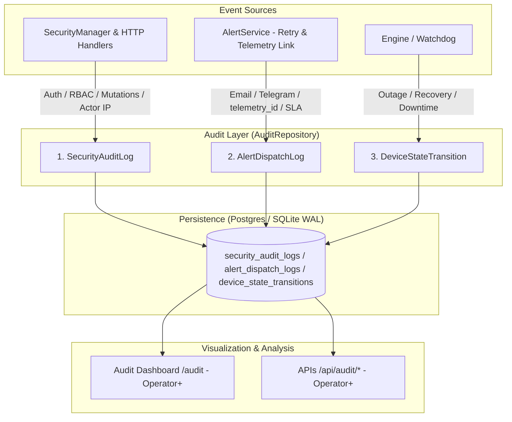

[📚 Documentation Hub](INDEX.md) > **Audit Trail & Observability**

---

# 🔍 Audit Trail & Observability: Noxfort Monitor™

This document outlines the compliance and audit trail subsystem of **Noxfort Monitor™ v2.0**, engineered to satisfy industrial regulatory standards, security access auditing, alert delivery verification (SLA), and equipment availability traceability.

---

## 1. The Three Audit Pillars

Noxfort Monitor segregates audit records into three independent streams ([`internal/domain/audit.go`](../internal/domain/audit.go)):

---

## 2. Audit Log Models in Detail

### 2.1 Security Audit (`SecurityAuditLog`)
Tracks all authentication events and administrative mutations attributed to the **real authenticated session username** (`SessionFromContext`) and **trusted client IP** (`ExtractClientIP` honoring `TRUSTED_PROXIES`):

| Field | Type | Description |
| :--- | :--- | :--- |
| `id` | `int64` | Unique sequential identifier. |
| `created_at` | `time.Time` | Action record timestamp. |
| `username` | `string` | Authenticated actor username (or attempted login username). |
| `action` | `string` | Standardized action identifier (see complete catalog below). |
| `details` | `string` | Contextual details (modified target, section, backup filename, attempt counter, etc.). |
| `ip_address` | `string` | Verified client IP address. |

#### Complete Catalog of Recorded Security Actions:
* **Authentication & Brute-Force Lockout (`security_manager.go`)**:
  * `AUTH_LOGIN_SUCCESS`: Successful login with role logged.
  * `AUTH_LOGIN_FAILED`: Failed login attempt (empty fields, unknown user, or incorrect password with attempt counter `N/5`).
  * `AUTH_LOGIN_LOCKED`: Blocked attempt due to active brute-force lockout cooldown.
* **User Account Lifecycle (`security_manager.go`)**:
  * `USER_CREATE`: New user account provisioned with target role.
  * `USER_PASSWORD_CHANGED`: Self-service password change or administrator reset.
  * `USER_ROLE_UPDATED`: Role transition between `ADMIN` and `OPERATOR`.
  * `USER_UNLOCKED`: Manual administrator clearance of brute-force lockout counters.
  * `USER_DELETE`: User account removal.
* **Device Lifecycle (`device_handler.go`)**:
  * `DEVICE_CREATED`: Manual provisioning of an `ACTIVE` device.
  * `DEVICE_UPDATED`: Device friendly name updated.
  * `DEVICE_PAUSED` / `DEVICE_RESUMED`: Maintenance Mode toggled (`enabled=false/true`).
  * `DEVICE_KEY_ROTATED`: Device API key rotated.
  * `DEVICE_DELETE`: Device deleted or pending pairing cancelled.
* **Response Contacts (`contact_handler.go`)**:
  * `CONTACT_CREATED`, `CONTACT_UPDATED`, `CONTACT_DELETED`.
* **System & Tunnel Configuration (`settings_handler.go`, `tunnel_handler.go`)**:
  * `SETTINGS_UPDATED`: Notification or MQTT settings saved (records updated `form_section`).
  * `TUNNEL_CONFIG_SAVED`, `TUNNEL_STARTED`, `TUNNEL_STOPPED`, `TUNNEL_DISCONNECTED`.
* **Database & Backup Operations (`database_handler.go`, `database_provision_handler.go`)**:
  * `DATABASE_CONFIG_UPDATED`: Engine/connection reconfiguration or migration.
  * `POSTGRES_USER_PROVISIONED`: Least-privilege PostgreSQL user provisioned.
  * `DATABASE_BACKUP_CREATED`, `DATABASE_BACKUP_DOWNLOADED`, `DATABASE_BACKUP_RESTORED`.

### 2.2 Alert Dispatch Audit (`AlertDispatchLog`)
Guarantees delivery traceability to ensure compliance with **incident response SLAs**:

| Field | Type | Description |
| :--- | :--- | :--- |
| `id` | `int64` | Sequential identifier. |
| `telemetry_id` | `*int64` | Primary key of the persisted `telemetry` incident row that triggered the alert (populated via `SaveEventReturningID` + `TriggerAlertWithTelemetryID` in both `StateManager` and `Engine`). |
| `channel` | `string` | Notification channel (`email` or `telegram`, rendered cleanly in UI regardless of casing). |
| `recipient` | `string` | Target destination (contact email or Telegram `chat_id`). |
| `role` | `string` | Recipient role (`TECHNICIAN`, `PROGRAMMER`, `ADMIN`). |
| `status` | `string` | `SENT` (delivered after up to 2 automatic retries with `500ms`/`1500ms` backoff) or `FAILED`. |
| `error_reason` | `string` | Diagnostic error returned by SMTP server or Telegram Bot API upon failure. |
| `dispatched_at`| `time.Time` | Timestamp of the incident/dispatch. |

### 2.3 Hardware State Transitions (`DeviceStateTransition`)
Calculates and formally records equipment availability and downtime:

| Field | Type | Description |
| :--- | :--- | :--- |
| `id` | `int64` | Sequential identifier. |
| `device_identifier` | `string` | Target system identifier (e.g., `synapse`, `pump-01`). |
| `previous_state` | `string` | Previous state: `ONLINE` or `OFFLINE`. |
| `new_state` | `string` | Newly detected state: `OFFLINE` or `ONLINE`. |
| `duration_offline_sec` | `int64` | Total duration (in seconds) the system was unresponsive prior to recovery. |
| `transition_at` | `time.Time` | Exact timestamp of the state transition. |

---

## 3. Retention & Web Dashboard Visualization (`/audit`)

* **Dashboard View (`/audit`)**: Organizes Security Logs, Alert Dispatch Logs, and Device State Transitions into tabbed views with status badges and human-readable downtime durations.
* **Access Control**: Read-only access is available to all authenticated sessions (**`OPERATOR` and `ADMIN`**).
* **Automated Pruning (`RetentionManager`)**: Records in `security_audit_logs`, `alert_dispatch_logs`, and `device_state_transitions` (alongside `telemetry`) are automatically pruned every 24 hours when older than **`MONITOR_RETENTION_DAYS`** (default: **90 days**).

---

## 4. Audit REST API Endpoints

All audit routes return structured JSON responses (latest 100 entries) for authenticated sessions (`Operator+`):

| Method | Endpoint | Role | Description |
| :--- | :--- | :--- | :--- |
| `GET` | `/api/audit/security` | Operator+ | Returns recent security and authentication event logs. |
| `GET` | `/api/audit/alerts` | Operator+ | Returns notification dispatch history, `telemetry_id` links, and delivery statuses. |
| `GET` | `/api/audit/transitions` | Operator+ | Returns device availability history and calculated downtime durations. |

---

### 🔗 Related Documentation
* 🏗️ [System Architecture](../ARCHITECTURE.md) — Watchdog Engine, AlertService retries, and StateManager
* 🔐 [Security & RBAC](SECURITY.md) — Authentication events, brute-force lockout, and RBAC rules
* 🗄️ [Database & Persistence](DATABASE.md) — Audit tables, composite indexes, and `RetentionManager`
* 📡 [API Reference](API_REFERENCE.md) — Technical specifications of JSON endpoints
* 🖥️ [Desktop Application](DESKTOP_APP.md) — Desktop client integration
