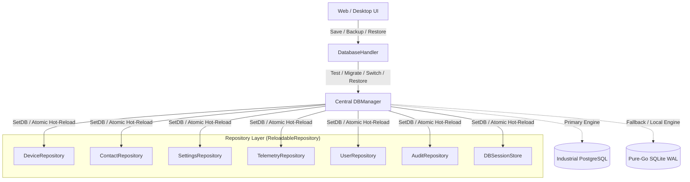

[📚 Documentation Hub](INDEX.md) > **Database & Dual-Engine Persistence**

---

# 🗄️ Persistence & Dual-Engine Architecture: Noxfort Monitor™

This document details the persistence architecture of **Noxfort Monitor™ v2.0**, covering native coexistence of **PostgreSQL** and **SQLite (WAL mode)**, live connection hot-reloading ([`DBManager`](../internal/storage/db_manager.go)), transactional cross-engine data migration ([`MigrateData`](../internal/storage/migrator.go)), hot backups and validated restore ([`BackupManager`](../internal/storage/backup.go)), automated data retention pruning ([`RetentionManager`](../internal/storage/retention.go)), and PostgreSQL least-privilege user provisioning.

---

## 1. Dual-Engine Architecture Overview



### Supported Engines

| Feature | SQLite (Pure-Go) | PostgreSQL |
| :--- | :--- | :--- |
| **Go Driver** | `modernc.org/sqlite` (CGO-free) | `github.com/lib/pq` |
| **Primary Use Case** | Local deployments, single-user desktop, edge nodes | Industrial servers, high concurrency, enterprise networks |
| **Default Location** | `~/Documentos/Monitor/monitor_logs.db` | TCP Server (default port `5432`) |
| **Concurrency & Journaling** | `PRAGMA journal_mode = WAL`, `synchronous = NORMAL`, `busy_timeout = 5000`, `MaxOpenConns(1)` | Connection pool with dedicated schema (`schema_monitor`) |
| **External Dependencies** | None (embedded in binary) | Network PostgreSQL 12+ server (`pg_dump`/`pg_restore` for backups) |

---

## 2. Bootstrapping and Automatic Fallback Lifecycle

During startup ([`cmd/server/main.go`](../cmd/server/main.go)), `storage.LoadDatabaseConfig()` reads `~/Documentos/Monitor/database_config.json` (or `MONITOR_DB_CONFIG_PATH`) and applies environment overrides (`MONITOR_DB_TYPE`, `MONITOR_DB_HOST`, `MONITOR_DB_PORT`, `MONITOR_DB_USER`, `MONITOR_DB_PASSWORD`, `MONITOR_DB_NAME`, `MONITOR_DB_SCHEMA`, `MONITOR_DB_SSLMODE`):

1. **PostgreSQL Attempt**: If configured for `postgres`, opens a connection via `storage.OpenConnection()` and initializes schema/indexes idempotently via `storage.InitPostgresSchema()`.
2. **Automatic Fallback to SQLite**: If PostgreSQL is unreachable or schema initialization fails, logs a warning and falls back immediately to local SQLite (`storage.NewDatabase()`), ensuring the monitor never fails to boot due to network outages.

---

## 3. Dynamic Manager (`DBManager`) & Live Hot-Reload

```go
type ReloadableRepository interface {
    SetDB(db *sql.DB, driver string)
}
```

1. All **7 stateful stores** (`DeviceRepository`, `ContactRepository`, `SettingsRepository`, `TelemetryRepository`, `UserRepository`, `AuditRepository`, and `DBSessionStore`) register with `DBManager.RegisterRepository()` at boot.
2. When an administrator switches engines via `/server` or `POST /api/settings/database/save`:
   * `DBManager.Switch(newCfg, migrate)` opens the target engine, runs `InitSchema`, and — if `migrate=true` — runs `MigrateData` inside a transaction. **If migration fails, `Switch` aborts cleanly** and leaves the previous active database intact.
   * On success, `DBManager` atomically updates its `*sql.DB` and driver under `sync.RWMutex`, saves `database_config.json` (`0600`), calls `SetDB(newDB, driver)` on all registered repositories, and drains the old handle.

---

## 4. Transactional Data Migrator (`MigrateData`)

Implemented in [`internal/storage/migrator.go`](../internal/storage/migrator.go), `MigrateData` executes inside a **single target database transaction** (`targetDB.Begin()` / `tx.Commit()`, rolling back automatically on any error) across all 9 tables:

1. **`devices`**: Name, `identifier`, `api_key`, `status`, `expires_at`, `last_seen`, `enabled`, `created_at` (`ON CONFLICT (identifier) DO NOTHING`).
2. **`contacts`**: Name, email, phone, role, `notify_critical`, `enabled`, `telegram_chat_id` (deduplicated by `email`).
3. **`users`**: Username, PBKDF2 `password_hash`, `role`, `created_at` (`ON CONFLICT (username) DO NOTHING`).
4. **`sessions`**: Active `token_hash`, `username`, `role`, `expires_at`, `created_at` (`ON CONFLICT (token_hash) DO NOTHING`).
5. **`settings`**: Global row (`id = 1`) including SMTP, MQTT broker address, Telegram, DuckDNS, and Ngrok configurations.
6. **`telemetry`**: Incident events (`category`, `device_id`, `origin`, `level`, `message`, `occurred_at`).
7. **`security_audit_logs`**: Access control and administrative action history.
8. **`alert_dispatch_logs`**: Notification delivery SLA logs (including `telemetry_id`).
9. **`device_state_transitions`**: Watchdog outage/recovery transitions and offline durations.

---

## 5. High-Throughput Batch Ingestion (`BufferedTelemetryWriter`)

Implemented in [`internal/storage/buffered_telemetry_writer.go`](../internal/storage/buffered_telemetry_writer.go):
* **Channel Queue**: Buffered channel (`batchSize * 4`, default batch size `50`, flush interval `100ms`) updating the `noxfort_telemetry_buffer_depth` Prometheus gauge.
* **Saturation Fallback**: If the channel fills under peak load, falls back immediately to synchronous `repo.SaveEvent()`.
* **Audit Linkage Support**: Exposes `SaveEventReturningID()` for incident paths (`StateManager`, `Engine`) that require the inserted `telemetry.id` to link `alert_dispatch_logs.telemetry_id`.
* **Graceful Drain**: `Close()` drains and flushes all queued records before closing the database on shutdown.

---

## 6. SQL Dialects & Query Adapter (`AdaptQuery`)

[`internal/storage/query_adapter.go`](../internal/storage/query_adapter.go) translates queries dynamically at runtime:
* **Placeholders**: Converts `?` to `$1, $2, ...` for PostgreSQL while preserving literal `?` inside single-quoted string literals.
* **Conflict Clauses**: Adapts `INSERT OR IGNORE INTO` to PostgreSQL `ON CONFLICT DO NOTHING`.

---

## 7. PostgreSQL Schema and User Provisioning

* **Idempotent Initialization ([`postgres_schema.go`](../internal/storage/postgres_schema.go))**: Creates `schema_monitor` (or custom schema), configures `search_path`, provisions all 9 tables, runs idempotent column migrations, and creates all **12 performance/composite indexes** (parity with SQLite `database.go`).
* **Least-Privilege User Provisioning ([`postgres_admin.go`](../internal/storage/postgres_admin.go))**: Via `/server` or `POST /api/settings/database/provision-user`, temporarily connects with admin credentials to create a dedicated user scoped exclusively to the Monitor schema (`GRANT USAGE ON SCHEMA`, `GRANT ALL PRIVILEGES ON ALL TABLES IN SCHEMA`).

---

## 8. Table Schemas

```mermaid
erDiagram
    devices {
        bigserial id PK
        text name
        text identifier UK
        text api_key
        text status
        timestamptz expires_at
        timestamptz last_seen
        boolean enabled
        timestamptz created_at
    }
    contacts {
        bigserial id PK
        text name
        text email
        text phone
        text role
        boolean notify_critical
        boolean enabled
        text telegram_chat_id
    }
    settings {
        integer id PK
        text smtp_host
        integer smtp_port
        text smtp_user
        text smtp_pass
        text smtp_from
        text admin_email
        text mqtt_address
        boolean enabled
        text telegram_bot_token
        text ngrok_auth_token
        text ngrok_domain
        boolean ngrok_enabled
        text duckdns_token
        text duckdns_domain
        boolean duckdns_enabled
    }
    telemetry {
        bigserial id PK
        text category
        text device_id
        text origin
        text level
        text message
        timestamptz occurred_at
        timestamptz received_at
    }
    users {
        bigserial id PK
        text username UK
        text password_hash
        text role
        timestamptz created_at
    }
    sessions {
        varchar token_hash PK
        varchar username
        varchar role
        timestamptz expires_at
        timestamptz created_at
    }
    security_audit_logs {
        bigserial id PK
        timestamptz created_at
        varchar username
        varchar action
        text details
        varchar ip_address
    }
    alert_dispatch_logs {
        bigserial id PK
        bigint telemetry_id
        varchar channel
        varchar recipient
        varchar role
        varchar status
        text error_reason
        timestamptz dispatched_at
    }
    device_state_transitions {
        bigserial id PK
        varchar device_identifier
        varchar previous_state
        varchar new_state
        bigint duration_offline_sec
        timestamptz transition_at
    }
```



---

## 9. Automated Hot Backups, Download & One-Click Restore

[`internal/storage/backup.go`](../internal/storage/backup.go) manages zero-downtime snapshots in `~/Documentos/Monitor/backups/` (or `./backups` via CLI):

### 9.1 Non-Blocking Hot Snapshots & Rotation
* **SQLite Mode**: Executes `VACUUM INTO '<target_path>'` for an atomic, defragmented `.db` snapshot.
* **PostgreSQL Mode**: Invokes `pg_dump -F c` to produce a compressed custom-format `.sql` snapshot.
* **Rotation**: Automatically retains the latest **7 snapshots** (`maxKeep = 7`).
* **Scheduled Backups**: `StartScheduledBackups` runs periodically based on **`MONITOR_BACKUP_INTERVAL_HOURS`** (default **`24`** hours; set `<= 0` to disable automatic scheduling).

### 9.2 Secure Download & Integrity-Checked Restore
* **Path-Traversal Guard (`ResolveBackupPath`)**: Validates filenames strictly against `monitor_*.db` / `monitor_*.sql` inside the backup directory before allowing downloads (`GET /api/settings/database/backups/download?file=...`) or restores.
* **Validated Restore (`RestoreBackup` / `POST /api/settings/database/restore`)**:
  * **SQLite (`.db`)**: Runs `PRAGMA quick_check;` on the backup before touching live data. On pass, `DBManager.RestoreSQLiteFile` closes the live DB, removes `-wal` and `-shm` sidecars, stages and atomically renames the restored file (`0600`), reopens SQLite with WAL pragmas, and reloads all 7 repositories via `SetDB`.
  * **PostgreSQL (`.sql`)**: Verifies the active connection is `postgres` and invokes `pg_restore --clean --if-exists`.

### 9.3 Invocation Interfaces
1. **Desktop / Web UI**: **Backups & Restauração** panel on `/server` (`ADMIN` only) for creating, listing, downloading, and restoring snapshots.
2. **Makefile & CLI**: `make backup`, `make backup-list`, or [`scripts/backup.sh`](../scripts/backup.sh).
3. **REST API (`ADMIN` only)**: `POST /api/settings/database/backup`, `GET /api/settings/database/backups`, `GET /api/settings/database/backups/download`, `POST /api/settings/database/restore`.

---

## 10. Automated Data Retention Pruning (`RetentionManager`)

Implemented in [`internal/storage/retention.go`](../internal/storage/retention.go) to bound disk growth during continuous 24/7 operation:
* **Schedule**: Runs on startup and every **24 hours** via `bgCtx`.
* **Retention Horizon**: Configured via **`MONITOR_RETENTION_DAYS`** (default **`90`** days; values `<= 0` disable pruning).
* **Pruned Tables**:
  1. `telemetry` (`occurred_at < cutoff`)
  2. `alert_dispatch_logs` (`dispatched_at < cutoff`)
  3. `security_audit_logs` (`created_at < cutoff`)
  4. `device_state_transitions` (`transition_at < cutoff`)

---

### 🔗 Related Documentation
* 🏗️ [System Architecture](../ARCHITECTURE.md) — Architectural layer separation overview
* 📡 [API Reference](API_REFERENCE.md) — Database & backup REST endpoints
* 🚀 [Production Deployment Guide](DEPLOYMENT.md) — PostgreSQL, retention & backup env tuning
* 🔐 [Security & RBAC](SECURITY.md) — Persistent hashed `sessions` and backup access restriction
* 🔍 [Audit Trail](AUDIT_TRAIL.md) — Audit log tables and indexes
