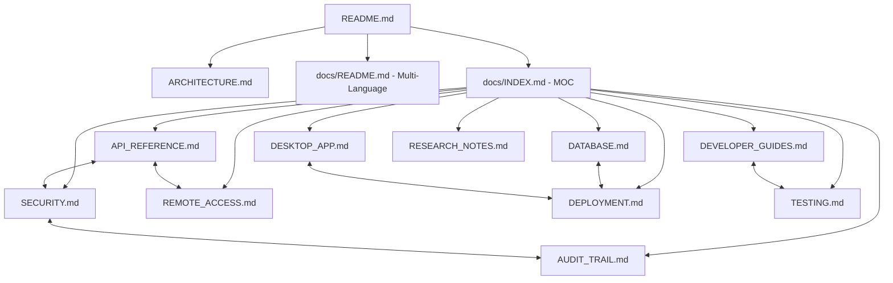

# 📚 Noxfort Monitor™ Technical Master Documentation Hub

Welcome to the **Noxfort Monitor™ v2.0** technical documentation library. Designed as an industrial event-driven observability, telemetry ingestion, and incident response platform, Noxfort Monitor bridges high-frequency MQTT/HTTP sensor streams, silent failure detection via Watchdog, automated multi-channel alert dispatching, and dual-engine persistence (PostgreSQL and SQLite).

This master documentation index provides deep technical coverage for software engineers, devops operators, field technicians, and system integrators. It is fully compatible with both **GitHub** and **[Obsidian](https://obsidian.md/)**.

---

## 🗺️ Codebase Map & Directory Hierarchy

```text
MONITOR_CORE/
├── caddy/                          # Automated TLS edge gateway (Docker)
│   ├── Dockerfile                  # Multi-stage Caddy build with caddy-dns/duckdns plugin
│   └── Caddyfile                   # Automatic HTTPS reverse proxy, X-Forwarded-* & WSS forwarder
├── cmd/
│   └── server/
│       └── main.go                 # Composition root, dependency injection & lifecycle bootstrap
├── internal/
│   ├── appdir/                     # Cross-mode asset and runtime path resolution
│   │   └── appdir.go               # Base directory & NOXFORT_HOME resolver
│   ├── desktop/                    # Native desktop application (Wails v2 runtime & single-instance lock)
│   │   ├── app.go                  # Wails bindings, desktopResponseWriter cookie bridge & lifecycle
│   │   └── singleinstance.go       # Atomic kernel flock (syscall.Flock) & Unix IPC socket listener
│   ├── domain/                     # Pure domain models (zero external dependencies)
│   │   ├── audit.go                # SecurityAuditLog, AlertDispatchLog, DeviceStateTransition models
│   │   ├── contact.go              # Contact notification recipient & role definitions
│   │   ├── database.go             # DatabaseConfig, DatabaseStatus & BackupMetadata models
│   │   ├── device.go               # Device entity, pairing status, API key & ErrDeviceAlreadyActive
│   │   ├── incident.go             # Incident classification constants & structures
│   │   ├── settings.go             # Application settings & SMTPSettings options
│   │   ├── telemetry.go            # Universal IncomingEvent telemetry payload & severity constants
│   │   └── user.go                 # System user, RoleAdmin/RoleOperator & AuthAttemptResult
│   ├── metrics/                    # Thread-safe Prometheus instrumentation counters & gauges
│   │   └── metrics.go              # Ingested/rejected telemetry, alerts dispatched & buffer depth
│   ├── monitor/                    # Reactive business logic engine
│   │   ├── alerts.go               # Role-based alert dispatcher with retry backoff & graceful Shutdown
│   │   ├── channel.go              # NotificationChannel interface
│   │   ├── email_channel.go        # SMTP channel with implicit TLS (465) & CRLF header sanitization
│   │   ├── engine.go               # Watchdog engine (silent failure, recovery & pending TTL cleanup)
│   │   ├── router.go               # RoleNotificationPolicy routing rules
│   │   ├── state.go                # StateManager, Maintenance Mode guard & heartbeat filter
│   │   ├── telegram_channel.go     # Telegram Bot API MarkdownV2 channel
│   │   ├── tester.go               # On-demand notification channel diagnostics
│   │   └── tracker.go              # SystemStatusTracker device health state machine
│   ├── protocol/                   # Telemetry protocol definitions & JSON payload decoder
│   │   └── decoder.go              # IncomingEvent decoder and field validator
│   ├── security/                   # Authentication & security subsystem
│   │   ├── env_validator.go        # Boot-time .env permissions (0600) & credential auditing
│   │   ├── hasher.go               # PBKDF2 HMAC-SHA256 password hashing (100k iterations)
│   │   ├── lockout.go              # Per-account/IP brute-force LoginAttemptTracker
│   │   ├── password_validator.go   # Industrial password complexity validator
│   │   ├── security_manager.go     # Central security coordinator, role/password edits & auditing
│   │   ├── session.go              # SessionStore contract & in-memory fallback store
│   │   └── superuser.go            # .env loader & idempotent superuser bootstrap
│   ├── storage/                    # Persistence tier & dual-engine database subsystem
│   │   ├── audit_repo.go           # AuditRepository implementation (PostgreSQL & SQLite)
│   │   ├── backup.go               # Hot backup (VACUUM INTO / pg_dump), download path & restore
│   │   ├── buffered_telemetry_writer.go # In-memory batch ingestion queue & worker
│   │   ├── contact_repo.go         # ContactRepository implementation
│   │   ├── database.go             # SQLite connection, WAL pragmas, schema & composite indexes
│   │   ├── db_config_store.go      # Database configuration persistence & env overrides
│   │   ├── db_manager.go           # Dynamic DBManager for live hot-reload & atomic SQLite restore
│   │   ├── device_repo.go          # DeviceRepository with Zero-Trust pairing, keys & maintenance toggle
│   │   ├── migrator.go             # Transactional heterogeneous data migrator (MigrateData)
│   │   ├── postgres_admin.go       # Least-privilege PostgreSQL user provisioning
│   │   ├── postgres_schema.go      # PostgreSQL DDL schema, tables & performance indexes
│   │   ├── query_adapter.go        # SQL dialect adapter (? vs $1, $2, ON CONFLICT)
│   │   ├── retention.go            # Automated 24h data retention pruning (RetentionManager)
│   │   ├── session_repo.go         # Persistent DBSessionStore storing SHA-256 session token hashes
│   │   ├── settings_repo.go        # SettingsRepository implementation
│   │   ├── telemetry_repo.go       # TelemetryRepository (returning IDs & batch inserts)
│   │   └── user_repo.go            # UserRepository implementation (incl. password & role updates)
│   ├── transport/                  # Network transport adapters
│   │   ├── http/                   # HTTP REST server, routes, handlers & middleware
│   │   │   ├── audit_handler.go    # Audit trail HTML & JSON endpoints (/api/audit/*)
│   │   │   ├── auth_handler.go     # Login (429 lockout), logout & session status APIs
│   │   │   ├── auth_helper.go      # Token extraction, TRUSTED_PROXIES IP & HTTPS detection
│   │   │   ├── browser_handler.go  # Safe OS default browser launcher (/api/open-external)
│   │   │   ├── contact_handler.go  # Response Team CRUD & audit logging
│   │   │   ├── dashboard_handler.go# Dashboard SSR & live polling snapshot (/api/dashboard/summary)
│   │   │   ├── database_dto.go     # Database API DTOs
│   │   │   ├── database_handler.go # DB status, test, hot-reload, backup download & restore APIs
│   │   │   ├── database_provision_handler.go # PostgreSQL user provisioning endpoint
│   │   │   ├── device_handler.go   # Device CRUD, pause/resume toggle, key rotation & secret redaction
│   │   │   ├── health_handler.go   # Public /healthz and /api/health diagnostics
│   │   │   ├── ip.go               # Local LAN IP resolver
│   │   │   ├── metrics_handler.go  # Prometheus /metrics exposition exporter
│   │   │   ├── middleware.go       # AuthMiddleware, strict Operator RBAC & content-negotiated 403
│   │   │   ├── redirect.go         # Safe redirect helpers
│   │   │   ├── routes.go           # Full DesktopHandler routing tree for native desktop container
│   │   │   ├── server.go           # ExternalIngestionHandler (pairing, telemetry & probes) & timeouts
│   │   │   ├── settings_handler.go # Sectioned settings merge, secret redaction & MQTT reconnect
│   │   │   ├── telemetry_handler.go# Zero-Trust /api/pair & authenticated /api/telemetry ingestion
│   │   │   ├── template_cache.go   # Thread-safe template cache & session view data injector
│   │   │   ├── tunnel_handler.go   # DuckDNS & Ngrok management endpoints with token redaction
│   │   │   └── user_handler.go     # User CRUD, password change, role toggle & lockout unlock APIs
│   │   └── mqtt/                   # Paho MQTT client on noxfort/telemetry/# & Zero-Trust policy
│   ├── tray/                       # Native Linux desktop system tray (Systray)
│   └── tunnel/                     # WAN reverse tunnel subsystem (DuckDNS / Ngrok)
│       ├── driver.go               # Driver, Status, Service and Tester interface definitions
│       ├── duckdns_driver.go       # Native DuckDNS dynamic IP updater & HTTPS URL builder
│       ├── duckdns_diagnostics.go  # Live DNS resolution & IPv6 discovery diagnostics
│       ├── duckdns_util.go         # Domain & token sanitization helpers
│       ├── manager.go              # Tunnel/DuckDNS lifecycle manager
│       └── ngrok_driver.go         # Outbound Ngrok reverse tunnel process driver
├── docs/                           # Comprehensive Knowledge Vault & Technical Guides
│   ├── README.md                   # Multi-Language Documentation Hub
│   ├── index.md                    # MkDocs Portal & Summary
│   ├── INDEX.md                    # Master Map of Content (MOC)
│   ├── API_REFERENCE.md            # Complete API & Protocol Reference
│   ├── AUDIT_TRAIL.md              # Triple Audit Trail & Compliance
│   ├── CADDY_INTEGRATION.md        # Caddy Reverse Proxy & Automatic HTTPS
│   ├── DATABASE.md                 # Dual-Engine Persistence, WAL, Backup/Restore & Retention
│   ├── DEPLOYMENT.md               # Production Deployment & Systemd
│   ├── DESKTOP_APP.md              # Wails v2 Desktop GUI, Headless & Demo Modes
│   ├── DEVELOPER_GUIDES.md         # Developer & Contributor Guide
│   ├── REMOTE_ACCESS.md            # WAN Telemetry Ingestion & Ngrok
│   ├── RESEARCH_NOTES.md           # Architectural Decisions & Roadmap
│   ├── SECURITY.md                 # Security, RBAC, Sessions & Lockout
│   ├── TESTING.md                  # Unit Testing & QA Verification
│   ├── assets/                     # Logos & diagrams (monitor-logo.png, noxfort-logo.png)
│   ├── stylesheets/                # Custom CSS for MkDocs Material (extra.css)
│   ├── en/                         # Canonical English Documentation Suite
│   ├── pt-br/                      # Suíte de Documentação em Português do Brasil
│   ├── es/                         # Suite de Documentación en Español
│   ├── fr/                         # Suite de Documentation en Français
│   ├── ru/                         # Комплект технической документации на Русском
│   └── zh/                         # 简体中文工业技术文档套件
├── scripts/                        # Operational & automated demo scripts
│   ├── backup.sh                   # CLI SQLite backup & 7-day pruning utility
│   ├── build_deb.sh                # Debian package staging script
│   ├── setup_mqtt_auth.sh          # Mosquitto PBKDF2 passwd generator & .env sync
│   └── demo/                       # Playwright presentation recorder & mock telemetry (token-aware)
├── web/                            # Frontend assets & HTML templates
│   ├── static/                     # CSS, JavaScript, i18n locales (en/es/fr/pt/ru/zh) & Vitest suites
│   └── templates/                  # Go html/template views (Dashboard, Devices, Audit, Forbidden, etc.)
├── Makefile                        # Build, test, run, demo, and packaging automation
├── build_installer.sh              # Debian installer build pipeline
└── wails.json                      # Wails v2 project configuration
```

---

## 🧭 Content Map (Knowledge Graph / MOC)



---

## 🗂️ Technical Guides Directory

### 1. Core & Architecture
* 🏗️ **[System Architecture](../ARCHITECTURE.md)**: Macro view of the Event-Driven Architecture (EDA), dependency injection in `cmd/server/main.go`, goroutine concurrency model, and SOLID layers.
* 📖 **[Project Overview (README)](../README.md)**: Executive summary, key features, multi-language switcher, quickstart setup, and AGPL-3.0-or-later (SPDX) licensing.
* 🌐 **[Multi-Language Documentation Hub](README.md)**: Cross-language matrix linking guides in English, Portuguese, Spanish, French, Russian, and Mandarin.
* 🤝 **[Contributing Guide](../CONTRIBUTING.md)**: Go code standards, pull request workflow, and architectural rules.

### 2. Protocols & External Integration
* 📡 **[Complete API & Protocol Reference](API_REFERENCE.md)**:
  * MQTT ingestion via the native broker on `tcp://127.0.0.1:1883` (`noxfort/telemetry/#` + `MONITOR_MQTT_STRICT`).
  * Zero-Trust device onboarding (`POST /api/pair`) and authenticated telemetry (`POST /api/telemetry` with `X-Device-Token`).
  * Routes for Live Dashboard, Devices, Contacts, Authentication, Users, Tunnel, Database Backup/Restore, Audit, and Prometheus `/metrics`.
* 🌐 **[Remote Access & WAN Ingestion](REMOTE_ACCESS.md)**:
  * Dynamic DNS synchronization via DuckDNS, IPv6 discovery, and status diagnostics.
  * Reverse tunnel architecture via Ngrok for strict industrial firewalls and CGNAT.
  * Public WAN ingestion endpoints for remote agents (Carina, Synapse, edge nodes).
  * Automated boot activation and on-demand connection testing (`/api/tunnel/test`).
* 🛡️ **[Caddy Reverse Proxy & DuckDNS](CADDY_INTEGRATION.md)**:
  * Automated TLS/SSL termination with DuckDNS DNS-01 ACME challenge and `X-Forwarded-*` headers.
  * Encrypted MQTT-over-WebSockets (WSS) and unified port 443 routing.

### 3. Persistence & Storage
* 🗄️ **[Database & Dual-Engine Persistence](DATABASE.md)**:
  * Coexistence and dynamic runtime switching between **PostgreSQL** and **SQLite** (WAL mode).
  * Live repository hot-reloading via `DBManager` (including `DBSessionStore`) without dropping connections.
  * Transactional heterogeneous data migrator (`MigrateData`) across all 9 tables.
  * Hot backup creation, secure download, integrity-checked restore (`PRAGMA quick_check` / `pg_restore`), and 90-day data retention pruning (`RetentionManager`).
  * Runtime SQL dialect adapter (`QueryAdapter`) and PostgreSQL user provisioning.

### 4. Security & Governance
* 🔐 **[Security, Authentication & RBAC](SECURITY.md)**:
  * Strict access roles (`RoleAdmin` vs read-only `RoleOperator` with content-negotiated `403` and `forbidden.html`).
  * Persistent SHA-256 hashed session storage (`DBSessionStore`), `noxfort_session` cookie (`Secure` via HTTPS/`TRUSTED_PROXIES`), and header-based tokens (query `?token=` rejected).
  * PBKDF2 HMAC-SHA256 password hashing (100,000 iterations), industrial complexity validation, and per-account/IP brute-force lockout (`429 Too Many Requests`).
  * Zero-Trust device pairing, secret redaction in HTML views, and idempotent superuser bootstrapping.
* 🔍 **[Audit Trail & Observability](AUDIT_TRAIL.md)**:
  * Security access traceability (`SecurityAuditLog`) with real actor and trusted-proxy IP attribution.
  * Alert delivery verification, retry backoff, `telemetry_id` linkage, and SLA tracking (`AlertDispatchLog`).
  * Availability monitoring and downtime calculation (`DeviceStateTransition`).

### 5. Desktop Application & Packaging
* 🖥️ **[Desktop Application & Operations](DESKTOP_APP.md)**:
  * Wails v2 + WebKitGTK architecture for Linux.
  * Single-instance lock via kernel `syscall.Flock` and Unix IPC socket (`desktop.AcquireLockOrActivate`).
  * System tray (`internal/tray`), minimize-on-close, and graceful shutdown (`AlertService.Shutdown`).
  * **Headless** server mode (`--headless` / `--server-only`) and **Demo** presentation mode (`--demo`).
  * Packaging and distribution via Debian installer (`.deb`).

### 6. Engineering, Testing & Operations
* 🚀 **[Production Deployment Guide](DEPLOYMENT.md)**:
  * Systemd service configured in headless mode.
  * Direct installation via `.deb` package.
  * NGINX reverse proxy configuration with SSL termination (port 22100).
* 👨‍💻 **[Developer Guide](DEVELOPER_GUIDES.md)**:
  * Local environment configuration (Go 1.22+, `libwebkit2gtk-4.1-dev`).
  * Dependency injection, channel extensions, and adding new entities.
* 🧪 **[Testing & Quality Assurance (QA)](TESTING.md)**:
  * Running unit tests with repository mocks.
  * Manual E2E testing with `mosquitto_pub` and `curl`.
  * Notification channel diagnostics (SMTP and Telegram).
* 🔬 **[Research Notes & Technical Decisions](RESEARCH_NOTES.md)**:
  * Decision log: CGO elimination, migration to Wails v2, and future clustering with gRPC.

---

### 🔗 Navigation Tips
* **On GitHub**: All links above use standard relative paths and work seamlessly in the web interface.
* **In Obsidian**: This `docs/` folder can be opened as a vault or viewed as a notes folder; the Graph View will reveal the full interconnection of the ecosystem.

---

<div align="center">
  <br/>
  <b>Noxfort Systems</b> — <i>A State Of Art Company</i><br/>
  <i>Industrial Telemetry & Observability • Noxfort Monitor™ Server v2.0</i><br/>
  <small>Licensed under the <a href="../LICENSE">GNU Affero General Public License v3.0 or later</a> (SPDX: <code>AGPL-3.0-or-later</code>). © 2026 Noxfort Systems.</small>
</div>
