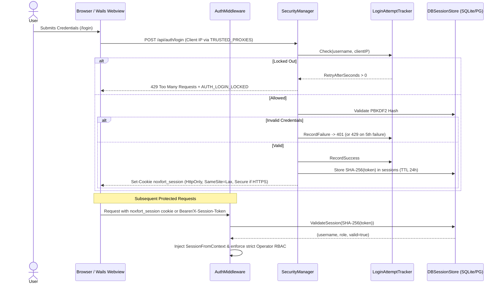
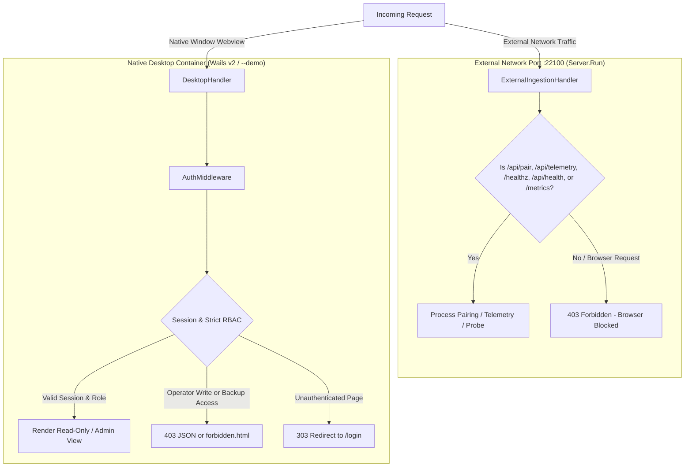

[📚 Documentation Hub](INDEX.md) > **Security, Authentication & RBAC**

---

# 🔐 Security, Authentication & RBAC: Noxfort Monitor™

This document details the security architecture of **Noxfort Monitor™ v2.0**, covering strict Role-Based Access Control (**RBAC**), persistent SHA-256 hashed sessions, per-account/IP brute-force lockout, **Zero-Trust** device & MQTT authentication, PBKDF2 HMAC-SHA256 credential hashing, secret redaction, SMTP hardening, and environment auditing.

---

## 1. Access Control Model (RBAC)

Noxfort Monitor enforces strict role segregation in [`AuthMiddleware`](../internal/transport/http/middleware.go) so operational observers cannot alter monitoring configurations, devices, credentials, or download sensitive backups.

### Available Roles ([`internal/domain/user.go`](../internal/domain/user.go))

| Role | Identifier | Permissions and Scope |
| :--- | :--- | :--- |
| **Administrator** | `ADMIN` | **Full Access**. Manages user accounts (create, reset passwords, toggle roles, unlock brute-force lockouts, delete), provisions/rotates/pauses devices, manages response contacts, edits SMTP/Telegram/MQTT/DuckDNS settings, switches/provisions databases, downloads/restores backups, and triggers diagnostics. |
| **Operator** | `OPERATOR` | **Strictly Read-Only**. Views the live dashboard (`/`), devices (`/devices`), contact directory (`/contacts`), remote status (`/remote`), server status (`/server`), settings summary (`/settings`), and audit trail (`/audit`, `/api/audit/*`). Allowed only to log out and change **their own password** (`/api/users/password` with current password). Blocked from `/users`, `/api/settings/database/backup*`, and all mutating actions (`POST`/`PUT`/`PATCH`/`DELETE`). |

### Content-Negotiated `403 Forbidden` Handling
When an `OPERATOR` attempts a restricted action or visits `/users`:
* **API / AJAX requests** (`/api/*`, `Accept: application/json`, or `X-Requested-With: XMLHttpRequest`): receive structured JSON (`{"success": false, "error": ..., "message": ...}`) with status `403`.
* **Desktop / HTML navigations**: render [`web/templates/forbidden.html`](../web/templates/forbidden.html) inside the Monitor layout shell with contextual navigation back to the originating view or dashboard (`/`), preventing dead-end plain-text screens inside WebKitGTK.
* **UI Guardrails**: `RenderPageWithRequest` injects `CurrentUser`, `Role`, `IsAdmin`, and `IsOperator` into templates, hiding admin forms/buttons, hiding the `/users` navigation link, and showing a read-only badge and notice banner.

---

## 2. Session Lifecycle, Persistent Storage & Reverse Proxy Trust

Authentication is orchestrated by [`SecurityManager`](../internal/security/security_manager.go) and [`DBSessionStore`](../internal/storage/session_repo.go):

### 2.1 Persistent Hashed Sessions (`DBSessionStore`)
* **SHA-256 Token Hashing**: Generates 32-byte random hex tokens (`crypto/rand`) and stores **only `SHA-256(token)`** in the `sessions` table (`TTL: 24h`), ensuring database snapshots or backups never expose live session tokens.
* **Hot-Reload & Cleanup**: `DBSessionStore` implements `ReloadableRepository` (`SetDB`) for zero-downtime switching between SQLite and PostgreSQL, participates in `MigrateData`, and runs an hourly background cleanup (`StartCleanup`).
* **Selective & Global Revocation**: Changing a password (`ChangePassword`), updating a user's role (`UpdateUserRole`), or deleting an account immediately calls `RevokeUserSessions(username)` to invalidate all active sessions for that user.

### 2.2 Token Extraction, Cookie Hardening & Trusted Proxies (`auth_helper.go`)
* **Accepted Transports**: `noxfort_session` cookie, `Authorization: Bearer <token>`, or `X-Session-Token: <token>`.
* **Query String Rejection**: URL query tokens (`?token=...`) are **intentionally rejected** to prevent token leakage into HTTP access logs and browser history.
* **Automatic Cookie Clearing**: When an invalid or expired `noxfort_session` cookie is presented, `AuthMiddleware` automatically sends an expiration cookie (`MaxAge: -1`).
* **Trusted Proxy Detection (`TRUSTED_PROXIES`)**:
  * `ExtractClientIP(r)` honors `X-Forwarded-For` and `X-Real-IP` **only** when `r.RemoteAddr` is loopback, a private network IP (`IsPrivate`, e.g., Docker bridge), or explicitly listed in `TRUSTED_PROXIES` (comma-separated IPs/CIDRs).
  * `IsHTTPSRequest(r)` sets `Secure: true` on session cookies when `r.TLS != nil`, `MONITOR_USE_HTTPS=true`, or `X-Forwarded-Proto: https` arrives from a trusted proxy.
* **Desktop Synchronization (Wails)**: In Linux WebKitGTK (`wails://`), [`desktopResponseWriter`](../internal/desktop/app.go) intercepts `Set-Cookie` headers and synchronizes the session token in desktop application memory.

---

## 3. Brute-Force Protection & Account Management

### 3.1 Per-Account & IP Rate Limiting (`internal/security/lockout.go`)
`LoginAttemptTracker` mitigates credential-stuffing and brute-force attacks keyed by `lowercase(username)|clientIP`:
* **Thresholds**: **5 consecutive failed attempts** within a **15-minute** sliding window engage a **5-minute cooldown lockout** (`DefaultMaxFailedAttempts = 5`, `DefaultAttemptWindow = 15m`, `DefaultLockoutDuration = 5m`).
* **HTTP `429` & Audit**: Locked attempts immediately reject even valid passwords during cooldown, return `429 Too Many Requests` with `retry_after_seconds`, and record `AUTH_LOGIN_LOCKED`.
* **Administrative Unlock**: Administrators can lift a user's lockout across all IPs via `POST /api/users/unlock` (`USER_UNLOCKED`), or lockouts expire automatically after cooldown.

### 3.2 Self-Service Password Updates & Admin Safeguards
* **Self-Service (`POST /api/users/password`)**: Any authenticated user (`ADMIN` or `OPERATOR`) may update their own password by supplying a valid `current_password`.
* **Role Management (`POST /api/users/role`)**: Administrators can promote/demote accounts (`ADMIN` ↔ `OPERATOR`), while [`SecurityManager`](../internal/security/security_manager.go) forbids demoting or deleting either the master superuser (`SuperuserUsername`) or the **last remaining `ADMIN`** in the system.

---

## 4. Cryptography & Password Policy

### 4.1 PBKDF2 Key Derivation (`internal/security/hasher.go`)
* **Algorithm**: **PBKDF2 HMAC-SHA256** (`golang.org/x/crypto/pbkdf2`) with **100,000 iterations**, a unique **16-byte** `crypto/rand` salt per password, and a **32-byte** derived key stored in `hex(salt):hex(hash)` format.
* **Timing-Attack Defense**: Verified using `subtle.ConstantTimeCompare`.
* **Serialization Safety**: [`domain.User`](../internal/domain/user.go) marks `PasswordHash` with `json:"-"`.

### 4.2 Industrial Password Complexity Policy (`password_validator.go`)
`ValidatePasswordComplexity()` enforces:
* **Minimum Length**: At least 8 characters.
* **Numeric Digit**: At least one digit (`0-9`).
* **Uppercase Letter**: At least one uppercase letter (`A-Z`).
* **Lowercase Letter**: At least one lowercase letter (`a-z`).
* **Special Character**: At least one symbol (`!@#$%^&*()-_=+[]{}|;:'",.<>/?`~\\§¬¢£`).

All user creation, password change, and admin reset requests violating these rules return HTTP `400 Bad Request`.

### 4.3 Dynamic Password Strength Meter (`password_meter.js`)
The registration and user management views integrate [`web/static/js/password_meter.js`](../web/static/js/password_meter.js) to display live entropy scoring (0–4), a 5-point requirement checklist, and submit blocking until requirements pass.

---

## 5. Zero-Trust Device Onboarding & Telemetry Security

### 5.1 Out-of-Band Device Pairing (`POST /api/pair`)
* New devices request pairing (`{"origin", "name"}`) and receive `202 Accepted` **without** the generated API key in the HTTP response (out-of-band console copy).
* Keys follow `nox_live_<64 hex chars>` with a **5-minute TTL** (cleaned up every 30s by the Watchdog Engine) and a cap of **50 pending requests** (`429`).
* Re-pairing an already `ACTIVE` device returns **`409 Conflict`** (`ErrDeviceAlreadyActive`) to prevent hijacking or denial-of-service against live agents.

### 5.2 Authenticated HTTP & MQTT Ingestion
* **HTTP (`POST /api/telemetry`)**: Requires `X-Device-Token` or `Authorization: Bearer <key>`, verified in constant time (`subtle.ConstantTimeCompare`). Legacy empty-key bypasses were removed. Enforces `X-Device-Origin` anti-spoofing (`403`), ±5-minute `occurred_at` anti-replay (`400`), `DisallowUnknownFields`, `64 KB` body cap, and blocks paused devices (`403`).
* **MQTT (`noxfort/telemetry/#`)**: Enforces `MONITOR_MQTT_STRICT` (default **`true`**), rejecting unregistered, `PENDING`, or paused (`enabled = false`) origins before events reach `StateManager`.

---

## 6. Secret Redaction, SMTP Hardening & Network Segregation

### 6.1 HTML Secret Redaction (`settings_handler.go`, `tunnel_handler.go`, `device_handler.go`)
* Stored credentials (`SMTPPass`, `TelegramBotToken`, `DuckDNSToken`, `NgrokAuthToken`, and `ACTIVE` device `ApiKey`) are **never rendered** into HTML inputs or DOM templates.
* Settings and Remote Access handlers pass boolean presence indicators (`HasSMTPPass`, `HasTelegramToken`, `HasDuckDNSToken`) and masked previews (`TelegramTokenHint`) and preserve existing secrets during partial saves (`form_section`).
* Device API keys are displayed **only once** upon manual creation, pending pairing, or explicit key rotation (`/devices/rotate-key`).

### 6.2 SMTP Hardening (`internal/monitor/email_channel.go`)
* **CRLF Header Injection Defense**: `sanitizeEmailHeader` strips `\r` and `\n` from `To`, `From`, and `Subject` before composing SMTP payloads.
* **Implicit TLS (Port 465)**: Automatically dials TLS (`MinVersion: tls.VersionTLS12`) when `SMTPPort == 465`.

### 6.3 Network Segregation (`ExternalIngestionHandler` vs `DesktopHandler`)

* **`ExternalIngestionHandler`**: Exposes `POST /api/pair`, `POST /api/telemetry`, `/healthz`, `/api/health`, and `/metrics`; all other paths return `403 Forbidden`.
* **`DesktopHandler` (`isPublicPath`)**: Permits `/static/*`, `/login`, `/api/auth/login`, `/api/auth/status`, `/api/telemetry`, `/api/open-external`, `/healthz`, `/api/health`, `/metrics`, and `/api/window/*`. `/register` redirects unauthenticated users to `/login` and admins to `/users`.

---

## 7. MQTT Broker Hardening, Environment Auditing & Bootstrap

1. **Mosquitto PBKDF2 Auth**: [`mosquitto.conf`](../mosquitto/config/mosquitto.conf) enforces `allow_anonymous false` and `password_file mosquitto/config/passwd`, generated via `make broker-auth` ([`scripts/setup_mqtt_auth.sh`](../scripts/setup_mqtt_auth.sh)) and ignored by [`mosquitto/config/.gitignore`](../mosquitto/config/.gitignore).
2. **Environment Validator ([`env_validator.go`](../internal/security/env_validator.go))**: At startup, enforces mode `0600` on `.env` on POSIX systems, warns on default superuser credentials (`admin` / `Admin@Noxfort2026!`), and notices missing `MQTT_USER` / `MQTT_PASSWORD`.
3. **Idempotent Superuser Bootstrap ([`superuser.go`](../internal/security/superuser.go))**: Reads `MONITOR_ADMIN_USER` / `MONITOR_ADMIN_PASSWORD` (with `NOXFORT_ADMIN_*` or `~/Documentos/Monitor/auth_config.json` fallbacks), provisions/updates the master `ADMIN`, and purges the default `admin` test account if custom production credentials are active.
4. **CI/CD Secret Audit ([`.github/workflows/ci.yml`](../.github/workflows/ci.yml))**: Blocks commits tracking `.env`, `.env.production`, `mosquitto/config/passwd`, `auth_config.json`, or `credentials.json`.

---

### 🔗 Related Documentation
* 🏗️ [System Architecture](../ARCHITECTURE.md) — Transport layers and dependency injection
* 🗄️ [Database & Dual-Engine](DATABASE.md) — `sessions` table, WAL mode & backup protection
* 📡 [API Reference](API_REFERENCE.md) — `/api/pair`, `/api/telemetry`, `/api/auth/*`, and `/api/users/*`
* 🔍 [Audit Trail](AUDIT_TRAIL.md) — Complete security audit actions & IP attribution
* 🚀 [Deployment Guide](DEPLOYMENT.md) — Environment variables and reverse proxy setup
