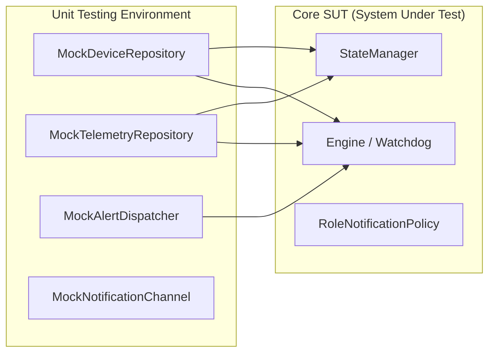

[📚 Documentation Hub](INDEX.md) > **Testing & Quality Assurance (QA)**

---

# 🧪 Testing & Quality Assurance (QA): Noxfort Monitor™

This document outlines the testing standards and procedures for **Noxfort Monitor™ v2.0**, including running the automated unit test suite, integration testing with in-memory mocks, manual end-to-end (**E2E**) verification via **MQTT** and **HTTP cURL**, and notification channel diagnostics.

---

## 1. Running the Automated Test Suite

The project maintains comprehensive test coverage across both the Go backend and the JavaScript web interface:

```bash
# Run the complete test suite (Backend Go + Frontend Vitest)
make test

# Run Go backend unit tests specifically (with race detector)
make test-backend

# Run Frontend DOM unit tests via Vitest
make test-frontend

# Run static analysis and linting (go vet)
make lint
```

### 1.1 Continuous Integration (CI/CD Pipeline)
All tests, race detection, static analysis, and security checks execute automatically on every push and pull request via [GitHub Actions](../.github/workflows/ci.yml).

---

## 2. Testing Philosophy & In-Memory Mocks

Thanks to strict Dependency Injection (**DI**) across the codebase, core logic tests (`internal/monitor` and `internal/security`) do not depend on on-disk databases or external running daemons:



### What Is Validated in Automated Tests:
* **Smart Heartbeat Filter & Maintenance Mode ([`state_test.go`](../internal/monitor/state_test.go))**: Confirms that `INFO` keep-alive messages update presence without noise and paused devices (`Enabled=false`) are suppressed.
* **Watchdog Timing, Outage Detection & Alert Reliability ([`engine_test.go`](../internal/monitor/engine_test.go), [`alerts_test.go`](../internal/monitor/alerts_test.go))**: Simulates devices silent > 5 minutes, validates retry backoff, graceful `Shutdown()`, `telemetry_id` audit linkage, and SMTP CRLF header sanitization.
* **Role-Based RBAC Routing ([`router_test.go`](../internal/monitor/router_test.go))**: Confirms `HARDWARE` alerts route to technicians/admins and `SOFTWARE` alerts route to programmers/admins.
* **Cryptography, Lockout & Persistent Sessions ([`hasher_test.go`](../internal/security/hasher_test.go), [`lockout_test.go`](../internal/security/lockout_test.go), [`session_repo_test.go`](../internal/storage/session_repo_test.go))**: Verifies PBKDF2 HMAC-SHA256 hashing, brute-force lockouts (HTTP `429`), password changes, role guards, SHA-256 hashed DB sessions, and hot-reload.
* **Zero-Trust Device & MQTT Enforcement ([`device_repo_test.go`](../internal/storage/device_repo_test.go), [`telemetry_handler_test.go`](../internal/transport/http/telemetry_handler_test.go), [`client_test.go`](../internal/transport/mqtt/client_test.go))**: Verifies `/api/pair` anti-hijack (`409`), constant-time `X-Device-Token`, TTL expiration, key rotation, and strict MQTT filtering.
* **Database Hot-Reload, Transactional Migration, Backup Restore & Retention ([`db_manager_test.go`](../internal/storage/db_manager_test.go), [`migrator_test.go`](../internal/storage/migrator_test.go), [`backup_test.go`](../internal/storage/backup_test.go), [`retention_test.go`](../internal/storage/retention_test.go))**: Validates engine switching, atomic SQLite backup/restore (`PRAGMA quick_check`), path traversal rejection, and 90-day pruning.
* **HTTP RBAC, Secret Redaction & Frontend Vitest Suite ([`server_test.go`](../internal/transport/http/server_test.go), [`settings_handler_test.go`](../internal/transport/http/settings_handler_test.go), [`web/static/js/__tests__/`](../web/static/js/__tests__/))**: Verifies Operator read-only `403` negotiation (`forbidden.html` / JSON), DOM secret redaction, i18n, password strength meter, and JS API clients.

---

## 3. Manual E2E Testing

### 3.1 MQTT Ingestion Test (`mosquitto_pub`)
Ensure the local broker is running (`make broker-auth && make broker-start`) and the origin (`pump-01`) is already registered and `ACTIVE` in `/devices` (unless `MONITOR_MQTT_STRICT=false` is set for local dev):

#### 1. Simulate Normal Heartbeat (Keep-alive)
```bash
mosquitto_pub -u "${MQTT_USER:-noxfort_user}" -P "${MQTT_PASSWORD:-noxfort_secret_pass_2026}" \
  -t "noxfort/telemetry/pump-01" -m '{
  "category": "HARDWARE",
  "origin": "pump-01",
  "level": "INFO",
  "message": "System OK",
  "occurred_at": "2026-09-05T10:00:00Z"
}'
```
*Expected Result*: Device `pump-01` updates its `last_seen` timestamp. No alert is dispatched and no unneeded record is added to `telemetry`.

#### 2. Simulate Critical Hardware Incident
```bash
mosquitto_pub -u "${MQTT_USER:-noxfort_user}" -P "${MQTT_PASSWORD:-noxfort_secret_pass_2026}" \
  -t "noxfort/telemetry/pump-01" -m '{
  "category": "HARDWARE",
  "origin": "pump-01",
  "level": "CRITICAL",
  "message": "Pressure Valve Failure: Pressure 120 PSI",
  "occurred_at": "2026-09-05T10:05:00Z"
}'
```
*Expected Result*: Event is persisted in `telemetry`, appears on the live Web Dashboard, and immediately dispatches alerts to contacts with `TECHNICIAN` and `ADMIN` roles.

---

### 3.2 HTTP REST Pairing & Ingestion Test (`cURL`)
To validate the Zero-Trust `POST /api/pair` and `POST /api/telemetry` workflow:

```bash
# 1. Initiate pairing (copy generated nox_live_... API key from /devices UI)
curl -X POST http://localhost:22100/api/pair \
  -H "Content-Type: application/json" \
  -d '{"origin": "synapse-node-02", "name": "Synapse Node 02"}'

# 2. Send authenticated telemetry (use current UTC timestamp within ±5 minutes)
curl -X POST http://localhost:22100/api/telemetry \
  -H "Content-Type: application/json" \
  -H "X-Device-Token: nox_live_<copied_api_key>" \
  -d '{
    "category": "SOFTWARE",
    "origin": "synapse-node-02",
    "level": "WARNING",
    "message": "RAM consumption exceeded 80%",
    "occurred_at": "'"$(date -u +%Y-%m-%dT%H:%M:%SZ)"'"
  }'
```
*Expected Result*: HTTP `202 Accepted` on pairing, followed by HTTP `200 OK` (`{"status":"received"}`) on ingestion (promoting `synapse-node-02` to `ACTIVE`).

You can also run the automated demo telemetry helper with a token:
```bash
NOXFORT_DEVICE_TOKEN="nox_live_<key>" node -e 'require("./scripts/demo/mock_telemetry.cjs").seedNormalTelemetry()'
# Or full automated Playwright demo video recording:
make record-demo
```

---

## 4. Notification Channel Diagnostics

The [`ChannelTester`](../internal/monitor/tester.go) module enables on-demand validation of notification credentials without triggering false incidents:

* **SMTP Test (Email)**: On the UI Settings tab (`/settings`) or via `POST /settings/test`, the system sends a verification email to administrators.
* **Telegram Test**: On the `/settings` screen or via `POST /settings/test-telegram`, the system formats and transmits a MarkdownV2 test message to the configured chat.

---

## 5. Observability & Health Probes Verification

Verify that application metrics and diagnostics are operating as intended:

```bash
# 1. Verify liveness probe
curl -i http://localhost:22100/healthz

# 2. Inspect comprehensive component diagnostics and latency
curl -s http://localhost:22100/api/health | jq .

# 3. Inspect Prometheus exposition telemetry
curl -s http://localhost:22100/metrics | grep "noxfort_"
```

---

## 6. Database Backup & Integrity Verification

Test automated hot database snapshots and check backup integrity:

```bash
# 1. Generate hot snapshot
make backup

# 2. List backups
make backup-list

# 3. Validate SQLite snapshot integrity
sqlite3 backups/monitor_sqlite_*.db "PRAGMA integrity_check;"
# Expected output: ok
```

---

### 🔗 Related Documentation
* 🏗️ [System Architecture](../ARCHITECTURE.md) — Isolation philosophy and dependency injection
* 📡 [API Reference](API_REFERENCE.md) — JSON payload specifications
* 👨‍💻 [Developer Guide](DEVELOPER_GUIDES.md) — Local environment and build steps
* 🔍 [Audit Trail](AUDIT_TRAIL.md) — Alert dispatch test logs and delivery statuses
