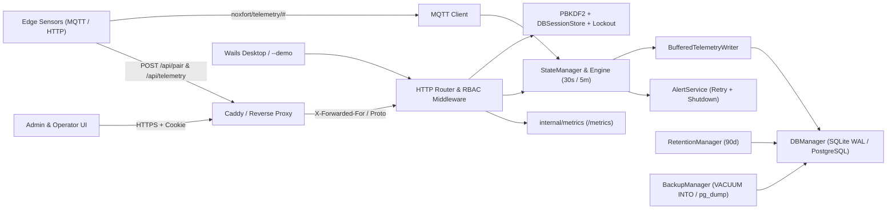

# Noxfort Monitor — System Architecture

Noxfort Monitor follows a modular Clean Architecture written in Go, combining multi-protocol edge ingestion, stateful device monitoring, resilient alerting, and dual-engine SQL persistence inside both headless servers and embedded Wails desktop binaries.

---

## 1. High-Level Topology

---

## 2. Core Runtime Modes (`cmd/server/main.go`)

The composition root (`cmd/server/main.go`) loads environment configuration via `LoadDotEnv()` (legacy `configs/config.yaml` has been removed) and launches one of three execution modes:

* **Desktop Mode (Default)**: Starts the embedded web server and native Wails desktop window/tray integration.
* **Headless Server (`--headless` / `--server-only`)**: Runs purely as a background HTTP + MQTT server with full graceful shutdown (`AlertService.Shutdown(shutdownCtx)`).
* **Demo Mode (`--demo`)**: Runs `RunDesktopServer()` directly without Wails window chrome for automated demonstrations (`make record-demo`).

---

## 3. Subsystem Responsibilities

1. **Ingress & Security Middleware (`internal/transport/http`, `internal/security`)**:
   * **Sessions & Lockout**: `DBSessionStore` validates `SHA-256` session token hashes (`sessions` table, 24h TTL, `?token=` rejected) while `LoginAttemptTracker` enforces a 5-attempt/15m/5m lockout (`429`).
   * **Proxy-Aware RBAC**: `ExtractClientIP` and `IsHTTPSRequest` validate `TRUSTED_PROXIES` + `MONITOR_USE_HTTPS`. `OPERATOR` is strictly read-only (`403` JSON for APIs; `web/templates/forbidden.html` for HTML UI), permitted only self-service `POST /api/users/password`.
2. **Protocol Ingestion (`internal/transport/mqtt`, `telemetry_handler.go`)**:
   * **MQTT**: Subscribes to `noxfort/telemetry/#`, obeys `MONITOR_MQTT_STRICT` (default `true`), retries broker connections every 5s at boot, and supports live `Reconnect(brokerURL)` on `/settings` updates.
   * **HTTP Zero-Trust**: `POST /api/pair` queues up to 50 `PENDING` devices (`202` without API keys; `409` if already `ACTIVE`); `POST /api/telemetry` validates `X-Device-Token` / `Bearer`, `X-Device-Origin`, and `±300s` `occurred_at`.
3. **Monitoring Engine, Buffering & Alerting (`internal/monitor`, `internal/storage`)**:
   * `BufferedTelemetryWriter` batches high-throughput telemetry asynchronously while exposing synchronous `SaveEventReturningID` for transitions that dispatch alerts (`TriggerAlertWithTelemetryID` linking `alert_dispatch_logs.telemetry_id`).
   * `StateManager` enforces Maintenance Mode (`PAUSED`) guards; `Engine` ticks every `30s` (marking devices offline after `5m` silence and running `CleanupExpiredPending()`).
   * `AlertService` dispatches Telegram, Email (implicit TLS port 465 + CRLF header sanitization), and Webhook notifications with retry backoff (`500ms`, `1500ms`) and clean shutdown flush.
4. **Persistence, Backups, Retention & Observability (`internal/storage`, `internal/metrics`)**:
   * `DBManager` coordinates SQLite (`WAL` mode) and PostgreSQL across 7 `ReloadableRepository` implementations (`SetDB(db *sql.DB, driver string)`) and transactional `MigrateData` over 9 tables.
   * `BackupManager` schedules automated hot backups (`MONITOR_BACKUP_INTERVAL_HOURS=24`, keeping 7) and verified restores (`PRAGMA quick_check` / `pg_restore`); `RetentionManager` prunes aged telemetry/audit/transition logs (`MONITOR_RETENTION_DAYS=90`); `/metrics` exports real-time Prometheus metrics.
