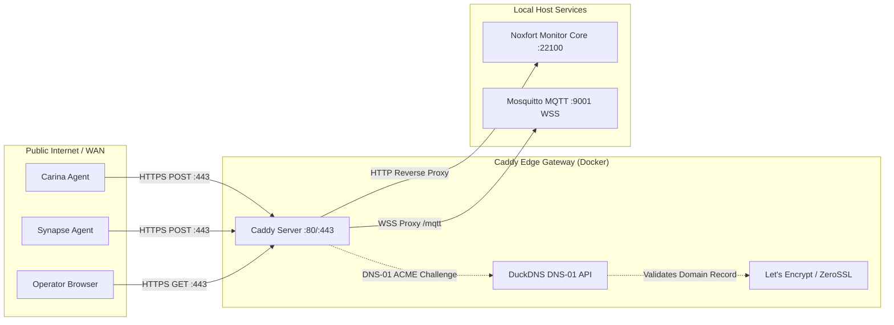

# 🛡️ Caddy Reverse Proxy & DuckDNS (Automatic HTTPS): Noxfort Monitor™

This document outlines the architecture, deployment, and operational procedures for **Caddy Server** integrated with **DuckDNS** in **Noxfort Monitor™ v2.0**. This configuration provides enterprise-grade, automatic TLS/SSL termination via the **DNS-01 ACME challenge**, eliminating plaintext transmissions across the WAN and exposing standard ports (`80`, `443`, and `WSS`).

⬅️ [Central Hub](README.md) | 🌐 [Remote Access](remote_access.md) | 🚀 [Deployment](deployment.md) | 📡 [API Reference](api_reference.md)

---

## 1. Architectural Overview

In industrial observability and telemetry networks, remote edge nodes (such as **Synapse**, **Carina**, or external sensors) dispatch telemetry over public networks. Exposing raw HTTP on non-standard ports (e.g., `:22100`) introduces security risks and frequently conflicts with corporate outbound firewalls.



### Key Advantages:
1. **Zero-Configuration HTTPS**: Caddy automatically requests and renews valid TLS certificates from Let's Encrypt / ZeroSSL.
2. **DNS-01 ACME Validation**: Unlike HTTP-01 challenges, DNS-01 does **not** require inbound port 80 to be open to issue or renew certificates. The challenge is fulfilled via outbound API calls to DuckDNS.
3. **Encrypted WebSockets (WSS)**: Enables secure MQTT-over-WebSockets for web dashboards via `wss://your-domain.duckdns.org/mqtt`.
4. **Standard Web Ports**: Standardizes traffic on port 443, eliminating the need to expose port `:22100` publicly.

---

## 2. Directory Structure

The Caddy subsystem is contained within the `caddy/` directory:

```text
MONITOR_CORE/
├── caddy/
│   ├── Dockerfile         # Multi-stage build with github.com/caddy-dns/duckdns
│   └── Caddyfile          # Reverse proxy and TLS rules
├── docker-compose.yml     # Orchestration for Mosquitto and Caddy
└── .env                   # Credentials (DuckDNS token, domain, email)
```

---

## 3. Configuration & Setup

### 3.1 Configure Environment Variables (`.env`)
Configure your DuckDNS details in `.env`:

```env
# DuckDNS Subdomain (e.g. 'my-monitor' for my-monitor.duckdns.org)
DUCKDNS_DOMAIN=your-subdomain

# DuckDNS Account API Token (from duckdns.org)
DUCKDNS_TOKEN=xxxxxxxx-xxxx-xxxx-xxxx-xxxxxxxxxxxx

# Email address for Let's Encrypt expiration notifications
ACME_EMAIL=admin@your-company.com

# Enable HTTPS telemetry URL formatting in Noxfort Monitor
MONITOR_USE_HTTPS=true
```

### 3.2 Build the Caddy Container
Compile the custom Caddy image equipped with the `caddy-dns/duckdns` plugin:

```bash
make caddy-build
```

### 3.3 Start the Edge Services
Start Mosquitto and Caddy in the background:

```bash
make services-start
```

To view live certificate issuance and access logs:
```bash
make services-logs
```

To stop the services:
```bash
make services-stop
```
