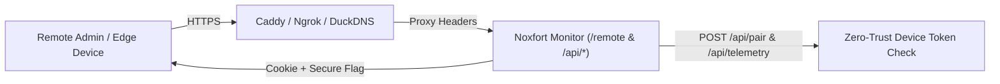

# Noxfort Monitor — Remote Access & Tunnels

Noxfort Monitor integrates native remote connectivity via **DuckDNS** dynamic DNS and **Ngrok** tunnels, managed through the `/remote` view while maintaining strict secret redaction and role-based access control.

---

## 1. Access Control & Secret Redaction on `/remote`

* **Role Enforcement**:
  * `ADMIN`: Can view tunnel status, update DuckDNS/Ngrok configuration, and start/stop tunnels.
  * `OPERATOR`: Restricted to read-only observation on `GET /remote`; mutation attempts fail with `403 Forbidden` (JSON for API calls or `forbidden.html` in the UI).
* **Credential Masking**: Sensitive credentials such as `duckdns_token` and Ngrok authtokens are **redacted in rendered HTML**. Submitting a partial settings update preserves existing stored credentials instead of overwriting them with masked values.
* **Auditing**: Configuration updates and tunnel state changes record `TUNNEL_*` events in `security_audit_logs` with the real actor username and `ip_address`.

---

## 2. Connectivity Flow

---

## 3. Remote Edge Onboarding Best Practices

1. Keep `MONITOR_USE_HTTPS=true` and `TRUSTED_PROXIES` configured when exposing telemetry endpoints over public DNS or tunnels.
2. Edge nodes connect to `https://<your-domain>/api/pair` with `{"origin":"...","name":"..."}` (`202 Accepted`, capped at 50 pending entries; `409 Conflict` if already active).
3. Copy the out-of-band 5-minute TTL `nox_live_` key in `/devices` and configure the remote gateway to send `X-Device-Token` and `X-Device-Origin` headers to `POST /api/telemetry`.
4. Always use `MQTTS` (TLS) or VPN/tunneling if exposing MQTT externally; keep `MONITOR_MQTT_STRICT=true` so unauthorized MQTT clients cannot auto-register devices.
