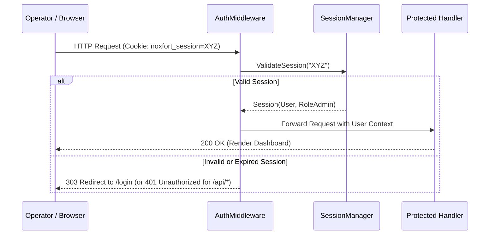

# 🔐 Security, Authentication & Role-Based Access Control (RBAC)

This document details the security architecture of **Noxfort Monitor™ v2.0**, including authentication, session token lifecycle, salted password hashing, and Role-Based Access Control (RBAC).

⬅️ [Central Hub](../README.md) | 🏛️ [Architecture](architecture.md) | 🔍 [Audit Trail](audit_trail.md) | 📡 [API](api_reference.md)

---

## 1. Security Architecture & RBAC

Noxfort Monitor enforces strict role segregation:

* **`RoleAdmin` ("ADMIN")**: Full administrative privileges: user management, database migration, reverse tunnel activation, and global system configuration.
* **`RoleOperator` ("OPERATOR")**: Operational privileges: viewing dashboard telemetry, monitoring registered devices, and inspecting alerts.
* **Incident Routing Roles**:
  * **`TECHNICIAN`**: Receives only `HARDWARE` incident notifications.
  * **`PROGRAMMER`**: Receives only `SOFTWARE` incident notifications.
  * **`ADMIN`**: Receives all global incidents.

---

## 2. Password Policy & Cryptographic Storage

### 2.1 Cryptographic Storage & Salting
Passwords are encrypted using cryptographic salt and SHA-256 derivation via [`internal/security/hasher.go`](../../internal/security/hasher.go):
* Unique 16-byte random salt generated per user via `crypto/rand`.
* Passwords and hashes are strictly excluded from JSON serialization (`json:"-"`).
* Constant-time comparison defends against timing attacks.

### 2.2 Industrial Password Complexity Policy (`password_validator.go`)
To protect operational systems from brute-force intrusions, [`internal/security/password_validator.go`](../../internal/security/password_validator.go) enforces mandatory validation via `ValidatePasswordComplexity()`:
* **Minimum Length**: At least 8 characters.
* **Numeric Digit**: At least one digit (`0-9`).
* **Uppercase Letter**: At least one uppercase letter (`A-Z`).
* **Lowercase Letter**: At least one lowercase letter (`a-z`).
* **Special Character**: At least one symbol (`!@#$%^&*()-_=+[]{}|;:'",.<>/?`~\\§¬¢£`).

Any registration or user creation failing these criteria returns HTTP `400 Bad Request`.

### 2.3 Interactive Password Strength Meter (`password_meter.js`)
All account management views integrate real-time client-side feedback ([`web/static/js/password_meter.js`](../../web/static/js/password_meter.js)):
* Dynamic score calculation (0 to 4) while typing.
* Interactive requirements checklist with instant visual feedback.
* Blocks form submission until all complexity criteria are fulfilled.

---

## 3. Session Lifecycle & AuthMiddleware

* **Session Storage**: In-memory thread-safe map with mutex synchronization.
* **Sliding Renewal**: Active user requests renew the 24-hour expiration window.
* **Dual Interception**: Web UI requests without a session redirect to `/login` with HTTP `303 See Other`; API calls return JSON `401 Unauthorized`.

---

## 4. MQTT Broker Hardening & PBKDF2 Authentication

* **Anonymous Access Disabled**: [`mosquitto.conf`](../../mosquitto/config/mosquitto.conf) enforces `allow_anonymous false`.
* **Strong Hashing**: Passwords stored in `mosquitto/config/passwd` use PBKDF2 (SHA-512) hashing.
* **Automated Setup**: Command `make broker-auth` generates credentials and synchronizes `.env`.
* **Git Protection**: Credential files (`passwd*`) are strictly excluded from version control.

---

## 5. Environment Hardening & Startup Auditing (`env_validator.go`)

At application boot, the environment validator verifies configuration integrity:
* **File Permissions (`0600`)**: Restricts `.env` to owner-only read/write permissions on Linux.
* **Weak Credential Alerts**: Emits a critical security warning if default credentials (`admin` / `Admin@Noxfort2026!`) remain in production.
* **MQTT Credential Check**: Warns if `MQTT_USER` or `MQTT_PASSWORD` are absent before broker connection.

---

## 6. Idempotent Superuser Bootstrap (`superuser.go`)

At startup, the system evaluates `MONITOR_ADMIN_USER` and `MONITOR_ADMIN_PASSWORD`:
* Provisions an `ADMIN` account if no administrator exists in the database.
* Automatically purges the default test account if custom credentials are configured in production, eliminating backdoor access.

---

## 7. Automated Secret Leak Prevention in CI/CD

Continuous integration pipelines ([`.github/workflows/ci.yml`](../../.github/workflows/ci.yml)) scan every commit to block `.env` files, private keys (`*.pem`, `*.key`), and Mosquitto password databases from being tracked in Git.
