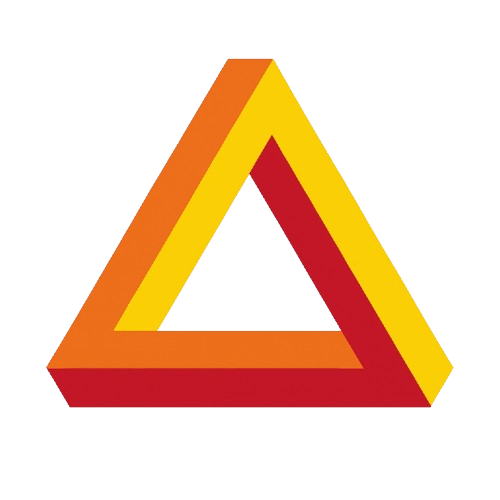

# Noxfort Monitor™ — Suite de Documentación Técnica
### Arquitectura del Sistema, Ingestión Telemétrica Zero-Trust y Persistencia Dual-Engine
*Noxfort Systems — A State Of Art Company*

---

🌐 **Traducciones / Idiomas:** **[🇺🇸 English](../en/README.md)** • **[🇧🇷 Português](../pt-br/README.md)** • **[🇪🇸 Español](README.md)** • **[🇫🇷 Français](../fr/README.md)** • **[🇷🇺 Русский](../ru/README.md)** • **[🇨🇳 简体中文](../zh/README.md)** • **[📚 Hub Central](../README.md)**

---

## Bienvenido a la Documentación Técnica Oficial

Este directorio contiene la suite de documentación técnica en **Español** para **Noxfort Monitor™ v2.0** — plataforma industrial de observabilidad orientada a eventos, ingestión de telemetría Zero-Trust en tiempo real y orquestación de respuesta a incidentes desarrollada en Go para sistemas distribuidos, agentes autónomos (**Carina**, **Synapse**) y nodos IoT.

## Índice de Guías Especializadas

| Documento | Tema & Alcance | Temas Principales |
|---|---|---|
| 📖 **[Arquitectura del Sistema](architecture.md)** | Especificación de Arquitectura | Arquitectura Orientada a Eventos (EDA), concurrencia mediante Goroutines, `BufferedTelemetryWriter`, modos Desktop / `--headless` / `--demo` y apagado limpio (`AlertService.Shutdown`). |
| 📡 **[API y Protocolos de Ingestión](api_reference.md)** | Protocolos de Red | MQTT asíncrono `noxfort/telemetry/#` (`MONITOR_MQTT_STRICT`), emparejamiento Zero-Trust `POST /api/pair` y `POST /api/telemetry` (`:22100`), esquema `IncomingEvent` y rutas administrativas RBAC. |
| 🗄️ **[Base de Datos y Dual-Engine](database.md)** | Persistencia Relacional | SQLite WAL + PostgreSQL con cambio dinámico vía `DBManager`, `7` `ReloadableRepository`, `MigrateData` transacional (9 tablas), backups/restore y `RetentionManager`. |
| 🔐 **[Seguridad, Autenticación y RBAC](security.md)** | Control de Acceso | `OPERATOR` estrictamente de solo lectura (`403` / `forbidden.html`), `PBKDF2Hasher` (100k iter.), `LoginAttemptTracker` (`429`), `DBSessionStore` (`SHA-256`), `TRUSTED_PROXIES` y redacción HTML. |
| 🌐 **[Acceso Remoto y WAN (DuckDNS y Ngrok)](remote_access.md)** | Conectividad WAN | Sincronización dinámica DuckDNS, túnel inverso Ngrok, redacción de tokens en `/remote` e ingestión remota Zero-Trust. |
| 🛡️ **[Proxy Inverso Caddy y DuckDNS](caddy_integration.md)** | Pasarela HTTPS | Terminación TLS/SSL automática con desafío ACME DNS-01, cabeceras `X-Forwarded-*` con `TRUSTED_PROXIES`, puerto 443 y WSS (`/mqtt`). |
| 🖥️ **[Aplicación Desktop, Headless y Demo](desktop_app.md)** | Interfaz y Operación | Runtime Wails v2 con WebKitGTK, bloqueo de instancia única IPC Unix, modos `--headless` y `--demo`, polling `/api/dashboard/summary` y página `forbidden.html`. |
| 🔍 **[Pista de Auditoría y SLA](audit_trail.md)** | Trazabilidad y Cumplimiento | Triple auditoría (`SecurityAuditLog`, `AlertDispatchLog` vinculado a `telemetry_id`, `DeviceStateTransition`), lectura `Operator+` y purga automática de 90 días. |
| 🚀 **[Guía de Despliegue en Producción](deployment.md)** | Operaciones y DevOps | Variables `.env` (`configs/config.yaml` eliminado), servicio systemd headless, Docker Compose, Caddy/NGINX, paquete `.deb`, backups y `/metrics`. |
| 🧪 **[Pruebas y Calidad de Software](testing.md)** | Validación y Calidad | Suite Go + Vitest (`make test`), mocks, pruebas E2E con `mosquitto_pub` (`noxfort/telemetry/#`) / `curl` (`/api/pair` + `X-Device-Token`) y `make record-demo`. |
| 👨‍💻 **[Guía Avanzada para Desarrolladores](developer_guides.md)** | Ingeniería y Extensibilidad | Entorno local, contrato `ReloadableRepository` (`SetDB(db, driver)`), `internal/metrics`, auxiliares HTTP de seguridad y ciclo de vida `bgCtx`. |
| 🔬 **[Notas de Investigación y Decisiones Técnicas](research_notes.md)** | Registros Arquitectónicos (ADRs) | Decisiones sobre eliminación de CGO y `config.yaml`, pareamento Zero-Trust, sesiones hasheadas en BD, retención WAL y métricas Prometheus. |

---

   
  <b>Noxfort Systems</b> — <i>A State Of Art Company</i> 
  <i>Telemetría Industrial & Observabilidad • Noxfort Monitor™ Server v2.0</i> 
  <small>Licenciado bajo la <a href="../../LICENSE">GNU Affero General Public License v3.0 o posterior</a> (SPDX: <code>AGPL-3.0-or-later</code>). © 2026 Noxfort Systems.</small>

