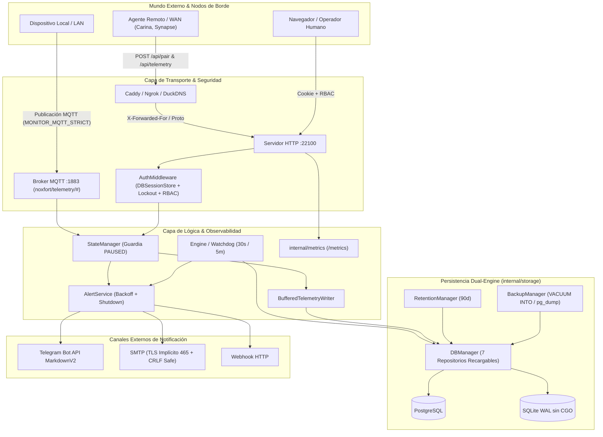

# 🏛️ Noxfort Monitor™: Arquitectura del Sistema y Concurrencia

Este documento especifica la arquitectura interna de **Noxfort Monitor™ v2.0**, detallando la Arquitectura Orientada a Eventos (EDA), el modelo de concurrencia con Goroutines, el emparejamiento Zero-Trust, la persistencia dual-engine y el ensamblaje en la raíz de composición.

⬅️ [Hub Central](../README.md) | 📡 [API y Protocolos](api_reference.md) | 🗄️ [Base de Datos](database.md) | 🔐 [Seguridad](security.md) | 🧪 [Pruebas](testing.md)

---

## 1. Filosofía Arquitectónica

Noxfort Monitor sigue una **Arquitectura Orientada a Eventos (EDA)** bajo principios **SOLID** e **Inyección de Dependencias (DI)** en [`cmd/server/main.go`](../../cmd/server/main.go). La configuración de arranque se carga desde `.env` mediante `LoadDotEnv()` (el antiguo `configs/config.yaml` fue eliminado), evitando estado global mutable.

---

## 2. Capas de Subsistemas Desacopladas

1. **Capa de Transporte (`internal/transport`)**: Suscripción MQTT (`noxfort/telemetry/#`, política `MONITOR_MQTT_STRICT`, reintento cada 5s y `Reconnect(brokerURL)` en caliente) y servidor HTTP REST (`:22100`) con `AuthMiddleware`, pareamento Zero-Trust `/api/pair`, ingestión `/api/telemetry` y métricas `/metrics`.
2. **Capa de Lógica de Monitorización (`internal/monitor`)**: `StateManager` (con bloqueo en dispositivos `PAUSED` y persistencia síncrona `SaveEventReturningID` en transiciones), `Engine` (tick `30s`, umbral offline `5m`, `CleanupExpiredPending()`), y `AlertService` (reintentos `500ms`/`1500ms` + drenaje `Shutdown(ctx)`).
3. **Capa de Seguridad (`internal/security`)**: `PBKDF2Hasher` (`100.000` iteraciones), `LoginAttemptTracker` (5 intentos/15m $\rightarrow$ 5m bloqueo `429`), `DBSessionStore` (`SHA-256` en `sessions`, 24h), validación proxy (`TRUSTED_PROXIES`, `MONITOR_USE_HTTPS`) y RBAC estricto (`OPERATOR` solo lectura + autogestión de contraseña).
4. **Capa de Acceso Remoto (`internal/tunnel`)**: Drivers DuckDNS y Ngrok en `/remote` con redacción HTML de secretos.
5. **Capa de Persistencia (`internal/storage`)**: `DBManager` sobre SQLite WAL + PostgreSQL, `7` `ReloadableRepository` (incluyendo `DBSessionStore`), `MigrateData` transacional sobre 9 tablas, `BufferedTelemetryWriter`, `BackupManager` (programado/descarga/restauración) y `RetentionManager` (`MONITOR_RETENTION_DAYS=90`).
6. **Capa Desktop, Demo & Métricas (`internal/desktop`, `internal/tray`, `internal/metrics`)**: UI nativa en Wails v2 + WebKitGTK, socket IPC de instancia única, modo `--demo` (`RunDesktopServer()`), modo `--headless` y exportación nativa Prometheus (`/metrics`).

---

## 3. Modelo de Concurrencia y Ciclo de Vida

* **Hilo Principal**: En modo escritorio ejecuta `desktopApp.Run()` (Wails v2); con `--demo` inicia `RunDesktopServer()`; con `--headless` / `--server-only` aguarda señales `SIGINT`/`SIGTERM`.
* **Trabajadores en Segundo Plano (`bgCtx`)**: Goroutines dedicadas operan el servidor HTTP (`:22100`), cliente Paho MQTT (con bucle de reconexión de 5s), `BufferedTelemetryWriter`, `Engine` (`30s`), limpieza horaria de `sessions`, `RetentionManager` (cada 24h) y backups programados (`MONITOR_BACKUP_INTERVAL_HOURS`).
* **Cierre Limpio (`AlertService.Shutdown`)**: Al terminar, el servidor HTTP se drena, `AlertService.Shutdown(shutdownCtx)` vacía alertas pendientes y se liberan las conexiones SQL/MQTT de forma atómica.
