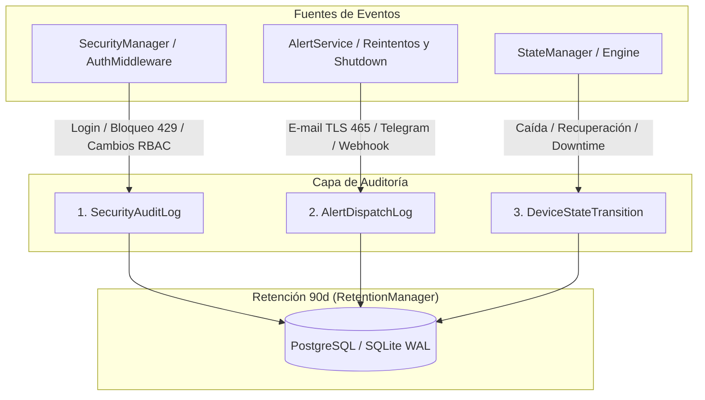

# 🔍 Pista de Auditoría y Observabilidad

Este documento especifica el subsistema de auditoría y cumplimiento de **Noxfort Monitor™ v2.0**, abarcando trazabilidad de seguridad, SLA de despacho de alertas vinculadas a telemetría y monitorización de disponibilidad, accesible para roles `Operator+` en `/audit` y `/api/audit/*`.

⬅️ [Hub Central](../README.md) | 🏛️ [Arquitectura](architecture.md) | 🔐 [Seguridad](security.md)

---

## 1. Arquitectura de Triple Auditoría

Noxfort Monitor separa los registros de auditoría en tres corrientes independientes e inmutables:

---

## 2. Modelos y Definición Exacta de Campos (`internal/domain/audit.go`)

### 2.1 `SecurityAuditLog` (`security_audit_logs`)
Registra eventos de autenticación, bloqueos y acciones administrativas:
* `id` (*int64*): Identificador secuencial único.
* `created_at` (*timestamp*): Fecha y hora en formato UTC.
* `username` (*string*): Usuario actor u objetivo de la operación.
* `action` (*string*): Identificador canónico (`AUTH_LOGIN_SUCCESS`, `AUTH_LOGIN_FAILED`, `AUTH_LOGIN_LOCKED`, `USER_CREATE`, `USER_PASSWORD_CHANGED`, `USER_ROLE_UPDATED`, `USER_UNLOCKED`, `USER_DELETE`, `DEVICE_*`, `CONTACT_*`, `SETTINGS_UPDATED`, `TUNNEL_*`, `DATABASE_*`, `POSTGRES_USER_PROVISIONED`).
* `details` (*string*): Contexto y resultado de la operación.
* `ip_address` (*string*): Dirección IP real resuelta mediante `ExtractClientIP` y `TRUSTED_PROXIES`.

### 2.2 `AlertDispatchLog` (`alert_dispatch_logs`)
Registra cada intento de entrega ejecutado por `AlertService` (con backoff `500ms`, `1500ms` y drenaje en `Shutdown`):
* `id` (*int64*): Identificador secuencial único.
* `telemetry_id` (*int64*): Enlace directo al evento `telemetry.id` obtenido vía `SaveEventReturningID`.
* `channel` (*string*): `telegram`, `email` o `webhook`.
* `recipient` (*string*): Destinatario o destino configurado.
* `role` (*string*): Rol operativo notificado.
* `status` (*string*): Estado del despacho (`SENT`, `FAILED`, etc.).
* `error_reason` (*string*): Detalle técnico en caso de fallo de red o protocolo.
* `dispatched_at` (*timestamp*): Momento exacto del intento de transmisión.

### 2.3 `DeviceStateTransition` (`device_state_transitions`)
Registra el historial SLA y cambios de disponibilidad detectados cada `30s` (umbral offline `5m`):
* `id` (*int64*): Identificador único.
* `device_identifier` (*string*): Identificador único del nodo monitorizado.
* `previous_state` (*string*): Estado anterior (`ONLINE`, `OFFLINE`, etc.).
* `new_state` (*string*): Nuevo estado (`OFFLINE`, `ONLINE`, etc.).
* `duration_offline_sec` (*int64*): Segundos totales acumulados fuera de línea al recuperarse.
* `transition_at` (*timestamp*): Instante de la transición registrada.

---

## 3. Acceso y Retención Automática
* **Acceso**: Tanto `ADMIN` como `OPERATOR` (solo lectura) tienen acceso a `/audit` y `/api/audit/{security,alerts,transitions}`.
* **Retención**: `RetentionManager` purga cada 24h los registros más antiguos que `MONITOR_RETENTION_DAYS` (por defecto `90` días) de estas tres tablas y de `telemetry`.
