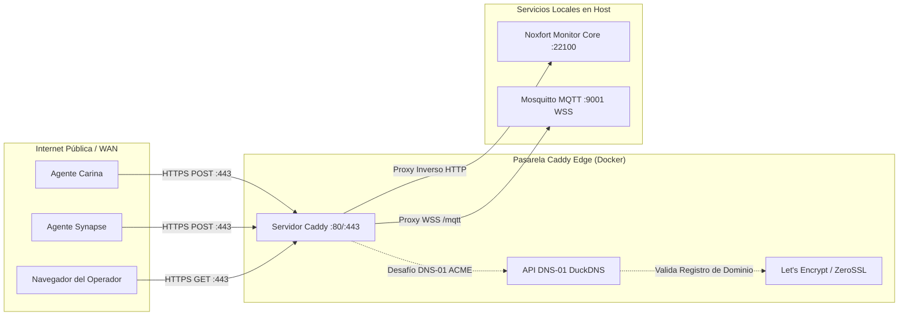

# 🛡️ Proxy Inverso Caddy y DuckDNS (HTTPS Automático): Noxfort Monitor™

Este documento describe la arquitectura, despliegue y operación de **Caddy Server** integrado con **DuckDNS** en **Noxfort Monitor™ v2.0**. Esta configuración proporciona terminación TLS/SSL automática de nivel empresarial mediante el **desafío ACME DNS-01**, eliminando transmisiones en texto plano en la WAN y exponiendo los puertos estándar (`80`, `443` y `WSS`).

⬅️ [Centro de Documentación](README.md) | 🌐 [Acceso Remoto](remote_access.md) | 🚀 [Despliegue](deployment.md) | 📡 [Referencia API](api_reference.md)

---

## 1. Visión General de la Arquitectura

En redes industriales de observabilidad y telemetría, los nodos de borde remotos (como **Synapse**, **Carina** o sensores IoT) transmiten datos a través de Internet. Exponer HTTP sin cifrado en puertos no estándar (ej: `:22100`) introduce riesgos de seguridad y bloqueos en cortafuegos corporativos.



### Principales Ventajas:
1. **HTTPS sin Configuración Manual**: Caddy solicita y renueva automáticamente certificados TLS válidos de Let's Encrypt / ZeroSSL.
2. **Validación DNS-01 ACME**: A diferencia de los desafíos HTTP-01, DNS-01 **no requiere** abrir el puerto 80 entrante para emitir certificados.
3. **WebSockets Cifrados (WSS)**: Permite MQTT-sobre-WebSockets seguro mediante `wss://tu-dominio.duckdns.org/mqtt`.
4. **Puertos Web Estándar**: Centraliza el tráfico en el puerto 443 (HTTPS), eliminando la necesidad de exponer `:22100` públicamente.

---

## 2. Configuración y Despliegue

```bash
# 1. Compilar contenedor Caddy con plugin DuckDNS
make caddy-build

# 2. Iniciar servicios en segundo plano
make services-start

# 3. Ver registros en tiempo real
make services-logs

# 4. Detener servicios
make services-stop
```
