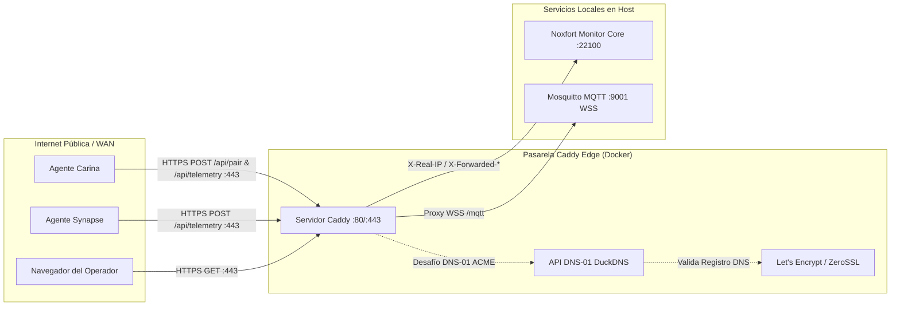

# 🛡️ Proxy Inverso Caddy y DuckDNS (HTTPS Automático): Noxfort Monitor™

Este documento describe la arquitectura, despliegue y operación de **Caddy Server** ([`caddy/Caddyfile`](../../caddy/Caddyfile)) integrado con **DuckDNS** en **Noxfort Monitor™ v2.0**, proporcionando terminación TLS automática mediante **ACME DNS-01**, WSS para MQTT y reenvío seguro de cabeceras proxy hacia `:22100`.

⬅️ [Centro de Documentación](README.md) | 🌐 [Acceso Remoto](remote_access.md) | 🚀 [Despliegue](deployment.md) | 📡 [Referencia API](api_reference.md)

---

## 1. Visión General de la Arquitectura



### Principales Ventajas:
1. **HTTPS Automático sin Puerto 80 Entrante**: Validación DNS-01 con DuckDNS.
2. **WebSockets Cifrados (WSS)**: MQTT seguro vía `wss://tu-dominio.duckdns.org/mqtt` (bajo política `MONITOR_MQTT_STRICT=true`).
3. **Atribución Real de IPs y Cookies `Secure`**: `caddy/Caddyfile` envía `X-Real-IP`, `X-Forwarded-For` y `X-Forwarded-Proto`.

---

## 2. Integración con `TRUSTED_PROXIES` y `MONITOR_USE_HTTPS`

Para aceptar las cabeceras de Caddy sin exponer el sistema a suplantación (*IP spoofing*):

1. Configure `TRUSTED_PROXIES` en `.env` con la IP o subred de Caddy/Docker (ej.: `TRUSTED_PROXIES=127.0.0.1/32,172.16.0.0/12`).
2. Establezca `MONITOR_USE_HTTPS=true` para garantizar cookies de sesión `Secure`.

Con esta configuración, `ExtractClientIP` registra la IP real del cliente en `LoginAttemptTracker` y en `SecurityAuditLog` (`ip_address`), e `IsHTTPSRequest` preserva la sesión tras TLS.

---

## 3. Despliegue y Prueba Zero-Trust detrás de Caddy

```bash
# 1. Compilar Caddy con el módulo DuckDNS e iniciar servicios
make caddy-build
make services-start

# 2. Consultar logs y detener si es necesario
make services-logs
make services-stop
```

```bash
# 3. Solicitar emparejamiento Zero-Trust (202 Accepted, sin clave API en respuesta)
curl -X POST https://tu-dominio.duckdns.org/api/pair \
  -H "Content-Type: application/json" \
  -d '{"origin":"carina-01","name":"Agente Carina 01"}'

# 4. Tras aprobar en /devices y copiar el token temporal nox_live_ (TTL 5m), enviar telemetría:
curl -X POST https://tu-dominio.duckdns.org/api/telemetry \
  -H "Content-Type: application/json" \
  -H "X-Device-Token: nox_live_tu_token_copiado" \
  -H "X-Device-Origin: carina-01" \
  -d '{"category":"HARDWARE","origin":"carina-01","level":"INFO","message":"System OK","occurred_at":"'"$(date -u +%Y-%m-%dT%H:%M:%SZ)"'"}'
```
