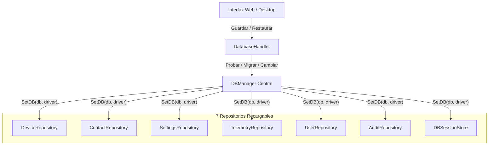

# 🗄️ Persistencia y Arquitectura Dual-Engine

Este documento detalla la capa de persistencia dual-engine de **Noxfort Monitor™ v2.0**, abarcando PostgreSQL y SQLite en modo WAL, la recarga en caliente (`DBManager`), la migración transaccional, respaldos/restauración verificada y retención automática.

⬅️ [Hub Central](../README.md) | 🏛️ [Arquitectura](architecture.md) | 📡 [API](api_reference.md) | 🔐 [Seguridad](security.md)

---

## 1. Coexistencia Dual-Engine y Modo WAL

Noxfort Monitor soporta despliegues ligeros autónomos y clústeres empresariales de alta concurrencia con **9 tablas y 12 índices** equivalentes en ambos motores:

| Dimensión | SQLite (Puro en Go, modo WAL) | PostgreSQL |
|---|---|---|
| **Driver Go** | `modernc.org/sqlite` (sin CGO) | `github.com/lib/pq` |
| **Optimizaciones** | `journal_mode=WAL`, `synchronous=NORMAL`, `busy_timeout=5000` | Pool configurable y esquema dedicado (`schema_monitor`) |
| **Caso de Uso** | Estaciones locales, nodos de borde | Servidores industriales, alta concurrencia |
| **Ubicación** | `~/Documentos/Monitor/monitor_logs.db` | Servidor TCP (puerto `5432`) |
| **Dependencias** | Ninguna (embebido en el binario Go) | Servidor PostgreSQL 12+ en red |

---

## 2. Recarga Dinámica en Caliente (`DBManager`)

El componente `DBManager` coordina el cambio de motor en tiempo de ejecución sin reiniciar el servidor HTTP ni cortar clientes conectados:



Cada repositorio implementa la interfaz `ReloadableRepository`:

```go
type ReloadableRepository interface {
    SetDB(db *sql.DB, driver string)
}
```

---

## 3. Migración Transaccional Única (`MigrateData`)

Al cambiar dinámicamente entre SQLite y PostgreSQL:
1. `Migrator.MigrateData` ejecuta la transferencia completa de las **9 tablas** (`devices`, `telemetry` con `device_id`, `settings`, `contacts`, `users`, `sessions`, `security_audit_logs`, `alert_dispatch_logs`, `device_state_transitions`) dentro de una **única transacción SQL**.
2. Utiliza `storage.AdaptQuery()` para adaptar parámetros y sintaxis entre dialectos (`devices` incluye `api_key`, `status`, `expires_at`).
3. Si ocurre cualquier fallo durante la copia, la transacción se revierte por completo y `DBManager.Switch` aborta evitando estados inconsistentes (*split-brain*).

---

## 4. Backups Calientes, Descarga, Restauración y Retención

* **Backups Calientes (`BackupManager`)**: Ejecuta `VACUUM INTO` en SQLite y `pg_dump -F c` en PostgreSQL sin detener la ingestión. `BackupManager.StartScheduledBackups` automatiza copias según `MONITOR_BACKUP_INTERVAL_HOURS` (por defecto `24h`, conservando hasta `7` snapshots).
* **Descarga y Restauración Segura**:
  * `GET /api/settings/database/backups/download` valida rutas mediante `ResolveBackupPath` contra *path traversal*.
  * `POST /api/settings/database/restore` valida archivos SQLite con `PRAGMA quick_check` antes de reemplazar con `RestoreSQLiteFile`, o ejecuta `pg_restore` para PostgreSQL.
* **Retención Automática (`RetentionManager`)**: Ejecutado cada **`24` horas**, elimina registros anteriores a `MONITOR_RETENTION_DAYS` (por defecto **`90` días**) en `telemetry`, `alert_dispatch_logs`, `security_audit_logs` y `device_state_transitions`.
