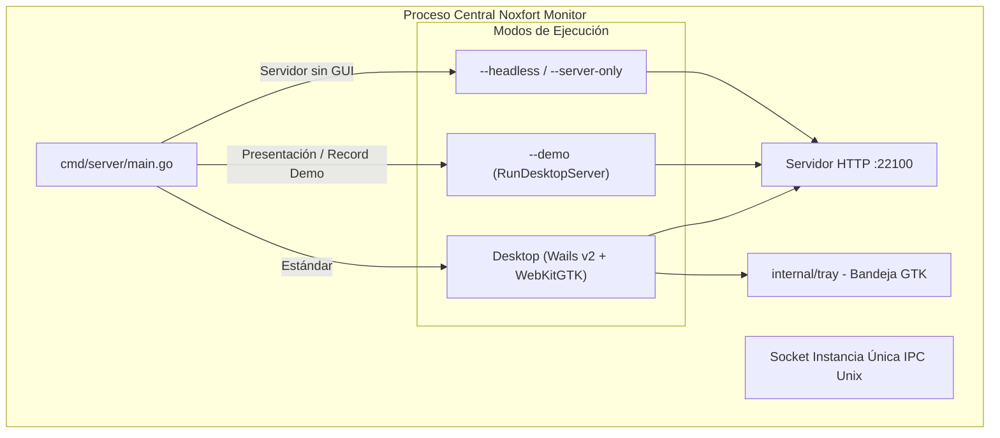

# 🖥️ Aplicación Desktop y Modos de Ejecución (Wails v2, `--demo` y `--headless`)

Este documento detalla la operación de **Noxfort Monitor™ v2.0** desde [`cmd/server/main.go`](../../cmd/server/main.go), cubriendo el runtime nativo en **Wails v2**, el modo demostración (`--demo`), el modo servidor (`--headless` / `--server-only`) y el comportamiento de seguridad en la interfaz.

⬅️ [Hub Central](../README.md) | 🏛️ [Arquitectura](architecture.md) | 🚀 [Despliegue](deployment.md)

---

## 1. Modos de Ejecución

* **Resolución y Ventana Desktop**: 1280x800 px (mínimo 1024x600 px), `HideWindowOnClose: true` (minimiza a la bandeja GTK sin detener MQTT ni HTTP), instancia única mediante `/tmp/noxfort-monitor-singleinstance.sock`.
* **Modo `--demo`**: Levanta `RunDesktopServer()` sin envoltura Wails para pruebas en navegador y capturas automatizadas (`make record-demo`).
* **Modo `--headless` / `--server-only`**: Prescinde de dependencias GTK/X11/Wayland y espera señales `SIGINT`/`SIGTERM`.

---

## 2. Funcionalidad de UI y Seguridad Integrada

* **Polling en Tiempo Real (`/api/dashboard/summary`)**: El panel consulta cada **10 segundos** el estado consolidado de los nodos en 5 categorías: `ONLINE`, `OFFLINE`, `PENDING`, `PAUSED` y `WAITING`.
* **Pantalla Dedicada `403 Forbidden`**: Cuando un usuario `OPERATOR` (solo lectura) accede a rutas restringidas (p. ej. `/users`) o intenta acciones de administrador desde la aplicación, la interfaz renderiza [`web/templates/forbidden.html`](../../web/templates/forbidden.html) de forma limpia en lugar de mostrar JSON crudo.
* **Autogestión de Contraseña**: Cualquier usuario autenticado (incluido `OPERATOR`) dispone del cambio de contraseña propia vía `POST /api/users/password` (validando `current_password`).
* **Redacción de Secretos y Claves Únicas**: En `/devices`, la clave inicial generada/emparejada (`nox_live_`) se muestra una sola vez; recargas posteriores enmascaran `ApiKey` y secretos de `/settings` y `/remote`.
* **Cierre Ordenado**: Al salir, el contexto cancela tareas periódicas (`RetentionManager`, backups agendados, limpieza de `sessions`) y ejecuta `AlertService.Shutdown(shutdownCtx)`.
