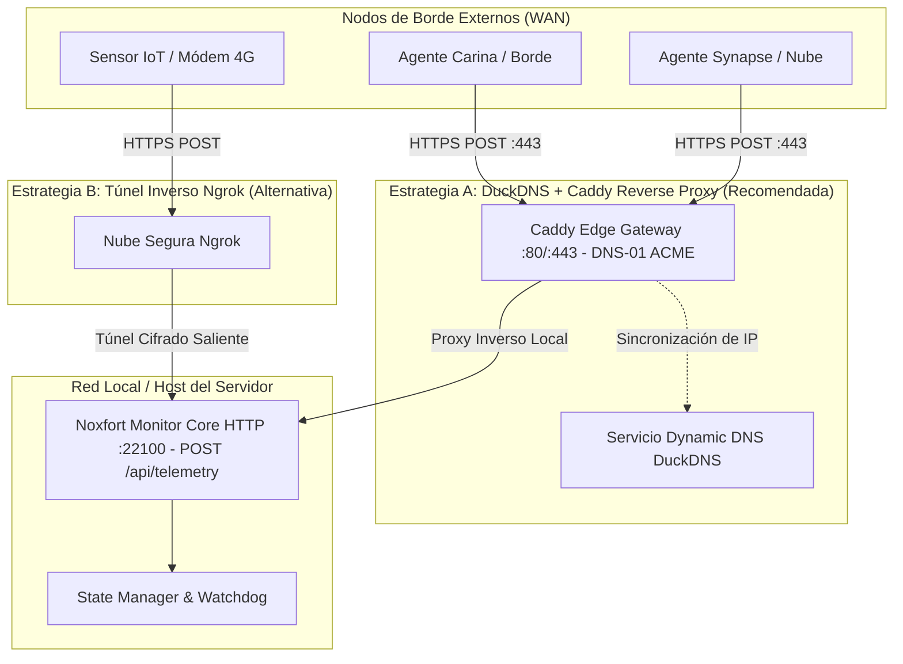

# 🌐 Acceso Remoto e Ingestión WAN (DuckDNS y Ngrok)

Este documento detalla la arquitectura de comunicación en red de área amplia (WAN) de **Noxfort Monitor™ v2.0**, cubriendo la sincronización dinámica de IP mediante **DuckDNS**, terminación TLS automática con **Caddy Server** y soporte alternativo de túnel inverso con **Ngrok** para la ingestión de telemetria externa (**Carina**, **Synapse**).

⬅️ [Centro de Documentación](README.md) | 🏛️ [Arquitectura](architecture.md) | 📡 [API](api_reference.md) | 🚀 [Despliegue](deployment.md)

---

## 1. Estrategias de Conectividad WAN

Noxfort Monitor implementa una estrategia dual para traspasar barreras de red:



1. **DuckDNS + Caddy (Primario / Recomendado)**:
   * Sincroniza dinámicamente tu subdominio (`tu-subdominio.duckdns.org`) con las direcciones IPv4/IPv6 públicas de la máquina.
   * [Caddy Server](caddy_integration.md) obtiene y renueva certificados SSL/TLS válidos automáticamente mediante **desafío ACME DNS-01** (sin requerir abrir el puerto 80).
   * Estandariza todo el tráfico en el puerto 443 con WebSockets cifrados (`/mqtt`).
2. **Túnel Inverso Ngrok (Alternativa para CGNAT Estricto)**:
   * Establece un enlace saliente seguro hacia la nube de Ngrok para instalaciones donde no es posible configurar redirección de puertos.

---

## 2. Abstracción del Driver (`internal/tunnel`)

El subsistema aplica el Principio de Inversión de Dependencias (DIP):
```go
type Service interface {
    Start(authToken, domain string) error
    Stop() error
    GetStatus() Status
    IsBinaryAvailable() bool
    TestConnection(ctx context.Context, token, domain string) (*TestResult, error)
}
```

* **`DuckDNSDriver`**: Actualiza registros mediante la API HTTP de DuckDNS, detecta direcciones IPv6 del sistema y ejecuta diagnósticos de resolución (`POST /api/tunnel/test`).
* **`NgrokDriver`**: Gestiona el binario de Ngrok y extrae las URLs públicas del cliente local.
