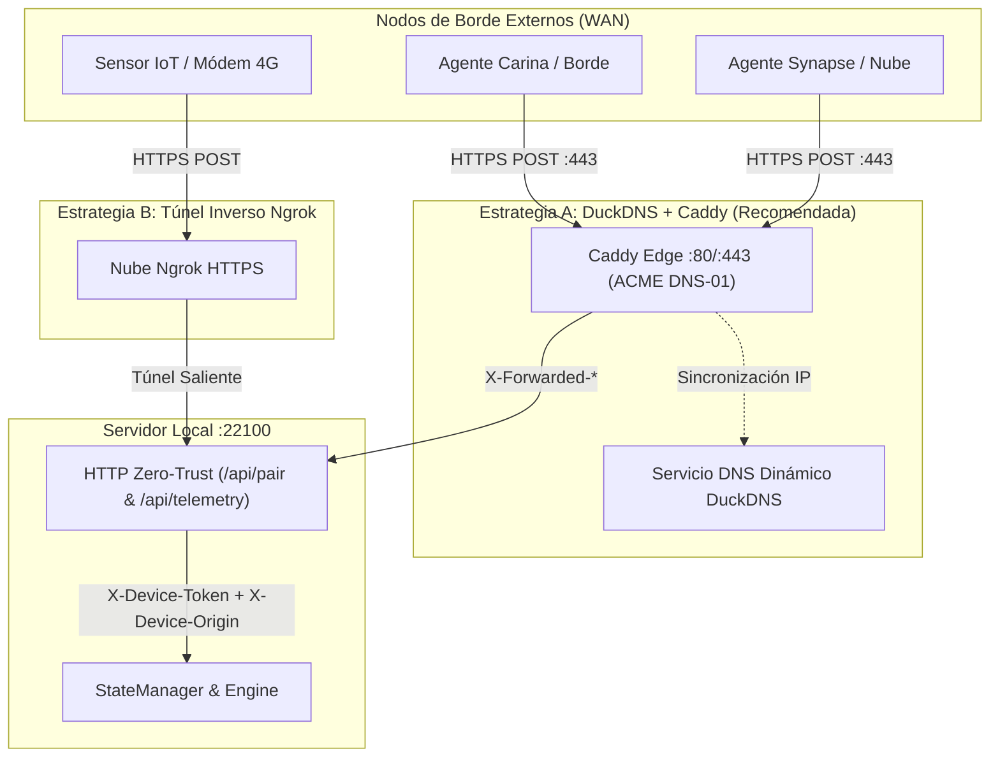

# 🌐 Acceso Remoto e Ingestión WAN (DuckDNS y Ngrok)

Este documento detalla la conectividad en red de área amplia (WAN) de **Noxfort Monitor™ v2.0** mediante **DuckDNS + Caddy** y túneles **Ngrok**, administrados desde `/remote` con RBAC estricto y redacción de credenciales.

⬅️ [Centro de Documentación](README.md) | 🏛️ [Arquitectura](architecture.md) | 📡 [API](api_reference.md) | 🚀 [Despliegue](deployment.md)

---

## 1. Estrategias de Conectividad WAN



---

## 2. Seguridad en `/remote`, RBAC y Redacción HTML

* **Control de Roles**:
  * `ADMIN`: Configura proveedores y ejecuta `/api/tunnel/{save,start,stop,disconnect,test}`.
  * `OPERATOR`: Acceso **únicamente de lectura** en `GET /remote` y `GET /api/tunnel/status`; cualquier intento de modificación devuelve `403 Forbidden` (`forbidden.html` en navegador o JSON en API).
* **Redacción de Secretos**: Tokens sensibles como `duckdns_token` o credenciales de Ngrok se enmascaran al renderizar `/remote` en HTML. Guardar formularios parciales conserva el token existente sin sobrescribirlo con valores enmascarados.
* **Registro en Auditoría**: Cada cambio o accionamiento genera eventos `TUNNEL_*` en `security_audit_logs` con IP real (`ExtractClientIP`).

---

## 3. Abstracción del Driver (`internal/tunnel`) y Borda Zero-Trust

```go
type Service interface {
    Start(authToken, domain string) error
    Stop() error
    GetStatus() Status
    IsBinaryAvailable() bool
    TestConnection(ctx context.Context, token, domain string) (*TestResult, error)
}
```

* **`DuckDNSDriver`**: Actualiza IPv4/IPv6 y valida resolución DNS en `POST /api/tunnel/test`.
* **`NgrokDriver`**: Gestiona el proceso Ngrok y expone la URL HTTPS asignada.
* **Buenas Prácticas WAN**: Habilite `MONITOR_USE_HTTPS=true`, declare `TRUSTED_PROXIES`, utilice `POST /api/pair` $\rightarrow$ aprobación manual en `/devices` $\rightarrow$ `X-Device-Token` + `X-Device-Origin` en `POST /api/telemetry`, y mantenga `MONITOR_MQTT_STRICT=true`.
