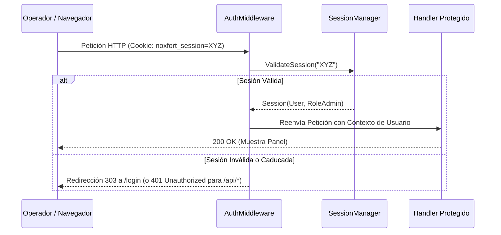

# 🔐 Seguridad, Autenticación y Control de Acceso (RBAC)

Este documento detalla la arquitectura de seguridad de **Noxfort Monitor™ v2.0**, abarcando autenticación, ciclo de vida de sesiones, hash de contraseñas con sal y Control de Acceso Basado en Roles (RBAC).

⬅️ [Hub Central](../README.md) | 🏛️ [Arquitectura](architecture.md) | 🔍 [Pista de Auditoría](audit_trail.md) | 📡 [API](api_reference.md)

---

## 1. Segregación de Roles y Permisos

Noxfort Monitor aplica una separación estricta de responsabilidades:

* **`RoleAdmin` ("ADMIN")**: Privilegios administrativos completos: gestión de usuarios, migración de bases de datos, activación de túneles y configuración del sistema.
* **`RoleOperator` ("OPERATOR")**: Privilegios de operación: consulta del cuadro de mando, estado de equipos y registros de incidentes.
* **Roles de Enrutamiento de Alertas**:
  * **`TECHNICIAN`**: Recibe exclusivamente alertas de categoría `HARDWARE`.
  * **`PROGRAMMER`**: Recibe exclusivamente alertas de categoría `SOFTWARE`.
  * **`ADMIN`**: Recibe todas las alertas globales.

---

## 2. Política de Contraseñas y Hash Criptográfico

### 2.1 Almacenamiento Criptográfico y Sal Única
Las contraseñas se protegen mediante derivación SHA-256 con sal aleatoria en [`internal/security/hasher.go`](../../internal/security/hasher.go):
* Sal criptográfica única de 16 bytes generada por usuario vía `crypto/rand`.
* Contraseñas y hashes quedan estrictamente excluidos de la serialización JSON (`json:"-"`).
* Comparación en tiempo constante para evitar ataques de temporización.

### 2.2 Política Industrial de Complejidad de Contraseñas (`password_validator.go`)
Para proteger los entornos operativos de intrusiones, [`internal/security/password_validator.go`](../../internal/security/password_validator.go) exige cumplimiento obligatorio mediante `ValidatePasswordComplexity()`:
* **Longitud Mínima**: Al menos 8 caracteres.
* **Dígito Numérico**: Al menos un número (`0-9`).
* **Letra Mayúscula**: Al menos una letra mayúscula (`A-Z`).
* **Letra Minúscula**: Al menos una letra minúscula (`a-z`).
* **Carácter Especial**: Al menos un símbolo (`!@#$%^&*()-_=+[]{}|;:'",.<>/?`~\\§¬¢£`).

Cualquier registro o creación de usuario que incumpla estas reglas devuelve HTTP `400 Bad Request`.

### 2.3 Medidor Dinámico de Fuerza de Contraseña (`password_meter.js`)
Las vistas de administración de usuarios integran validación en tiempo real ([`web/static/js/password_meter.js`](../../web/static/js/password_meter.js)):
* Cálculo dinámico de puntuación de 0 a 4 al escribir.
* Lista interactiva de requisitos con retroalimentación visual inmediata.
* Bloqueo preventivo del formulario hasta cumplir todos los criterios.

---

## 3. Ciclo de Vida de Sesiones y AuthMiddleware

* **Almacenamiento**: Mapa en memoria protegido por mutex.
* **Renovación Deslizante**: Cada petición activa extiende la expiración en 24 horas.
* **Intercepción Inteligente**: Las peticiones web no autenticadas se redirigen con HTTP `303 See Other`; las llamadas a la API devuelven JSON `401 Unauthorized`.

---

## 4. Hardening de Mosquitto con PBKDF2
* **Desactivación de Acceso Anónimo**: `allow_anonymous false` en la configuración de Mosquitto.
* **Cifrado Fuerte**: Credenciales con hash PBKDF2 (SHA-512) gestionadas con `make broker-auth`.

---

## 5. Validación de Seguridad de Entorno (`env_validator.go`)
* **Permisos del `.env` (`0600`)**: Restringe permisos en Linux para evitar lecturas públicas.
* **Alerta de Credenciales por Defecto**: Emite una advertencia crítica si se conservan las credenciales estándar (`admin` / `Admin@Noxfort2026!`) en producción.

---

## 6. Bootstrap Idempotente del Superusuario (`superuser.go`)
* Crea automáticamente la cuenta de superusuario en el primer arranque si no existen administradores.
* Purga la cuenta de prueba por defecto cuando se configuran credenciales seguras personalizadas.
