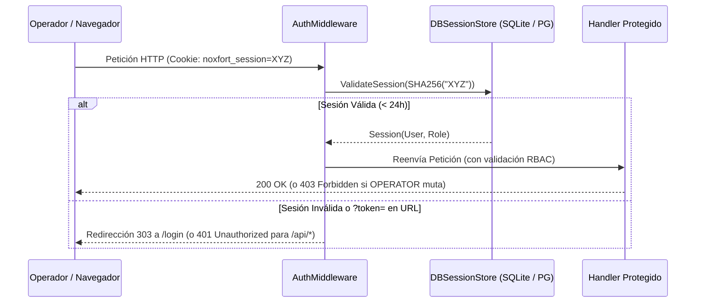

# 🔐 Seguridad, Autenticación y RBAC

Este documento detalla los controles de defensa en profundidad de **Noxfort Monitor™ v2.0**, abarcando RBAC estricto, derivación PBKDF2, protección anti-fuerza bruta, sesiones persistentes hasheadas, proxies confiables, pareamento Zero-Trust y endurecimiento de alertas.

⬅️ [Hub Central](../README.md) | 🏛️ [Arquitectura](architecture.md) | 📡 [API y Protocolos](api_reference.md) | 🔍 [Auditoría](audit_trail.md)

---

## 1. Control de Acceso Basado en Roles (RBAC)

Dos roles regulan los privilegios tanto en la API HTTP como en la interfaz Wails:

* **`ADMIN`**: Acceso total sobre dispositivos y rotación de claves, gestión de usuarios/roles/desbloqueos, contactos de alerta, ajustes MQTT/SMTP, túneles remotos y migración/backup/restauración de base de datos. Las cuentas de superusuario y del último administrador están protegidas frente a eliminación (`DeleteUserByActor`).
* **`OPERATOR` (Estrictamente Solo Lectura)**: Permitido únicamente para consultas (`GET` en panel principal, `/audit`, `/api/audit/*`, `/remote`, `/server`, `/settings`), `/api/auth/logout` y el cambio de contraseña propia (`POST /api/users/password` validando `current_password`). Bloqueado en `/users`, mutaciones de `/api/users`, `/api/settings/database/backup*` y cualquier cambio de estado:
  * Clientes API/XHR (`/api/*`, `Accept: application/json`, `XMLHttpRequest`) reciben JSON **`403 Forbidden`**.
  * Vistas HTML en navegador o escritorio renderizan la plantilla dedicada [`web/templates/forbidden.html`](../../web/templates/forbidden.html).

---

## 2. Derivación de Contraseñas y Complejidad

* **PBKDF2 HMAC-SHA256**: [`PBKDF2Hasher`](../../internal/security/hasher.go) deriva claves con **PBKDF2 HMAC-SHA256**, **`100.000` iteraciones**, sal criptográfica aleatoria de **`16` bytes** y clave resultante de **`32` bytes**.
* **Política de Complejidad (`ValidatePasswordComplexity`)**: Exige longitud mínima y diversidad de caracteres al crear cuentas, cambiar contraseñas o inicializar el superusuario.
* Las vistas de administración integran validación en tiempo real ([`web/static/js/password_meter.js`](../../web/static/js/password_meter.js)) con puntuación dinámica y bloqueo preventivo del envío.

---

## 3. Bloqueo Anti-Fuerza Bruta (`LoginAttemptTracker`)

* Cada intento fallido en `POST /api/auth/login` se rastrea por clave compuesta `username|ip` (IP resuelta mediante `ExtractClientIP`).
* **Regla**: Tras **`5` intentos fallidos** en una ventana de **`15` minutos**, la cuenta/IP queda bloqueada durante **`5` minutos**, devolviendo HTTP **`429 Too Many Requests`** y registrando `AUTH_LOGIN_LOCKED`.
* Un `ADMIN` puede revertir el bloqueo inmediatamente mediante `POST /api/users/unlock`.

---

## 4. Ciclo de Vida de Sesiones Persistentes y Proxies Confiables

* **`DBSessionStore`**: Las sesiones se almacenan de forma persistente en la tabla `sessions` guardando únicamente el hash **`SHA-256` (`token_hash`)** del token, con un **TTL fijo de `24` horas** y purga horaria automática. Al implementar `ReloadableRepository`, las sesiones sobreviven cambios en caliente entre SQLite y PostgreSQL.
* **Prohibición de `?token=`**: `ExtractSessionToken` acepta solo cookies HTTP-only y rechaza explícitamente tokens en query string (`?token=`) para evitar fugas en logs HTTP.
* **`TRUSTED_PROXIES` y `MONITOR_USE_HTTPS`**: `ExtractClientIP` e `IsHTTPSRequest` evalúan `X-Real-IP`, `X-Forwarded-For` y `X-Forwarded-Proto` (enviados por `caddy/Caddyfile`) únicamente desde rangos configurados en `TRUSTED_PROXIES`, asegurando atributos `Secure` en cookies y exactitud forense de IPs.

---

## 5. Endurecimiento de Ingestión, Redacción HTML y Alertas

* **Pareamento Zero-Trust**: `POST /api/pair` registra nodos en `PENDING` (tope 50, `409 Conflict` si ya está `ACTIVE`) devolviendo `202` sin claves; `POST /api/telemetry` exige `X-Device-Token`/`Bearer` (comparación constante), `X-Device-Origin` y marca temporal dentro de `±300s`.
* **Política MQTT Estrita**: `MONITOR_MQTT_STRICT` (por defecto `true`) ignora mensajes en `noxfort/telemetry/#` de dispositivos no registrados o pausados.
* **Redacción de Secretos**: Las plantillas HTML de `/settings`, `/remote` y `/devices` ocultan secretos activos (`ApiKey`, `duckdns_token`) y preservan credenciales al guardar formularios parciales.
* **SMTP Seguro**: `EmailChannel` soporta TLS implícito en puerto `465` (`TLS 1.2+`) y sanea encabezados (`sanitizeEmailHeader`, eliminando CRLF).
* **Mosquitto PBKDF2 y `env_validator.go` / `superuser.go`**: `allow_anonymous false` con `./scripts/setup_mqtt_auth.sh`, verificación de permisos `0600` del `.env`, alerta ante credenciales por defecto y arranque idempotente del superusuario.
