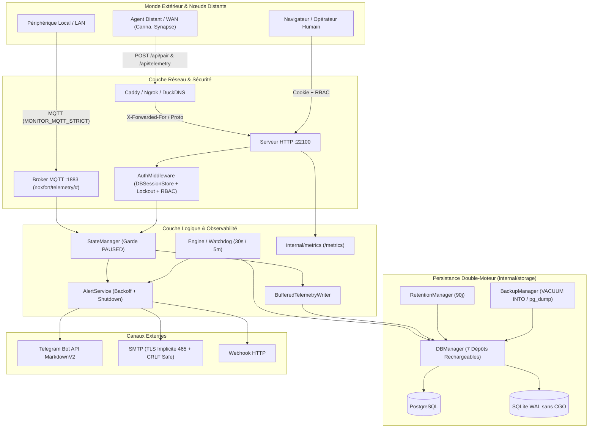

# 🏛️ Noxfort Monitor™ : Architecture Système et Concurrence

Ce document spécifie l'architecture interne de **Noxfort Monitor™ v2.0** : architecture orientée événements (EDA), modèle de concurrence Goroutines, appairage Zero-Trust, persistance double-moteur et assemblage à la racine.

⬅️ [Hub Central](../README.md) | 📡 [API Réseau](api_reference.md) | 🗄️ [Base de Données](database.md) | 🔐 [Sécurité](security.md) | 🧪 [Tests](testing.md)

---

## 1. Philosophie d'Architecture

Noxfort Monitor suit une **Architecture Orientée Événements (EDA)** couplée aux principes **SOLID** et à l'**Injection de Dépendances (DI)** assemblée dans [`cmd/server/main.go`](../../cmd/server/main.go). La configuration démarre depuis `.env` via `LoadDotEnv()` (`configs/config.yaml` a été supprimé), sans état global mutable.

---

## 2. Découpage Modulaire des Couches

1. **Couche Transport (`internal/transport`)** : Client MQTT (`noxfort/telemetry/#`, politique `MONITOR_MQTT_STRICT`, boucle de reconnexion 5s et `Reconnect(brokerURL)` à chaud) et serveur HTTP REST (`:22100`) avec `AuthMiddleware`, `/api/pair`, `/api/telemetry` et `/metrics`.
2. **Couche Surveillance & Alertes (`internal/monitor`)** : `StateManager` (protection Maintenance `PAUSED` et `SaveEventReturningID` synchrone), `Engine` (tick `30s`, seuil hors ligne `5m`, `CleanupExpiredPending()`), et `AlertService` (`500ms`/`1500ms` backoff + `Shutdown(ctx)`).
3. **Couche Sécurité (`internal/security`)** : `PBKDF2Hasher` (`100 000` itérations), `LoginAttemptTracker` (5 échecs/15m $\rightarrow$ 5m `429`), `DBSessionStore` (`SHA-256` dans `sessions`, 24h), proxies de confiance (`TRUSTED_PROXIES`, `MONITOR_USE_HTTPS`) et RBAC strict (`OPERATOR` lecture seule + changement du propre mot de passe).
4. **Couche Accès Distant (`internal/tunnel`)** : Pilotes DuckDNS et Ngrok sur `/remote` avec redaction HTML des secrets.
5. **Couche Persistance (`internal/storage`)** : `DBManager` SQLite WAL + PostgreSQL, `7` `ReloadableRepository`, `MigrateData` transactionnel (9 tables), `BufferedTelemetryWriter`, `BackupManager` (planifié/téléchargement/restauration) et `RetentionManager` (`MONITOR_RETENTION_DAYS=90`).
6. **Couche Desktop, Démo & Métriques (`internal/desktop`, `internal/tray`, `internal/metrics`)** : Runtime Wails v2 + WebKitGTK, socket IPC d'instance unique, modes `--demo` (`RunDesktopServer()`) et `--headless`, et export Prometheus (`/metrics`).

---

## 3. Concurrence et Arrêt Maîtrisé

* **Thread Principal** : Mode desktop (`desktopApp.Run()`), mode `--demo` (`RunDesktopServer()`) ou `--headless` / `--server-only` (signaux `SIGINT`/`SIGTERM`).
* **Goroutines (`bgCtx`)** : Serveur HTTP `:22100`, client MQTT, `BufferedTelemetryWriter`, `Engine` (`30s`), purge horaire de `sessions`, `RetentionManager` (24h) et sauvegardes planifiées (`MONITOR_BACKUP_INTERVAL_HOURS`).
* **Fermeture Propre (`AlertService.Shutdown`)** : Vide les alertes en file avant de fermer les connexions SQL et MQTT.
