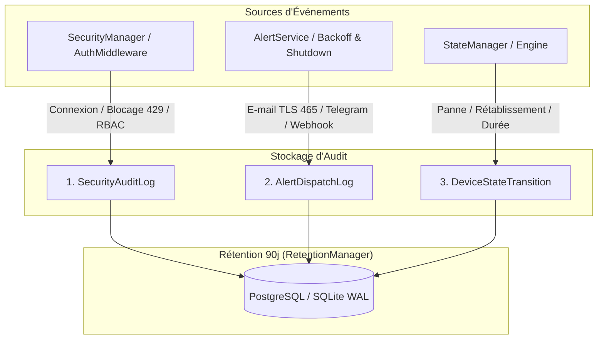

# 🔍 Piste d'Audit et Observabilité

Ce document spécifie le sous-système d'audit et de conformité de **Noxfort Monitor™ v2.0**, couvrant la traçabilité de sécurité, le suivi SLA des alertes liées aux événements de télémétrie et l'historique de disponibilité, accessibles aux profils `Operator+` sur `/audit` et `/api/audit/*`.

⬅️ [Hub Central](../README.md) | 🏛️ [Architecture](architecture.md) | 🔐 [Sécurité](security.md)

---

## 1. Architecture de l'Audit Triple

---

## 2. Modèles de Données et Champs Exactes (`internal/domain/audit.go`)

### 2.1 `SecurityAuditLog` (`security_audit_logs`)
* `id` (*int64*) : Identifiant séquentiel unique.
* `created_at` (*timestamp*) : Horodatage UTC.
* `username` (*string*) : Acteur ou compte cible.
* `action` (*string*) : Identifiant canonique (`AUTH_LOGIN_SUCCESS`, `AUTH_LOGIN_FAILED`, `AUTH_LOGIN_LOCKED`, `USER_CREATE`, `USER_PASSWORD_CHANGED`, `USER_ROLE_UPDATED`, `USER_UNLOCKED`, `USER_DELETE`, `DEVICE_*`, `CONTACT_*`, `SETTINGS_UPDATED`, `TUNNEL_*`, `DATABASE_*`, `POSTGRES_USER_PROVISIONED`).
* `details` (*string*) : Détails contextuels et résultat.
* `ip_address` (*string*) : IP cliente réelle résolue via `ExtractClientIP` et `TRUSTED_PROXIES`.

### 2.2 `AlertDispatchLog` (`alert_dispatch_logs`)
Trace chaque envoi d'`AlertService` (avec tentatives différées `500ms`, `1500ms` et vidage lors de `Shutdown`) :
* `id` (*int64*) : Identifiant unique.
* `telemetry_id` (*int64*) : Lien direct vers `telemetry.id` obtenu par `SaveEventReturningID`.
* `channel` (*string*) : `telegram`, `email` ou `webhook`.
* `recipient` (*string*) : Destinataire ou cible configurée.
* `role` (*string*) : Rôle notifié.
* `status` (*string*) : Statut d'émission.
* `error_reason` (*string*) : Motif d'erreur en cas d'échec.
* `dispatched_at` (*timestamp*) : Moment de la tentative d'envoi.

### 2.3 `DeviceStateTransition` (`device_state_transitions`)
Enregistre les transitions calculées toutes les `30s` (seuil hors ligne `5m`) :
* `id` (*int64*) : Identifiant unique.
* `device_identifier` (*string*) : Identifiant unique du nœud.
* `previous_state` (*string*) : État précédent.
* `new_state` (*string*) : Nouvel état.
* `duration_offline_sec` (*int64*) : Durée totale hors ligne au rétablissement.
* `transition_at` (*timestamp*) : Instant de la transition.

---

## 3. Contrôle d'Accès et Purge Automatique
* **Consultation** : Les comptes `ADMIN` et `OPERATOR` peuvent consulter `/audit`, `/api/audit/security`, `/api/audit/alerts` et `/api/audit/transitions`.
* **Rétention** : `RetentionManager` supprime toutes les 24h les entrées de plus de `MONITOR_RETENTION_DAYS` (`90` jours par défaut) dans ces 3 tables et `telemetry`.
