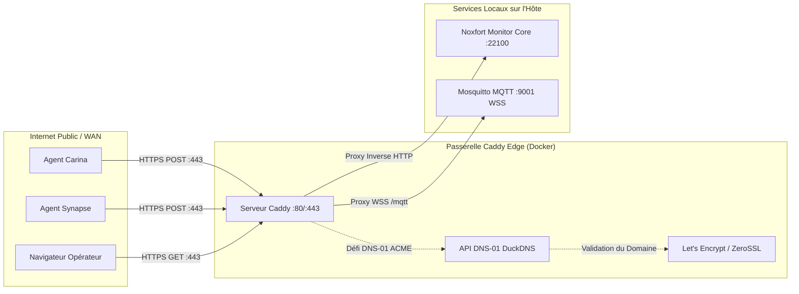

# 🛡️ Proxy Inverse Caddy & DuckDNS (HTTPS Automatique) : Noxfort Monitor™

Ce document décrit l'architecture, le déploiement et l'exploitation de **Caddy Server** intégré avec **DuckDNS** dans **Noxfort Monitor™ v2.0**. Cette topologie assure une terminaison TLS/SSL automatique de niveau entreprise via le **défi ACME DNS-01**, éliminant les flux non chiffrés sur le réseau étendu (WAN) et exposant les ports standards (`80`, `443` et `WSS`).

⬅️ [Centre de Documentation](README.md) | 🌐 [Accès Distant](remote_access.md) | 🚀 [Déploiement](deployment.md) | 📡 [Référence API](api_reference.md)

---

## 1. Vue d'Ensemble de l'Architecture



### Avantages Clés :
1. **HTTPS Zéro Configuration** : Caddy émet et renouvelle automatiquement des certificats valides.
2. **Défi ACME DNS-01** : Ne requiert pas l'ouverture du port 80 entrant.
3. **WebSockets Sécurisés (WSS)** : MQTT-over-WebSockets chiffré via `wss://votre-domaine.duckdns.org/mqtt`.
4. **Standardisation des Ports** : Centralise le trafic sur le port 443 sans exposer `:22100`.

---

## 2. Déploiement

```bash
make caddy-build
make services-start
make services-logs
make services-stop
```
