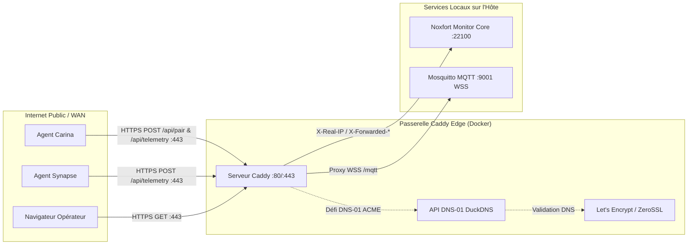

# 🛡️ Proxy Inverse Caddy & DuckDNS (HTTPS Automatique) : Noxfort Monitor™

Ce document décrit le déploiement de **Caddy Server** ([`caddy/Caddyfile`](../../caddy/Caddyfile)) avec **DuckDNS** devant **Noxfort Monitor™ v2.0**, assurant terminaison TLS automatique via **ACME DNS-01**, WebSockets WSS (`/mqtt`) et transmission vérifiée des en-têtes proxy vers `:22100`.

⬅️ [Centre de Documentation](README.md) | 🌐 [Accès Distant](remote_access.md) | 🚀 [Déploiement](deployment.md) | 📡 [Référence API](api_reference.md)

---

## 1. Vue d'Ensemble de l'Architecture



---

## 2. Intégration avec `TRUSTED_PROXIES` et `MONITOR_USE_HTTPS`

`caddy/Caddyfile` transmet `X-Real-IP`, `X-Forwarded-For` et `X-Forwarded-Proto` :

1. Renseignez la plage IP de Caddy/Docker dans `TRUSTED_PROXIES` (ex. `TRUSTED_PROXIES=127.0.0.1/32,172.16.0.0/12`).
2. Activez `MONITOR_USE_HTTPS=true` pour émettre des cookies `Secure`.

Ainsi, `ExtractClientIP` consigne la véritable IP du client dans `LoginAttemptTracker` et `SecurityAuditLog`, et `IsHTTPSRequest` maintient les sessions derrière TLS.

---

## 3. Déploiement et Test Zero-Trust derrière Caddy

```bash
make caddy-build
make services-start
make services-logs
make services-stop
```

```bash
# 1. Pré-enregistrement Zero-Trust (202 Accepted sans clé API)
curl -X POST https://votre-domaine.duckdns.org/api/pair \
  -H "Content-Type: application/json" \
  -d '{"origin":"carina-01","name":"Agent Carina 01"}'

# 2. Approuver dans /devices, copier le jeton nox_live_ (TTL 5m), puis envoyer :
curl -X POST https://votre-domaine.duckdns.org/api/telemetry \
  -H "Content-Type: application/json" \
  -H "X-Device-Token: nox_live_votre_jeton" \
  -H "X-Device-Origin: carina-01" \
  -d '{"category":"HARDWARE","origin":"carina-01","level":"INFO","message":"System OK","occurred_at":"'"$(date -u +%Y-%m-%dT%H:%M:%SZ)"'"}'
```
