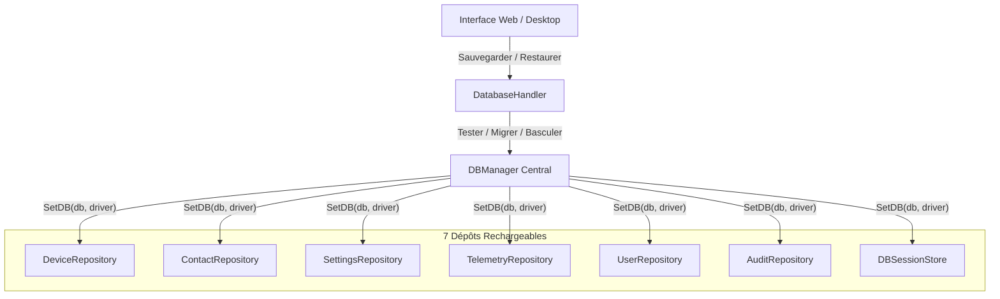

# 🗄️ Persistance et Architecture Double-Moteur

Ce document détaille la couche de persistance double-moteur de **Noxfort Monitor™ v2.0** : coexistence PostgreSQL et SQLite en mode WAL, basculement à chaud (`DBManager`), migration transactionnelle sur 9 tables, sauvegardes/restauration vérifiées et rétention automatique.

⬅️ [Hub Central](../README.md) | 🏛️ [Architecture](architecture.md) | 📡 [API](api_reference.md) | 🔐 [Sécurité](security.md)

---

## 1. Coexistence Double-Moteur et Mode WAL

Les schémas SQLite et PostgreSQL maintiennent une parité exacte sur **9 tables et 12 index** :

| Dimension | SQLite (Pur en Go, mode WAL) | PostgreSQL |
|---|---|---|
| **Pilote Go** | `modernc.org/sqlite` (sans CGO) | `github.com/lib/pq` |
| **Optimisations** | `journal_mode=WAL`, `synchronous=NORMAL`, `busy_timeout=5000` | Schéma dédié (`schema_monitor`) |
| **Cas d'Usage** | Postes locaux, passerelles de bordure | Serveurs industriels haute concurrence |
| **Emplacement** | `~/Documentos/Monitor/monitor_logs.db` | Serveur TCP (port `5432`) |
| **Dépendances** | Aucune (embarqué dans le binaire Go) | PostgreSQL 12+ en réseau |

---

## 2. Rechargement Dynamique à Chaud (`DBManager`)



Chaque dépôt implémente l'interface `ReloadableRepository` :

```go
type ReloadableRepository interface {
    SetDB(db *sql.DB, driver string)
}
```

---

## 3. Migration Transactionnelle Unique (`MigrateData`)

Lors d'un basculement SQLite $\leftrightarrow$ PostgreSQL :
1. `Migrator.MigrateData` transfère l'ensemble des **9 tables** (`devices` incluant `api_key`, `status`, `expires_at`, `telemetry` avec `device_id`, `settings`, `contacts`, `users`, `sessions`, `security_audit_logs`, `alert_dispatch_logs`, `device_state_transitions`) dans une **transaction SQL unique**.
2. Les requêtes sont normalisées avec `storage.AdaptQuery()`.
3. En cas d'erreur sur n'importe quelle table, la transaction est annulée et `DBManager.Switch` avorte sans laisser d'état partiel.

---

## 4. Sauvegardes à Chaud, Restauration et Rétention

* **Sauvegardes (`BackupManager`)** : Produit des snapshots non bloquants (`VACUUM INTO` pour SQLite, `pg_dump -F c` pour PostgreSQL). `BackupManager.StartScheduledBackups` s'exécute selon `MONITOR_BACKUP_INTERVAL_HOURS` (défaut `24h`, conservation des `7` plus récents).
* **Téléchargement & Restauration** :
  * `GET /api/settings/database/backups/download` applique `ResolveBackupPath` contre le *path traversal*.
  * `POST /api/settings/database/restore` vérifie l'intégrité SQLite via `PRAGMA quick_check` avant `RestoreSQLiteFile`, ou invoque `pg_restore`.
* **Rétention (`RetentionManager`)** : Purge toutes les **`24` heures** les enregistrements antérieurs à `MONITOR_RETENTION_DAYS` (défaut **`90` jours**) dans `telemetry`, `alert_dispatch_logs`, `security_audit_logs` et `device_state_transitions`.
