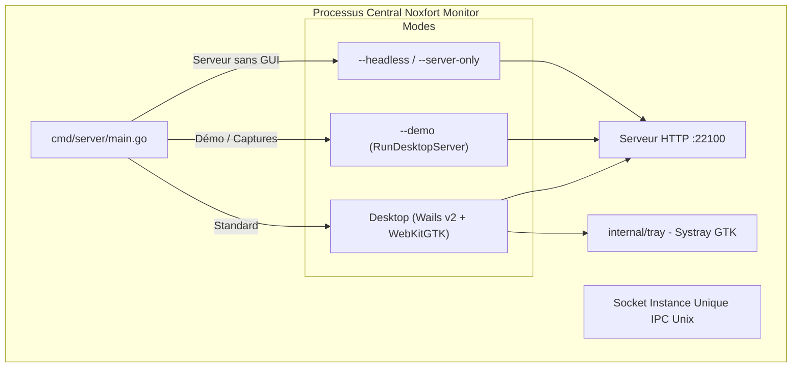

# 🖥️ Application Desktop et Modes d'Exécution (Wails v2, `--demo` & `--headless`)

Ce document détaille l'architecture client/serveur de **Noxfort Monitor™ v2.0** à partir de [`cmd/server/main.go`](../../cmd/server/main.go) : **Wails v2** + **WebKitGTK**, mode présentation `--demo`, mode serveur `--headless` / `--server-only`, polling temps réel et sécurité intégrée.

⬅️ [Hub Central](../README.md) | 🏛️ [Architecture](architecture.md) | 🚀 [Déploiement](deployment.md)

---

## 1. Modes d'Exécution

* **Desktop (Défaut)** : Fenêtre 1280x800 px (min 1024x600), `HideWindowOnClose: true`, verrou d'instance unique sur `/tmp/noxfort-monitor-singleinstance.sock`.
* **Mode `--demo`** : Lance `RunDesktopServer()` sans fenêtre Wails pour automatisations et captures navigateur (`make record-demo`).
* **Mode `--headless` / `--server-only`** : Fonctionne sans interface graphique ni dépendances X11/Wayland sous `SIGINT`/`SIGTERM`.

---

## 2. Fonctionnalités Interface & Sécurité

* **Polling Temps Réel (`/api/dashboard/summary`)** : Rafraîchit toutes les **10 secondes** les compteurs et nœuds dans les 5 états : `ONLINE`, `OFFLINE`, `PENDING`, `PAUSED` et `WAITING`.
* **Vue Dédiée `403 Forbidden`** : Les comptes `OPERATOR` (lecture seule) accédant à des routes réservées (ex. `/users`) reçoivent [`web/templates/forbidden.html`](../../web/templates/forbidden.html) dans la fenêtre applicative au lieu de JSON brut.
* **Changement de Mot de Passe Personnel** : Tous les utilisateurs (y compris `OPERATOR`) peuvent modifier leur mot de passe via `POST /api/users/password` (avec `current_password`).
* **Masquage des Clés** : Les jetons initiaux dans `/devices` ne s'affichent qu'une seule fois ; `ApiKey`, `duckdns_token` et autres secrets sont masqués au rendu HTML suivant.
* **Arrêt Propre** : Annule `bgCtx` (`RetentionManager`, backups planifiés, nettoyage de `sessions`) et appelle `AlertService.Shutdown(shutdownCtx)`.
