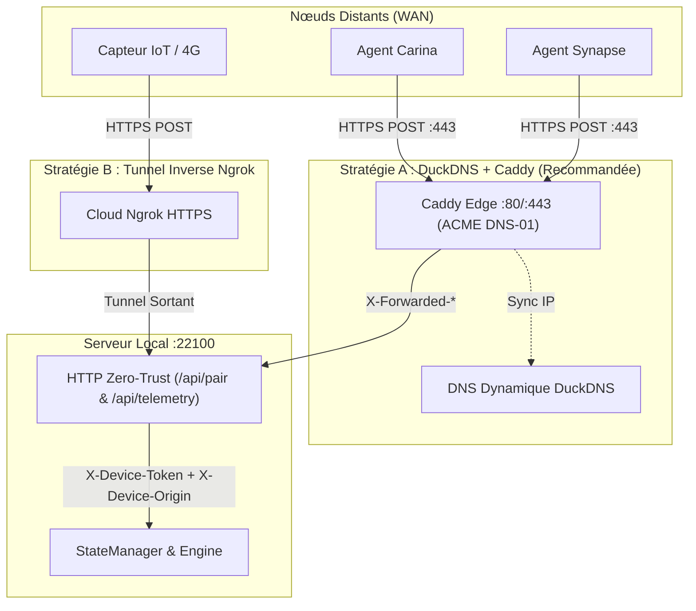

# 🌐 Accès Distant et Ingestion WAN (DuckDNS & Ngrok)

Ce document détaille l'accès WAN de **Noxfort Monitor™ v2.0** via **DuckDNS + Caddy** et **Ngrok**, administré depuis `/remote` avec contrôle RBAC strict et rédaction des secrets.

⬅️ [Centre de Documentation](README.md) | 🏛️ [Architecture](architecture.md) | 📡 [API](api_reference.md) | 🚀 [Déploiement](deployment.md)

---

## 1. Stratégies de Connectivité WAN



---

## 2. Sécurité sur `/remote`, RBAC et Masquage HTML

* **Contrôle des Rôles** :
  * `ADMIN` : Paramètre DuckDNS/Ngrok et exécute `/api/tunnel/{save,start,stop,disconnect,test}`.
  * `OPERATOR` : Lecture seule stricte sur `GET /remote` et `GET /api/tunnel/status` ; toute mutation renvoie `403 Forbidden` (`forbidden.html` en UI ou JSON pour `/api/*`).
* **Masquage des Secrets** : `duckdns_token` et les jetons Ngrok sont masqués dans le HTML de `/remote` ; les enregistrements partiels préservent les secrets existants en base.
* **Audit** : Toute opération consigne un événement `TUNNEL_*` dans `security_audit_logs` avec l'IP réelle (`ExtractClientIP`).

---

## 3. Pilotes (`internal/tunnel`) & Ingestion Zero-Trust

```go
type Service interface {
    Start(authToken, domain string) error
    Stop() error
    GetStatus() Status
    IsBinaryAvailable() bool
    TestConnection(ctx context.Context, token, domain string) (*TestResult, error)
}
```

* En WAN, configurez `MONITOR_USE_HTTPS=true`, `TRUSTED_PROXIES`, imposez l'enrôlement `/api/pair` $\rightarrow$ validation `/devices` $\rightarrow$ `X-Device-Token` + `X-Device-Origin` sur `/api/telemetry`, et gardez `MONITOR_MQTT_STRICT=true`.
