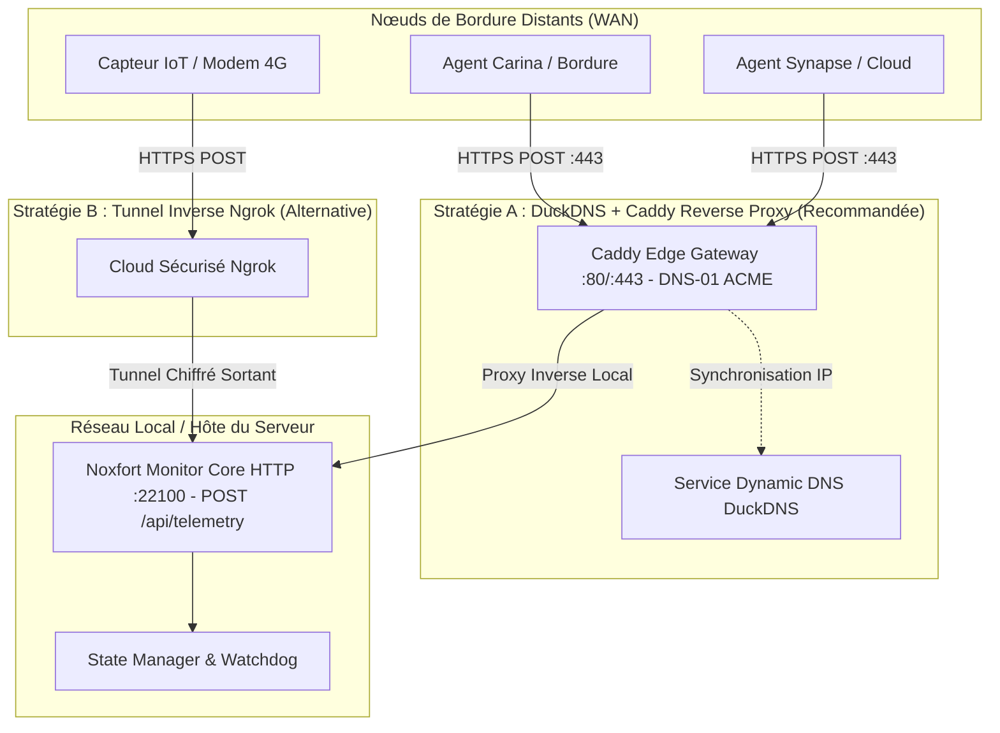

# 🌐 Accès Distant et Ingestion WAN (DuckDNS & Ngrok)

Ce document détaille l'architecture réseau longue distance (WAN) de **Noxfort Monitor™ v2.0**, couvrant la synchronisation d'IP dynamique via **DuckDNS**, la terminaison TLS automatique avec **Caddy Server**, et le support alternatif de tunnel inverse via **Ngrok** pour l'ingestion d'agents distants (**Carina**, **Synapse**).

⬅️ [Centre de Documentation](README.md) | 🏛️ [Architecture](architecture.md) | 📡 [API](api_reference.md) | 🚀 [Déploiement](deployment.md)

---

## 1. Stratégies de Connectivité WAN

Noxfort Monitor applique une stratégie double pour franchir les restrictions de réseau :



1. **DuckDNS + Caddy (Primaire / Recommandée)** :
   * Synchronise dynamiquement votre sous-domaine (`votre-sousdomaine.duckdns.org`) avec les adresses IPv4/IPv6 publiques de la machine.
   * [Caddy Server](caddy_integration.md) émet et renouvelle automatiquement les certificats SSL/TLS valides via le **défi ACME DNS-01** (sans exiger l'ouverture du port 80).
   * Standardise tout le trafic sur le port 443 avec WebSockets chiffrés (`/mqtt`).
2. **Tunnel Inverse Ngrok (Alternative pour CGNAT Strict)** :
   * Établit une liaison sortante sécurisée vers le cloud Ngrok pour les installations où aucune redirection de port n'est possible.

---

## 2. Abstraction du Pilote (`internal/tunnel`)

Le sous-système applique le principe d'inversion des dépendances (DIP) :
```go
type Service interface {
    Start(authToken, domain string) error
    Stop() error
    GetStatus() Status
    IsBinaryAvailable() bool
    TestConnection(ctx context.Context, token, domain string) (*TestResult, error)
}
```

* **`DuckDNSDriver`** : Met à jour les enregistrements via l'API HTTP de DuckDNS, détecte les adresses IPv6 du système et réalise des diagnostics de résolution (`POST /api/tunnel/test`).
* **`NgrokDriver`** : Supervise le processus Ngrok et extrait les URLs publiques.
