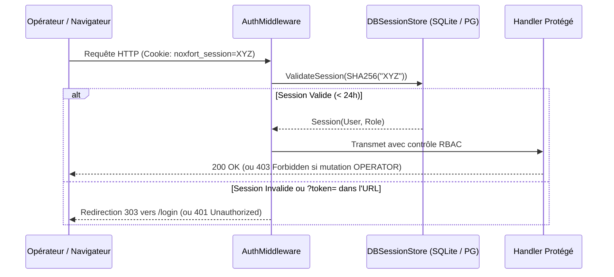

# 🔐 Sécurité, Authentification et Contrôle d'Accès (RBAC)

Ce document décrit les mesures de défense en profondeur de **Noxfort Monitor™ v2.0** : RBAC strict, dérivation PBKDF2, protection anti-force brute, sessions hachées persistantes, proxies de confiance, appairage Zero-Trust et durcissement des alertes.

⬅️ [Hub Central](../README.md) | 🏛️ [Architecture](architecture.md) | 🔍 [Piste d'Audit](audit_trail.md) | 📡 [API](api_reference.md)

---

## 1. Ségrégation des Privilèges et Rôles (RBAC)

* **`ADMIN`** : Privilèges complets (gestion des équipements/clés, comptes/rôles/déverrouillage, contacts, réglages système/MQTT, tunnels et basculement/sauvegarde/restauration SQL). Le superutilisateur et le dernier administrateur sont protégés contre la suppression (`DeleteUserByActor`).
* **`OPERATOR` (Strictement en Lecture Seule)** : Autorisé uniquement sur les vues `GET` (tableau de bord, `/audit`, `/api/audit/*`, `/remote`, `/server`, `/settings`), `/api/auth/logout` et le changement de son propre mot de passe (`POST /api/users/password` avec `current_password`). Bloqué sur `/users`, les mutations `/api/users`, `/api/settings/database/backup*` et toute écriture :
  * Les appels API/XHR (`/api/*`, `Accept: application/json`, `XMLHttpRequest`) reçoivent JSON **`403 Forbidden`**.
  * Les vues HTML navigateur/desktop affichent la page dédiée [`web/templates/forbidden.html`](../../web/templates/forbidden.html).

---

## 2. Dérivation PBKDF2 et Complexité des Mots de Passe

* **PBKDF2 HMAC-SHA256** : [`PBKDF2Hasher`](../../internal/security/hasher.go) applique **PBKDF2 HMAC-SHA256** avec **`100 000` itérations**, un sel aléatoire de **`16` octets** (`crypto/rand`) et une clé dérivée de **`32` octets**.
* **Complexité (`ValidatePasswordComplexity`)** : Exige au moins 8 caractères, majuscule, minuscule, chiffre et caractère spécial lors des créations, mises à jour et initialisation du superutilisateur, complété par l'indicateur [`web/static/js/password_meter.js`](../../web/static/js/password_meter.js).

---

## 3. Protection Anti-Force Brute (`LoginAttemptTracker`)

* Les échecs d'authentification sur `POST /api/auth/login` sont suivis par clé composite `username|ip` (`ExtractClientIP`).
* **Verrouillage** : Après **`5` tentatives échouées** en **`15` minutes**, un blocage de **`5` minutes** s'active avec code HTTP **`429 Too Many Requests`** et audit `AUTH_LOGIN_LOCKED`.
* Un `ADMIN` peut lever ce blocage via `POST /api/users/unlock`.

---

## 4. Sessions Persistantes Hachées et Proxies de Confiance

* **`DBSessionStore`** : Les sessions sont persistées dans la table `sessions` en ne stockant que l'empreinte **`SHA-256` (`token_hash`)**, avec un **TTL fixe de `24h`** et un nettoyage horaire automatique. Participant à `ReloadableRepository`, elles survivent aux basculements SQLite $\leftrightarrow$ PostgreSQL.
* **Rejet de `?token=`** : `ExtractSessionToken` rejette explicitement les jetons passés en query string (`?token=`) pour éviter les fuites dans les journaux.
* **`TRUSTED_PROXIES` et `MONITOR_USE_HTTPS`** : `ExtractClientIP` et `IsHTTPSRequest` n'acceptent `X-Real-IP`, `X-Forwarded-For` et `X-Forwarded-Proto` (`caddy/Caddyfile`) que depuis les plages déclarées dans `TRUSTED_PROXIES`, garantissant des cookies `Secure` et des IP d'audit fiables.

---

## 5. Ingestion Zero-Trust, Rédaction HTML et Durcissement SMTP/MQTT

* **Appairage Zero-Trust** : `POST /api/pair` place les équipements en file `PENDING` (max 50, `409 Conflict` si déjà `ACTIVE`) et répond `202` sans divulguer de secret ; `POST /api/telemetry` vérifie `X-Device-Token`/`Bearer` en temps constant, `X-Device-Origin` et une dérive maximale de `±300s`.
* **MQTT Strict (`MONITOR_MQTT_STRICT=true`)** : Ignore les publications sur `noxfort/telemetry/#` provenant d'équipements inconnus ou en pause (`PAUSED`).
* **Rédaction dans les Vues HTML** : `/settings`, `/remote` et `/devices` masquent `ApiKey` et `duckdns_token` et préservent les secrets existants lors d'enregistrements partiels.
* **SMTP Sécurisé** : `EmailChannel` prend en charge TLS implicite sur le port `465` (`TLS 1.2+`) et assainit les en-têtes (`sanitizeEmailHeader`, suppression CRLF).
* **Mosquitto, `env_validator.go` et `superuser.go`** : Authentification PBKDF2 (`./scripts/setup_mqtt_auth.sh`), vérification des droits `0600` du `.env`, alerte sur identifiants par défaut et amorçage idempotent du superutilisateur.
