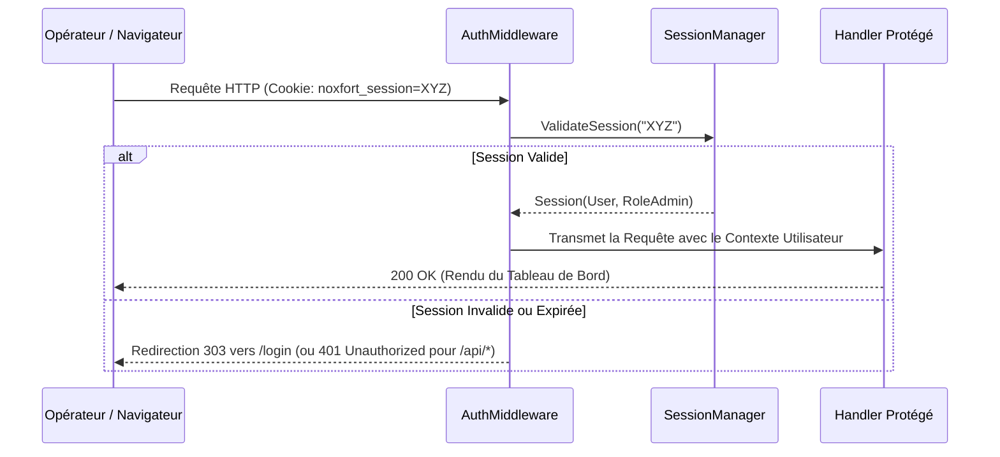

# 🔐 Sécurité, Authentification et Contrôle d'Accès (RBAC)

Ce document spécifie l'architecture de sécurité de **Noxfort Monitor™ v2.0**, couvrant l'authentification, le cycle de vie des sessions, le hachage des mots de passe et le Contrôle d'Accès Basé sur les Rôles (RBAC).

⬅️ [Hub Central](../README.md) | 🏛️ [Architecture](architecture.md) | 🔍 [Piste d'Audit](audit_trail.md) | 📡 [API](api_reference.md)

---

## 1. Ségrégation des Privilèges et Rôles

Noxfort Monitor applique une politique stricte d'habilitation :

* **`RoleAdmin` ("ADMIN")** : Privilèges complets d'administration : gestion des utilisateurs, migration de bases de données, gestion du tunnel distant et configuration système.
* **`RoleOperator` ("OPERATOR")** : Privilèges opérationnels : consultation de la télémétrie, des équipements enregistrés et de l'historique d'alertes.
* **Rôles de Routage d'Incidents** :
  * **`TECHNICIAN`** : Reçoit exclusivement les alertes de catégorie `HARDWARE`.
  * **`PROGRAMMER`** : Reçoit exclusivement les alertes de catégorie `SOFTWARE`.
  * **`ADMIN`** : Reçoit l'ensemble des alertes.

---

## 2. Politique de Mots de Passe et Hachage Cryptographique

### 2.1 Hachage avec Sel Cryptographique
Les mots de passe sont protégés par dérivation SHA-256 avec sel cryptographique via [`internal/security/hasher.go`](../../internal/security/hasher.go) :
* Sel aléatoire unique de 16 octets généré pour chaque compte (`crypto/rand`).
* Mots de passe et empreintes sont strictement exclus de la sérialisation JSON (`json:"-"`).
* Comparaison en temps constant pour prévenir les attaques temporelles.

### 2.2 Politique Industrielle de Complexité des Mots de Passe (`password_validator.go`)
Pour prémunir les environnements critiques contre les attaques par force brute, [`internal/security/password_validator.go`](../../internal/security/password_validator.go) impose des règles strictes via `ValidatePasswordComplexity()` :
* **Longueur Minimale** : Au moins 8 caractères.
* **Chiffre Numérique** : Au moins un chiffre (`0-9`).
* **Lettre Majuscule** : Au moins une majuscule (`A-Z`).
* **Lettre Minuscule** : Au moins une minuscule (`a-z`).
* **Caractère Spécial** : Au moins un symbole (`!@#$%^&*()-_=+[]{}|;:'",.<>/?`~\\§¬¢£`).

Toute création de compte ne respectant pas ces critères retourne HTTP `400 Bad Request`.

### 2.3 Indicateur Dynamique de Force de Mot de Passe (`password_meter.js`)
L'interface d'administration intègre un indicateur interactif en temps réel ([`web/static/js/password_meter.js`](../../web/static/js/password_meter.js)) :
* Calcul de score dynamique de 0 à 4 lors de la saisie.
* Checklist interactive des critères de sécurité avec retour visuel immédiat.
* Blocage de soumission tant que les exigences ne sont pas validées.

---

## 3. Cycle de Vie des Sessions et AuthMiddleware

* **Stockage en Mémoire** : Table de hachage synchronisée par mutex.
* **Renouvellement Glissant** : Toute activité prolonge la validité de 24 heures.
* **Interception Adaptée** : Les requêtes web sans session sont redirigées vers `/login` avec HTTP `303 See Other` ; les requêtes API retournent `401 Unauthorized`.

---

## 4. Renforcement du Broker MQTT et Hachage PBKDF2
* **Désactivation de l'Accès Anonyme** : `allow_anonymous false` dans Mosquitto.
* **Chiffrement Robuste** : Mots de passe hachés via PBKDF2 (SHA-512) initialisés via `make broker-auth`.

---

## 5. Audit de Sécurité au Démarrage (`env_validator.go`)
* **Permissions du Fichier `.env` (`0600`)** : Restreint les permissions en environnement Linux.
* **Alerte d'Identifiants par Défaut** : Émet un avertissement critique si les identifiants d'usine (`admin` / `Admin@Noxfort2026!`) restent actifs en production.

---

## 6. Bootstrap Idempotent du Superutilisateur (`superuser.go`)
* Crée automatiquement le compte administrateur initial si aucun compte n'existe.
* Supprime automatiquement le compte de test si des identifiants personnalisés sont configurés en production.
