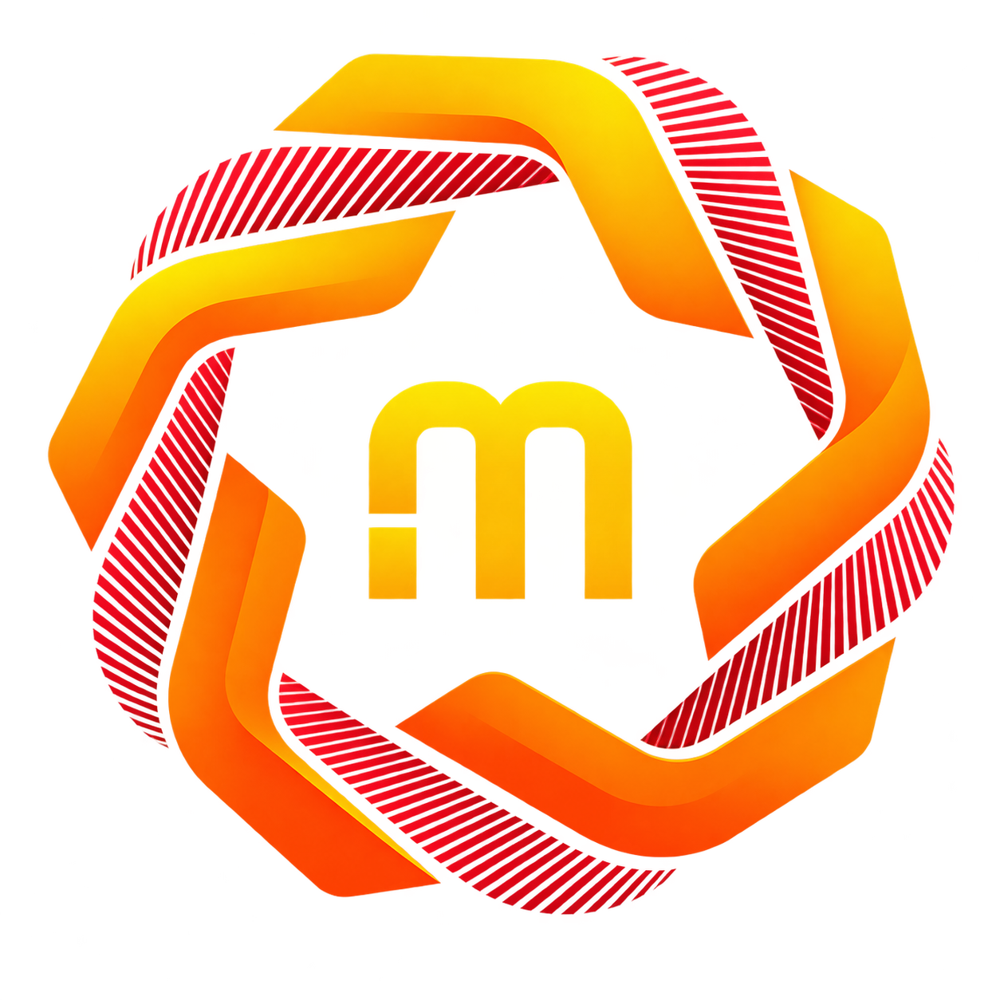
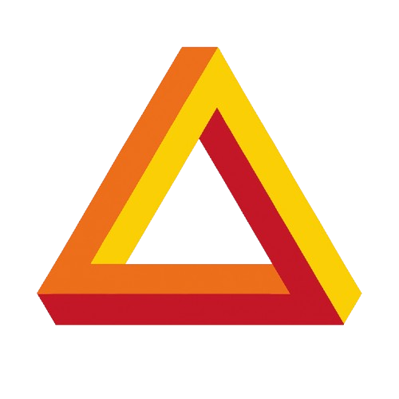

# Noxfort Monitor™ — Suíte de Documentação Técnica
### Arquitetura de Sistemas, Ingestão de Telemetria e Persistência Dual-Engine
*Noxfort Systems — A State Of Art Company*

---

🌐 **Idiomas / Translations:** **[🇺🇸 English](../en/README.md)** • **[🇧🇷 Português](README.md)** • **[🇪🇸 Español](../es/README.md)** • **[🇫🇷 Français](../fr/README.md)** • **[🇷🇺 Русский](../ru/README.md)** • **[🇨🇳 简体中文](../zh/README.md)** • **[📚 Central de Documentação](../README.md)**

---

## Bem-vindo à Documentação Técnica Oficial

Este diretório reúne toda a suíte de documentação técnica em **Português do Brasil** do **Noxfort Monitor™ v2.0** — ecossistema corporativo de observabilidade, ingestão de telemetria em tempo real e orquestração de resposta a incidentes desenvolvido em Go para sistemas distribuídos, agentes autônomos (**Carina**, **Synapse**) e nós de campo IoT.

## Índice de Guias Especializados

| Documento | Tema & Escopo | Principais Tópicos |
|---|---|---|
| 📖 **[Arquitetura do Sistema](architecture.md)** | Especificação Estrutural | Arquitetura Orientada a Eventos (EDA), concorrência via Goroutines, isolamento em camadas SOLID e injeção de dependência na raiz. |
| 📡 **[API e Protocolos de Ingestão](api_reference.md)** | Protocolos de Comunicação | Ingestão MQTT assíncrona (`:1883`), REST `POST /api/telemetry` (`:22100`), esquema JSON unificado `IncomingEvent` e rotas administrativas. |
| 🗄️ **[Banco de Dados e Dual-Engine](database.md)** | Persistência Relacional | Troca dinâmica a quente via `DBManager`, coexistência PostgreSQL & SQLite puro sem CGO, migração consistente e adaptadores de dialeto. |
| 🔐 **[Segurança, Autenticação e RBAC](security.md)** | Controle de Acesso | Controle de acesso por papéis (`RoleAdmin`, `RoleOperator`), hash criptográfico com sal, cookies de sessão e bootstrap idempotente. |
| 🌐 **[Acesso Remoto e WAN (DuckDNS & Ngrok)](remote_access.md)** | Conectividade WAN | Atualização de IP dinâmico DuckDNS, túnel reverso Ngrok ultrapassando firewalls/CGNAT e suporte a ingestão remota. |
| 🛡️ **[Proxy Reverso Caddy & DuckDNS](caddy_integration.md)** | Gateway HTTPS | Terminação TLS/SSL automática com desafio ACME DNS-01, tráfego unificado na porta 443 e WebSockets criptografados (`/mqtt`). |
| 🖥️ **[Aplicação Desktop e Headless](desktop_app.md)** | Interface e Operações | Runtime Wails v2 + WebKitGTK, trava de instância única via socket Unix IPC, bandeja do sistema (Systray) e modo daemon `--headless`. |
| 🔍 **[Trilha de Auditoria e SLA](audit_trail.md)** | Rastreabilidade e Compliance | Modelo de auditoria tripla: logs de acesso (`SecurityAuditLog`), conformidade de envio de alertas (`AlertDispatchLog`) e downtime de nós. |
| 🚀 **[Guia de Deploy em Produção](deployment.md)** | Implantação e DevOps | Serviço systemd dedicado em modo headless, proxy reverso NGINX/Caddy e empacotamento Debian `.deb`. |
| 🧪 **[Testes e Garantia de Qualidade](testing.md)** | Validação e Qualidade | Suíte de testes unitários com mocks em Go, verificação manual E2E com `mosquitto_pub` / `curl` e diagnósticos de canais. |
| 👨‍💻 **[Guia Avançado do Desenvolvedor](developer_guides.md)** | Engenharia e Extensibilidade | Ambiente local, convenções SOLID, repositórios recarregáveis (`DBManager`), novos canais e entidades. |
| 🔬 **[Notas de Pesquisa e Decisões Técnicas](research_notes.md)** | Registro Arquitetural (ADRs) | Histórico de decisões técnicas, eliminação de CGO, migração para Wails v2, DuckDNS e roadmap com gRPC. |

---

   
  <b>Noxfort Systems</b> — <i>A State Of Art Company</i> 
  <i>Telemetria Industrial & Observabilidade • Noxfort Monitor™ Server v2.0</i>

