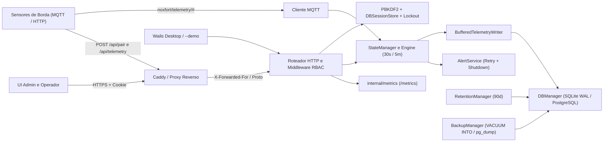

# Noxfort Monitor — Arquitetura do Sistema

O Noxfort Monitor adota uma arquitetura modular limpa em Go, unificando ingestão multiprotocolo, máquina de estados de dispositivos, despacho resiliente de alertas e persistência SQL de motor duplo em binários desktop (Wails) ou servidor headless.

---

## 1. Topologia de Alto Nível

---

## 2. Modos de Execução (`cmd/server/main.go`)

A raiz de composição (`cmd/server/main.go`) carrega variáveis via `LoadDotEnv()` (o antigo `configs/config.yaml` foi removido) e inicia um dos três modos:

* **Modo Desktop (Padrão)**: Executa o servidor embutido com janela nativa Wails e bandeja do sistema.
* **Servidor Headless (`--headless` / `--server-only`)**: Executa apenas os serviços HTTP e MQTT em segundo plano, com desligamento gracioso (`AlertService.Shutdown(shutdownCtx)`).
* **Modo Demonstração (`--demo`)**: Invoca `RunDesktopServer()` diretamente sem interface gráfica Wails para apresentações automatizadas (`make record-demo`).

---

## 3. Responsabilidades dos Subsistemas

1. **Ingresso e Segurança (`internal/transport/http`, `internal/security`)**:
   * **Sessões e Bloqueio**: `DBSessionStore` valida hashes `SHA-256` na tabela `sessions` (TTL de 24h, `?token=` rejeitado), enquanto `LoginAttemptTracker` aplica bloqueio após 5 falhas em 15m (`429`).
   * **RBAC Consciente de Proxy**: `ExtractClientIP` e `IsHTTPSRequest` respeitam `TRUSTED_PROXIES` + `MONITOR_USE_HTTPS`. O perfil `OPERATOR` é estritamente somente leitura (`403` JSON em APIs; `web/templates/forbidden.html` na UI), com permissão apenas para autoatendimento `POST /api/users/password`.
2. **Ingestão de Borda (`internal/transport/mqtt`, `telemetry_handler.go`)**:
   * **MQTT**: Assina `noxfort/telemetry/#`, aplica `MONITOR_MQTT_STRICT` (padrão `true`), tenta reconectar a cada 5s na inicialização e suporta `Reconnect(brokerURL)` ao salvar `/settings`.
   * **HTTP Zero-Trust**: `POST /api/pair` enfileira até 50 dispositivos `PENDING` (`202` sem retornar segredo; `409` se já `ACTIVE`); `POST /api/telemetry` exige `X-Device-Token` / `Bearer`, `X-Device-Origin` e janela `±300s` em `occurred_at`.
3. **Motor de Monitoramento, Buffer e Alertas (`internal/monitor`, `internal/storage`)**:
   * `BufferedTelemetryWriter` grava telemetria em lote assíncrono, oferecendo também `SaveEventReturningID` síncrono em transições que disparam alertas (`TriggerAlertWithTelemetryID`).
   * `StateManager` respeita dispositivos `PAUSED` (Modo Manutenção); `Engine` roda a cada `30s` (limiar offline de `5m` + `CleanupExpiredPending()`).
   * `AlertService` envia notificações Telegram, E-mail (TLS implícito na porta 465 + sanitização CRLF) e Webhooks com retentativas (`500ms`, `1500ms`) e drenagem no encerramento.
4. **Persistência, Backups, Retenção e Métricas (`internal/storage`, `internal/metrics`)**:
   * `DBManager` alterna SQLite (`WAL`) e PostgreSQL via `SetDB(db *sql.DB, driver string)` nos 7 `ReloadableRepository`, usando `MigrateData` em transação única nas 9 tabelas.
   * `BackupManager` agenda backups quentes (`MONITOR_BACKUP_INTERVAL_HOURS=24`, mantendo 7) e restauração (`PRAGMA quick_check` / `pg_restore`); `RetentionManager` limpa dados antigos (`MONITOR_RETENTION_DAYS=90`); `/metrics` expõe contadores Prometheus.
