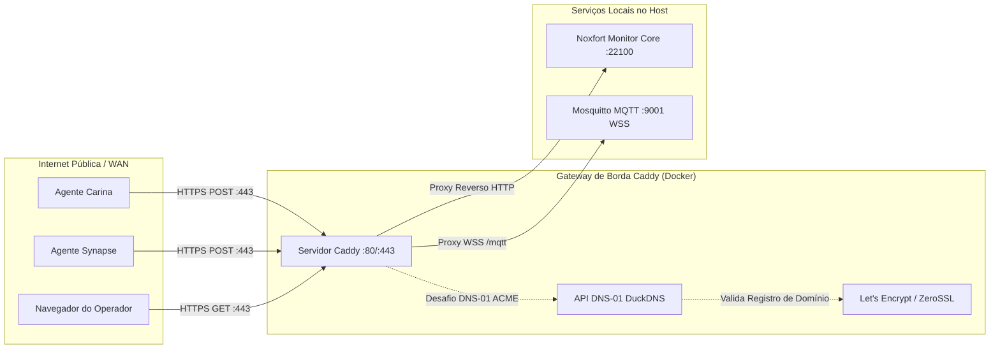

# 🛡️ Proxy Reverso Caddy & DuckDNS (HTTPS Automático): Noxfort Monitor™

Este documento descreve a arquitetura, implantação e operação do **Caddy Server** integrado com **DuckDNS** no **Noxfort Monitor™ v2.0**. Essa topologia fornece terminação TLS/SSL automática de nível corporativo via **desafio ACME DNS-01**, eliminando transmissões em texto puro na WAN e expondo as portas padrão (`80`, `443` e `WSS`).

⬅️ [Central de Documentação](README.md) | 🌐 [Acesso Remoto](remote_access.md) | 🚀 [Implantação](deployment.md) | 📡 [API](api_reference.md)

---

## 1. Visão Geral da Arquitetura

Em redes industriais de observabilidade e telemetria, agentes remotos de campo (como **Synapse**, **Carina** ou sensores IoT externos) transmitem dados através da rede pública. Expor HTTP sem criptografia em portas não convencionais (ex: `:22100`) gera vulnerabilidades severas e bloqueios em firewalls corporativos.



### Principais Vantagens:
1. **HTTPS com Zero Configuração Manual**: O Caddy solicita e renova automaticamente certificados TLS válidos junto ao Let's Encrypt e ZeroSSL.
2. **Validação ACME DNS-01**: Ao contrário dos desafios HTTP-01, o DNS-01 **não exige** porta 80 aberta na máquina para emitir ou renovar certificados. A validação é realizada via chamadas seguras à API do DuckDNS.
3. **WebSockets Criptografados (WSS)**: Habilita MQTT-sobre-WebSockets seguro via `wss://seu-dominio.duckdns.org/mqtt`.
4. **Padronização nas Portas Web Padrão**: Centraliza todo o tráfego externo na porta 443 (HTTPS), sem necessidade de abrir a porta `:22100` publicamente.

---

## 2. Estrutura do Subsistema

O gateway de borda Caddy reside no diretório `caddy/`:

```text
MONITOR_CORE/
├── caddy/
│   ├── Dockerfile         # Build multi-estágio com plugin caddy-dns/duckdns
│   └── Caddyfile          # Regras de proxy reverso e TLS automático
├── docker-compose.yml     # Orquestração do Mosquitto e Caddy
└── .env                   # Variáveis de ambiente (token, domínio e email)
```

---

## 3. Configuração e Inicialização

### 3.1 Configuração do `.env`
Defina as credenciais do DuckDNS no seu arquivo `.env`:

```env
# Subdomínio DuckDNS (ex: 'meu-monitor' para meu-monitor.duckdns.org)
DUCKDNS_DOMAIN=meu-subdominio

# Token da conta no duckdns.org
DUCKDNS_TOKEN=xxxxxxxx-xxxx-xxxx-xxxx-xxxxxxxxxxxx

# E-mail para notificações de expiração do Let's Encrypt
ACME_EMAIL=admin@minha-empresa.com

# Formatação de URLs públicas em HTTPS
MONITOR_USE_HTTPS=true
```

### 3.2 Construir o Contêiner do Caddy
Compile a imagem personalizada com o plugin do DuckDNS:

```bash
make caddy-build
```

### 3.3 Inicializar os Serviços de Borda
Inicie o Mosquitto e o Caddy em segundo plano via Docker Compose:

```bash
make services-start
```

Para verificar os logs de emissão de certificados:
```bash
make services-logs
```

Para parar os serviços:
```bash
make services-stop
```
