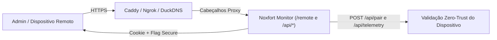

# Noxfort Monitor — Acesso Remoto e Túneis

O Noxfort Monitor integra conectividade remota nativa via DNS dinâmico **DuckDNS** e túneis **Ngrok**, gerenciados na página `/remote` com mascaramento de credenciais e controle RBAC rigoroso.

---

## 1. Controle de Acesso e Redação de Segredos em `/remote`

* **Aplicação de Perfis (RBAC)**:
  * `ADMIN`: Pode visualizar o status, atualizar configurações de DuckDNS/Ngrok e ativar ou parar túneis.
  * `OPERATOR`: Limitado a visualização somente leitura em `GET /remote`; tentativas de alteração retornam `403 Forbidden` (JSON na API ou `forbidden.html` na UI).
* **Proteção de Credenciais**: Segredos como `duckdns_token` e tokens do Ngrok são **mascarados no HTML renderizado**. Ao salvar alterações parciais, tokens não editados são preservados com segurança no banco de dados.
* **Auditoria**: Alterações de configuração e acionamento de túneis gravam eventos `TUNNEL_*` em `security_audit_logs` com usuário e `ip_address`.

---

## 2. Fluxo de Conectividade

---

## 3. Boas Práticas para Borda Remota

1. Mantenha `MONITOR_USE_HTTPS=true` e `TRUSTED_PROXIES` configurados ao expor o serviço em túneis ou domínios públicos.
2. Dispositivos remotos solicitam pareamento em `https://<seu-dominio>/api/pair` com `{"origin":"...","name":"..."}` (`202 Accepted`, máximo de 50 pendentes; `409 Conflict` se já ativo).
3. Copie a chave `nox_live_` (TTL de 5 minutos) em `/devices` e configure o gateway remoto para enviar `X-Device-Token` e `X-Device-Origin` em `POST /api/telemetry`.
4. Utilize `MQTTS` (TLS) ou VPN para tráfego MQTT externo e mantenha `MONITOR_MQTT_STRICT=true` para impedir auto-registro indevido.
