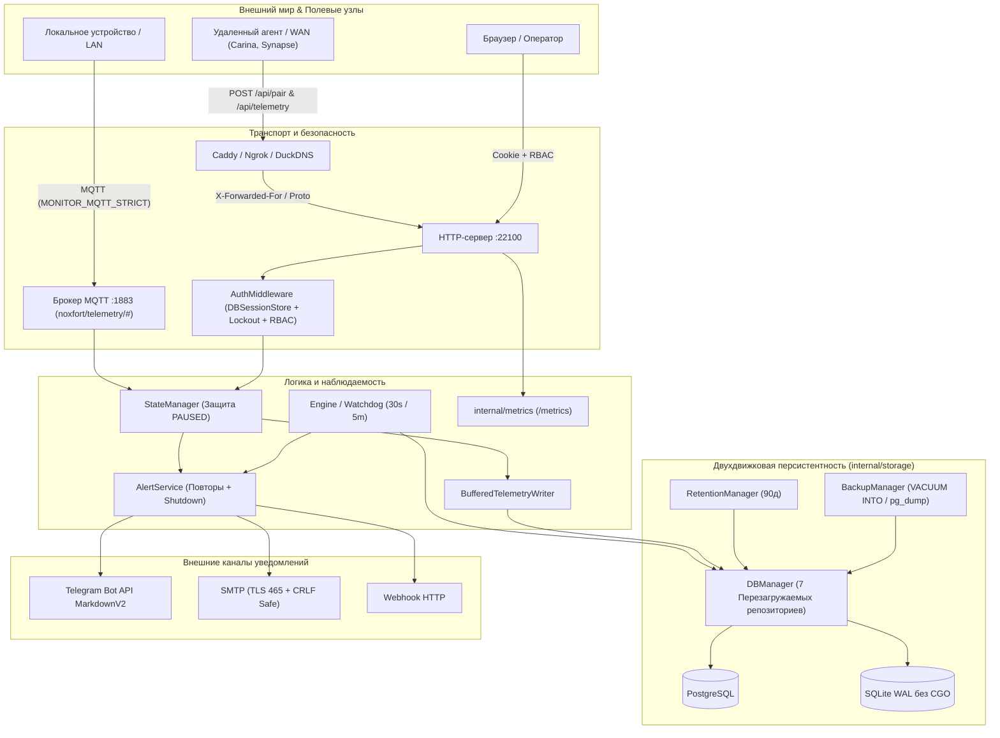

# 🏛️ Noxfort Monitor™: Архитектура системы и параллелизм

Данный документ описывает внутреннюю архитектуру **Noxfort Monitor™ v2.0**: событийно-ориентированную модель (EDA), конкурентность на горутинах, Zero-Trust сопряжение, двухдвижковую персистентность и композицию в точке входа.

⬅️ [Главный Хаб](../README.md) | 📡 [Справочник API](api_reference.md) | 🗄️ [База данных](database.md) | 🔐 [Безопасность](security.md) | 🧪 [Тестирование](testing.md)

---

## 1. Философия архитектуры

Noxfort Monitor следует **Событийно-Ориентированной Архитектуре (EDA)**, принципам **SOLID** и **Внедрению Зависимостей (DI)** в [`cmd/server/main.go`](../../cmd/server/main.go). Начальные настройки загружаются из `.env` через `LoadDotEnv()` (`configs/config.yaml` удален), без скрытого глобального состояния.

---

## 2. Изоляция подсистем по слоям

1. **Транспортный уровень (`internal/transport`)**: Клиент MQTT (`noxfort/telemetry/#`, политика `MONITOR_MQTT_STRICT`, переподключение 5с при старте и горячий `Reconnect(brokerURL)`) и HTTP REST (`:22100`) с `AuthMiddleware`, `/api/pair`, `/api/telemetry` и `/metrics`.
2. **Уровень мониторинга и оповещений (`internal/monitor`)**: `StateManager` (игнорирование `PAUSED` в режиме обслуживания и синхронный `SaveEventReturningID`), `Engine` (тик `30s`, таймаут `5m`, `CleanupExpiredPending()`) и `AlertService` (`500ms`/`1500ms` backoff + `Shutdown(ctx)`).
3. **Уровень безопасности (`internal/security`)**: `PBKDF2Hasher` (`100 000` итераций), `LoginAttemptTracker` (5 ошибок/15м $\rightarrow$ блокировка 5м с кодом `429`), `DBSessionStore` (`SHA-256` в таблице `sessions`, 24ч), проверка прокси (`TRUSTED_PROXIES`, `MONITOR_USE_HTTPS`) и строгий RBAC (`OPERATOR` только чтение + смена своего пароля).
4. **Уровень удаленного доступа (`internal/tunnel`)**: Драйверы DuckDNS и Ngrok для `/remote` с маскировкой секретов в HTML.
5. **Уровень хранения (`internal/storage`)**: `DBManager` для SQLite WAL и PostgreSQL, `7` `ReloadableRepository` (включая `DBSessionStore`), единый транзакционный `MigrateData` (9 таблиц), `BufferedTelemetryWriter`, `BackupManager` (расписание/скачивание/восстановление) и `RetentionManager` (`MONITOR_RETENTION_DAYS=90`).
6. **Десктоп, Demo и Метрики (`internal/desktop`, `internal/tray`, `internal/metrics`)**: Wails v2 + WebKitGTK, блокировка единого экземпляра через сокет Unix IPC, режимы `--demo` (`RunDesktopServer()`) и `--headless`, и экспорт Prometheus (`/metrics`).

---

## 3. Параллелизм и корректное завершение

* **Главный поток**: Десктоп (`desktopApp.Run()`), `--demo` (`RunDesktopServer()`) или `--headless` / `--server-only` (ожидание `SIGINT`/`SIGTERM`).
* **Фоновые горутины (`bgCtx`)**: HTTP `:22100`, клиент MQTT, `BufferedTelemetryWriter`, `Engine` (`30s`), ежечасная очистка `sessions`, `RetentionManager` (24ч) и плановые бэкапы (`MONITOR_BACKUP_INTERVAL_HOURS`).
* **Корректный останов (`AlertService.Shutdown`)**: Дренирует очередь оповещений до закрытия соединений с БД и MQTT.
