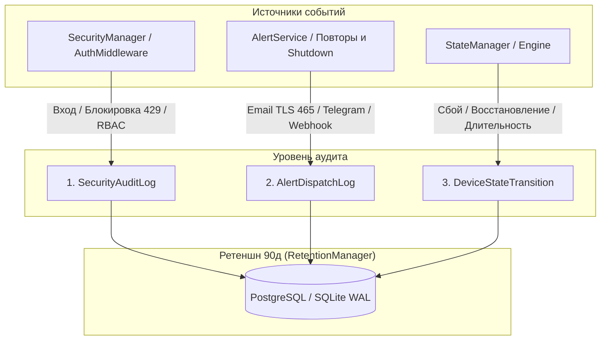

# 🔍 Аудиторский след и наблюдаемость

Данный документ описывает подсистему аудита **Noxfort Monitor™ v2.0**: журналирование безопасности, доставку оповещений со связью с телеметрией и историю переходов состояний, доступные пользователям `Operator+` через `/audit` и `/api/audit/*`.

⬅️ [Главный Хаб](../README.md) | 🏛️ [Архитектура](architecture.md) | 🔐 [Безопасность](security.md)

---

## 1. Архитектура тройного аудита

---

## 2. Модели и точная спецификация полей (`internal/domain/audit.go`)

### 2.1 `SecurityAuditLog` (`security_audit_logs`)
* `id` (*int64*): Уникальный первичный ключ.
* `created_at` (*timestamp*): Время события UTC.
* `username` (*string*): Инициатор или целевой пользователь.
* `action` (*string*): Идентификатор (`AUTH_LOGIN_SUCCESS`, `AUTH_LOGIN_FAILED`, `AUTH_LOGIN_LOCKED`, `USER_CREATE`, `USER_PASSWORD_CHANGED`, `USER_ROLE_UPDATED`, `USER_UNLOCKED`, `USER_DELETE`, `DEVICE_*`, `CONTACT_*`, `SETTINGS_UPDATED`, `TUNNEL_*`, `DATABASE_*`, `POSTGRES_USER_PROVISIONED`).
* `details` (*string*): Контекст и результат операции.
* `ip_address` (*string*): Реальный IP-адрес клиента через `ExtractClientIP` и `TRUSTED_PROXIES`.

### 2.2 `AlertDispatchLog` (`alert_dispatch_logs`)
Фиксирует каждую попытку доставки в `AlertService` (повторы `500ms`, `1500ms`, сброс при `Shutdown`):
* `id` (*int64*): Уникальный ключ.
* `telemetry_id` (*int64*): Прямая ссылка на `telemetry.id`, полученная через `SaveEventReturningID`.
* `channel` (*string*): `telegram`, `email` или `webhook`.
* `recipient` (*string*): Адресат уведомления.
* `role` (*string*): Уведомляемая роль.
* `status` (*string*): Статус доставки.
* `error_reason` (*string*): Текст ошибки при сбое.
* `dispatched_at` (*timestamp*): Время попытки отправки.

### 2.3 `DeviceStateTransition` (`device_state_transitions`)
Фиксирует переходы, определяемые каждые `30s` (порог недоступности `5m`):
* `id` (*int64*): Уникальный ключ.
* `device_identifier` (*string*): Идентификатор устройства.
* `previous_state` (*string*): Предыдущее состояние.
* `new_state` (*string*): Новое состояние.
* `duration_offline_sec` (*int64*): Суммарная длительность простоя при восстановлении.
* `transition_at` (*timestamp*): Момент фиксации перехода.

---

## 3. Доступ и автоочистка
* **Права доступа**: Пользователи `ADMIN` и `OPERATOR` имеют доступ на чтение к `/audit` и `/api/audit/{security,alerts,transitions}`.
* **Срок хранения**: `RetentionManager` каждые 24ч удаляет записи старше `MONITOR_RETENTION_DAYS` (`90` дней по умолчанию) из этих трех таблиц и `telemetry`.
