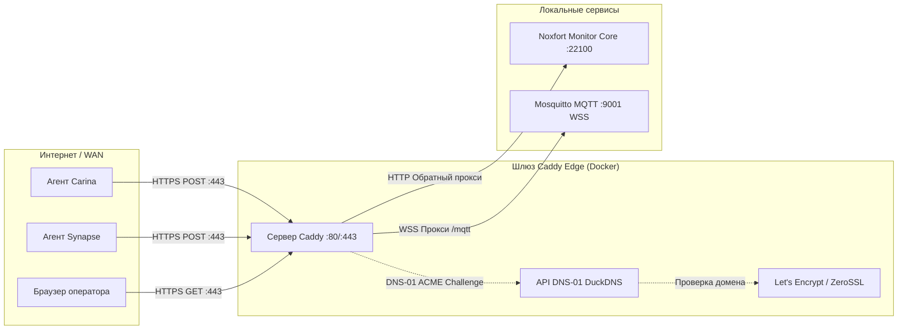

# 🛡️ Обратный прокси Caddy и DuckDNS (Автоматический HTTPS): Noxfort Monitor™

В данном документе описывается архитектура, развертывание и эксплуатация **Caddy Server**, интегрированного с **DuckDNS** в **Noxfort Monitor™ v2.0**. Данная конфигурация обеспечивает автоматическую терминацию TLS/SSL корпоративного уровня через **DNS-01 ACME challenge**, исключая передачу открытого текста через WAN и открывая стандартные порты (`80`, `443` и `WSS`).

⬅️ [Центр документации](README.md) | 🌐 [Удаленный доступ](remote_access.md) | 🚀 [Развертывание](deployment.md) | 📡 [Справочник API](api_reference.md)

---

## 1. Обзор архитектуры



### Ключевые преимущества:
1. **HTTPS без ручной настройки**: Caddy автоматически запрашивает и обновляет действующие сертификаты.
2. **Проверка DNS-01 ACME**: Не требует открытия входящего 80 порта.
3. **Безопасные веб-сокеты (WSS)**: Шифрованный MQTT через `wss://ваш-домен.duckdns.org/mqtt`.
4. **Стандартные веб-порты**: Централизация трафика на 443 порту без открытия `:22100`.

---

## 2. Развертывание

```bash
make caddy-build
make services-start
make services-logs
make services-stop
```
