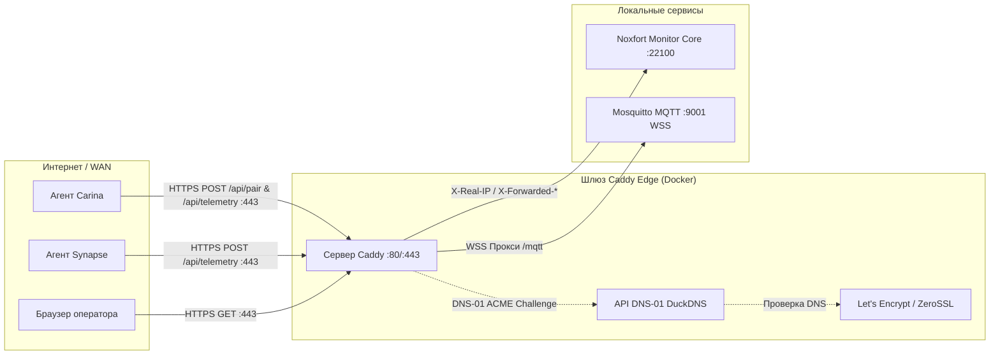

# 🛡️ Обратный прокси Caddy и DuckDNS (Автоматический HTTPS): Noxfort Monitor™

Документ описывает развертывание **Caddy Server** ([`caddy/Caddyfile`](../../caddy/Caddyfile)) с **DuckDNS** перед **Noxfort Monitor™ v2.0**: автоматический TLS через **ACME DNS-01**, шифрованные веб-сокеты (`/mqtt`) и доверенная передача заголовков прокси на порт `:22100`.

⬅️ [Центр документации](README.md) | 🌐 [Удаленный доступ](remote_access.md) | 🚀 [Развертывание](deployment.md) | 📡 [Справочник API](api_reference.md)

---

## 1. Обзор архитектуры



---

## 2. Настройка `TRUSTED_PROXIES` и `MONITOR_USE_HTTPS`

`caddy/Caddyfile` передает `X-Real-IP`, `X-Forwarded-For` и `X-Forwarded-Proto`:

1. Укажите IP или подсеть Caddy/Docker в `TRUSTED_PROXIES` (например, `TRUSTED_PROXIES=127.0.0.1/32,172.16.0.0/12`).
2. Установите `MONITOR_USE_HTTPS=true`, чтобы сессионные cookie получали атрибут `Secure`.

Тогда `ExtractClientIP` фиксирует реальный IP клиента в `LoginAttemptTracker` и `SecurityAuditLog`, а `IsHTTPSRequest` корректно распознает HTTPS-терминацию.

---

## 3. Развертывание и проверка Zero-Trust через Caddy

```bash
make caddy-build
make services-start
make services-logs
make services-stop
```

```bash
# 1. Предварительное Zero-Trust сопряжение (202 Accepted без ключа API)
curl -X POST https://vash-domen.duckdns.org/api/pair \
  -H "Content-Type: application/json" \
  -d '{"origin":"carina-01","name":"Carina Edge 01"}'

# 2. После подтверждения в /devices скопируйте токен nox_live_ (TTL 5м) и отправьте телеметрию:
curl -X POST https://vash-domen.duckdns.org/api/telemetry \
  -H "Content-Type: application/json" \
  -H "X-Device-Token: nox_live_vash_token" \
  -H "X-Device-Origin: carina-01" \
  -d '{"category":"HARDWARE","origin":"carina-01","level":"INFO","message":"System OK","occurred_at":"'"$(date -u +%Y-%m-%dT%H:%M:%SZ)"'"}'
```
