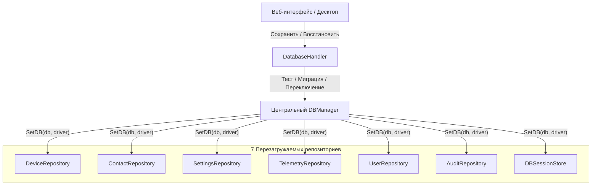

# 🗄️ База данных и двухдвижковая персистентность

Данный документ описывает слой хранения данных **Noxfort Monitor™ v2.0**: работу PostgreSQL и SQLite (режим WAL), горячее переключение (`DBManager`), транзакционную миграцию 9 таблиц, резервное копирование/восстановление и автоматическое удаление устаревших данных.

⬅️ [Главный Хаб](../README.md) | 🏛️ [Архитектура](architecture.md) | 📡 [API](api_reference.md) | 🔐 [Безопасность](security.md)

---

## 1. Сосуществование двух СУБД и режим WAL

Оба диалекта поддерживают идентичную схему из **9 таблиц и 12 индексов**:

| Параметр | SQLite (Чистый Go, режим WAL) | PostgreSQL |
|---|---|---|
| **Go-драйвер** | `modernc.org/sqlite` (без CGO) | `github.com/lib/pq` |
| **Настройки** | `journal_mode=WAL`, `synchronous=NORMAL`, `busy_timeout=5000` | Выделенная схема (`schema_monitor`) |
| **Сценарий** | Локальные узлы, автономные шлюзы | Промышленные серверы, высокая нагрузка |
| **Файл / Хост** | `~/Documentos/Monitor/monitor_logs.db` | TCP-сервер (порт `5432`) |
| **Зависимости** | Нет (встроен в бинарный файл Go) | PostgreSQL 12+ |

---

## 2. Горячая перезагрузка (`DBManager`)



Каждый репозиторий реализует интерфейс `ReloadableRepository`:

```go
type ReloadableRepository interface {
    SetDB(db *sql.DB, driver string)
}
```

---

## 3. Единая транзакционная миграция (`MigrateData`)

При переключении SQLite $\leftrightarrow$ PostgreSQL:
1. `Migrator.MigrateData` переносит все **9 таблиц** (`devices` с `api_key`, `status`, `expires_at`, `telemetry` с `device_id`, `settings`, `contacts`, `users`, `sessions`, `security_audit_logs`, `alert_dispatch_logs`, `device_state_transitions`) внутри **одной SQL-транзакции**.
2. Запросы адаптируются через `storage.AdaptQuery()`.
3. При любой ошибке транзакция полностью откатывается, а `DBManager.Switch` прерывается, исключая частичное состояние (*split-brain*).

---

## 4. Горячие резервные копии, восстановление и хранение данных

* **Резервные копии (`BackupManager`)**: `VACUUM INTO` (SQLite) и `pg_dump -F c` (PostgreSQL). `BackupManager.StartScheduledBackups` работает по расписанию `MONITOR_BACKUP_INTERVAL_HOURS` (по умолчанию `24ч`), храня до **`7`** копий.
* **Скачивание и восстановление**:
  * `GET /api/settings/database/backups/download` защищен функцией `ResolveBackupPath`.
  * `POST /api/settings/database/restore` проверяет SQLite командой `PRAGMA quick_check` перед `RestoreSQLiteFile`, либо применяет `pg_restore` для PostgreSQL.
* **Автоочистка (`RetentionManager`)**: Каждые **`24` часа** удаляет записи старше `MONITOR_RETENTION_DAYS` (по умолчанию **`90` дней**) из `telemetry`, `alert_dispatch_logs`, `security_audit_logs` и `device_state_transitions`.
