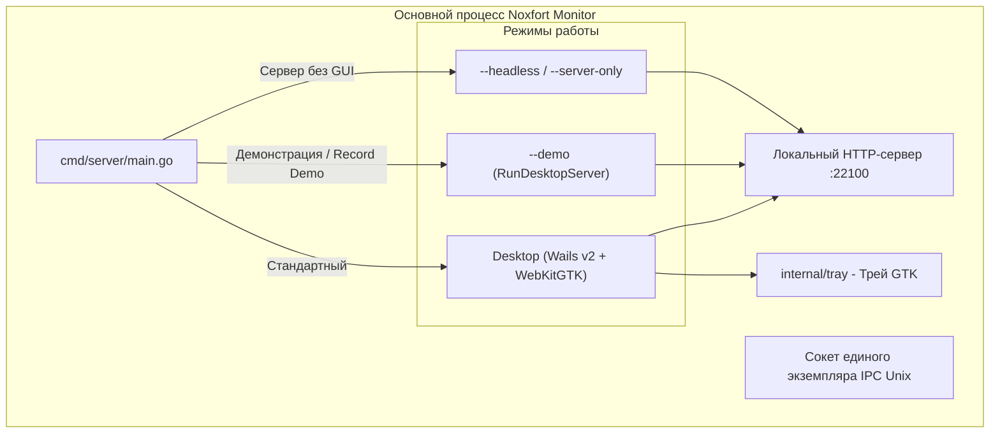

# 🖥️ Десктопное приложение и режимы работы (Wails v2, `--demo` и `--headless`)

Документ описывает режимы запуска **Noxfort Monitor™ v2.0** из [`cmd/server/main.go`](../../cmd/server/main.go): нативный десктоп **Wails v2 + WebKitGTK**, режим презентации `--demo`, серверный режим `--headless` / `--server-only` и встроенные средства UI-безопасности.

⬅️ [Главный Хаб](../README.md) | 🏛️ [Архитектура](architecture.md) | 🚀 [Развертывание](deployment.md)

---

## 1. Режимы запуска

* **Desktop (по умолчанию)**: Окно 1280x800 px (мин. 1024x600), `HideWindowOnClose: true`, блокировка второго запуска через `/tmp/noxfort-monitor-singleinstance.sock`.
* **Режим `--demo`**: Запускает `RunDesktopServer()` без графического окна Wails для демонстраций и записи (`make record-demo`).
* **Режим `--headless` / `--server-only`**: Работает без X11/Wayland/GTK в ожидании сигналов `SIGINT`/`SIGTERM`.

---

## 2. Возможности интерфейса и безопасность

* **Живой опрос дашборда (`/api/dashboard/summary`)**: Обновляется каждые **10 секунд**, отображая сводку и устройства в 5 состояниях: `ONLINE`, `OFFLINE`, `PENDING`, `PAUSED` и `WAITING`.
* **Экран `403 Forbidden` в приложении**: Если пользователь с ролью `OPERATOR` (только чтение) открывает административные страницы (например, `/users`), вместо сырого JSON отображается шаблон [`web/templates/forbidden.html`](../../web/templates/forbidden.html).
* **Смена собственного пароля**: Любой авторизованный пользователь, включая `OPERATOR`, может сменить свой пароль через `POST /api/users/password` (с проверкой `current_password`).
* **Маскировка секретов**: В `/devices` новый API-ключ (`nox_live_`) показывается только один раз; последующие загрузки скрывают `ApiKey`, `duckdns_token` и другие секреты.
* **Корректное завершение**: Отмена `bgCtx` останавливает `RetentionManager`, плановые бэкапы и очистку `sessions`, после чего `AlertService.Shutdown(shutdownCtx)` завершает отправку активных уведомлений.
