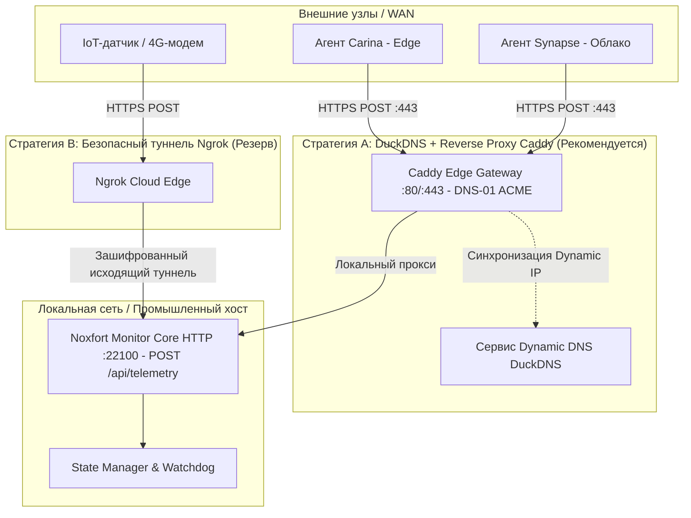

# 🌐 Удаленный доступ и WAN-телеметрия (DuckDNS и Ngrok)

Данный документ описывает сетевую архитектуру глобального подключения (WAN) **Noxfort Monitor™ v2.0**, включая динамическое обновление DNS через **DuckDNS**, автоматическое завершение HTTPS через **Caddy Server** и резервный обратный туннель через **Ngrok** для внешнего сбора телеметрии (**Carina**, **Synapse**, IoT-датчики).

⬅️ [Главный Хаб](../README.md) | 🏛️ [Архитектура](architecture.md) | 📡 [API](api_reference.md) | 🚀 [Развертывание](deployment.md)

---

## 1. Стратегии WAN-подключения

Noxfort Monitor предоставляет две взаимодополняющие стратегии для преодоления межсетевых экранов и NAT:



1. **DuckDNS + Caddy (Основная / Рекомендуемая)**:
   - Синхронизирует персональный субдомен (`vash-domen.duckdns.org`) с публичным IPv4/IPv6 сервера.
   - [Caddy Server](caddy_integration.md) автоматически получает доверенные сертификаты TLS через **DNS-01 ACME challenge** без необходимости открывать входящий порт 80.
   - Стандартизирует внешний трафик на портах 80 и 443 с шифрованными веб-сокетами (`/mqtt`).
2. **Обратный туннель Ngrok (Резерв без проброса портов)**:
   - Устанавливает исходящий TLS-туннель для узлов в сетях со строгим CGNAT оператора связи, где port forwarding невозможен.

---

## 2. Архитектура драйвера (`internal/tunnel`)

Подсистема туннелирования реализует Принцип Инверсии Зависимостей (DIP):
```go
type Service interface {
    Start(authToken, domain string) error
    Stop() error
    GetStatus() Status
    IsBinaryAvailable() bool
    TestConnection(ctx context.Context, token, domain string) (*TestResult, error)
}
```

* **`DuckDNSDriver`**: Отправляет обновления динамического DNS через HTTP API, определяет системный IPv6 и выполняет диагностику разрешения домена по запросу (`POST /api/tunnel/test`).
* **`NgrokDriver`**: Управляет дочерним процессом клиента `ngrok` и отслеживает состояние туннеля.
* **Сохранение в БД**: Конфигурация WAN хранится в таблице `settings` (`duckdns_token`, `duckdns_domain`, `duckdns_enabled` и параметры Ngrok).
* **Эндпоинты API**:
  * `GET /api/tunnel/status`: Возвращает статус, провайдера, публичные URL и IPv6.
  * `POST /api/tunnel/save`: Сохраняет параметры DuckDNS или Ngrok.
  * `POST /api/tunnel/start`: Инициирует синхронизацию DNS или запускает туннель.
  * `POST /api/tunnel/stop`: Останавливает обновления WAN и отключает автостарт.
  * `POST /api/tunnel/disconnect`: Удаляет учетные данные из БД и завершает работу сервиса.
  * `POST /api/tunnel/test`: Проверяет токен DuckDNS и разрешение домена в реальном времени.
