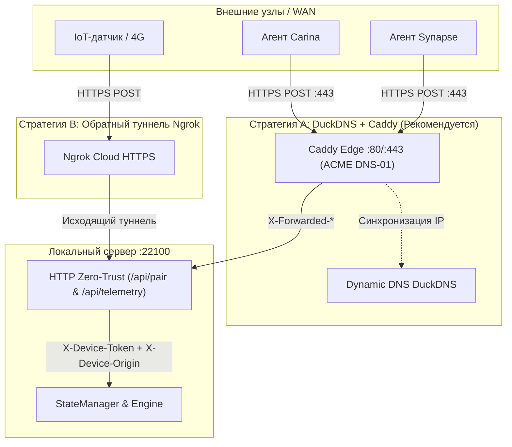

# 🌐 Удаленный доступ и WAN-телеметрия (DuckDNS и Ngrok)

Документ описывает организацию удаленного доступа (WAN) в **Noxfort Monitor™ v2.0** через **DuckDNS + Caddy** и **Ngrok**, с управлением в `/remote`, строгим RBAC и маскировкой секретов.

⬅️ [Главный Хаб](../README.md) | 🏛️ [Архитектура](architecture.md) | 📡 [API](api_reference.md) | 🚀 [Развертывание](deployment.md)

---

## 1. Стратегии WAN-подключения



---

## 2. Права доступа на `/remote` и маскировка секретов

* **Модель RBAC**:
  * `ADMIN`: Настраивает провайдеров и вызывает `/api/tunnel/{save,start,stop,disconnect,test}`.
  * `OPERATOR`: Доступ **только для чтения** на `GET /remote` и `GET /api/tunnel/status`; попытки изменения отклоняются с `403 Forbidden` (`forbidden.html` в UI или JSON для API).
* **Защита токенов**: `duckdns_token` и ключи Ngrok маскируются в HTML `/remote`. Частичное сохранение настроек сохраняет существующие секреты в БД без перезаписи маской.
* **Аудит**: Изменения конфигурации и запуск/остановка туннеля записывают события `TUNNEL_*` в `security_audit_logs`.

---

## 3. Интерфейс драйвера (`internal/tunnel`) и WAN Zero-Trust

```go
type Service interface {
    Start(authToken, domain string) error
    Stop() error
    GetStatus() Status
    IsBinaryAvailable() bool
    TestConnection(ctx context.Context, token, domain string) (*TestResult, error)
}
```

* При работе через WAN задайте `MONITOR_USE_HTTPS=true`, настройте `TRUSTED_PROXIES`, используйте цикл `/api/pair` $\rightarrow$ подтверждение в `/devices` $\rightarrow$ `X-Device-Token` + `X-Device-Origin` в `/api/telemetry`, и оставьте `MONITOR_MQTT_STRICT=true`.
