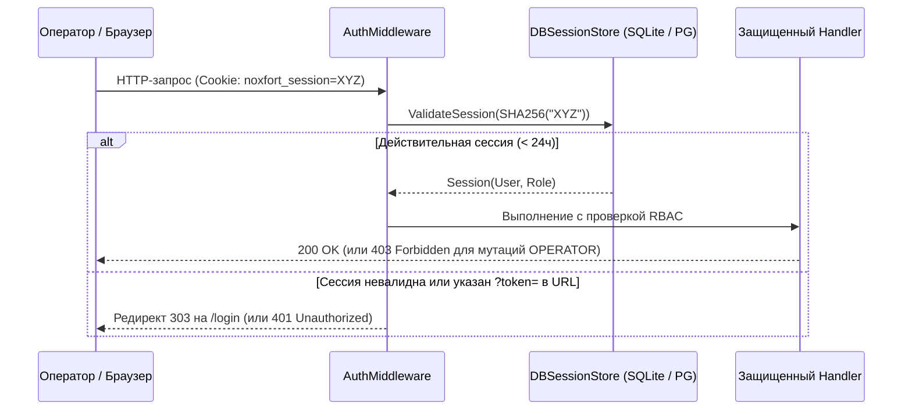

# 🔐 Безопасность, аутентификация и контроль доступа (RBAC)

Данный документ описывает эшелонированную защиту **Noxfort Monitor™ v2.0**: строгий RBAC, хеширование PBKDF2, защиту от подбора паролей, постоянные хешированные сессии, доверенные прокси, Zero-Trust сопряжение устройств и защиту каналов оповещений.

⬅️ [Главный Хаб](../README.md) | 🏛️ [Архитектура](architecture.md) | 🔍 [Аудит](audit_trail.md) | 📡 [API](api_reference.md)

---

## 1. Модель RBAC и разграничение ролей

* **`ADMIN`**: Полные права (управление устройствами и ротацией ключей, пользователями/ролями/разблокировкой, контактами, системными/MQTT-настройками, туннелями и резервным копированием/восстановлением/миграцией БД). Суперпользователь и последний администратор защищены от удаления (`DeleteUserByActor`).
* **`OPERATOR` (Строго только чтение)**: Разрешены только `GET`-просмотры (дашборд, `/audit`, `/api/audit/*`, `/remote`, `/server`, `/settings`), `/api/auth/logout` и самостоятельная смена пароля (`POST /api/users/password` при указании `current_password`). Запрещены `/users`, изменения `/api/users`, `/api/settings/database/backup*` и любые мутации:
  * Запросы API/XHR (`/api/*`, `Accept: application/json`, `XMLHttpRequest`) получают JSON **`403 Forbidden`**.
  * Веб-интерфейс и десктоп отображают страницу [`web/templates/forbidden.html`](../../web/templates/forbidden.html).

---

## 2. Политика паролей и PBKDF2

* **PBKDF2 HMAC-SHA256**: [`PBKDF2Hasher`](../../internal/security/hasher.go) использует **PBKDF2 HMAC-SHA256** (`100 000` итераций, случайная соль `16` байт `crypto/rand`, производный ключ `32` байта).
* **Сложность (`ValidatePasswordComplexity`)**: Минимум 8 символов, цифра, заглавная и строчная буквы и спецсимвол; фронтенд-индикатор [`web/static/js/password_meter.js`](../../web/static/js/password_meter.js) проверяет требования до отправки формы.

---

## 3. Защита от перебора (`LoginAttemptTracker`)

* Неудачные попытки входа в `POST /api/auth/login` считаются по составному ключу `username|ip` (`ExtractClientIP`).
* **Блокировка**: **`5` ошибок** за **`15` минут** вызывают блокировку на **`5` минут** с ответом HTTP **`429 Too Many Requests`** и записью `AUTH_LOGIN_LOCKED`.
* Администратор может снять блокировку досрочно через `POST /api/users/unlock`.

---

## 4. Постоянные хешированные сессии и доверенные прокси

* **`DBSessionStore`**: Сессии сохраняются в таблице `sessions` в виде хеша **`SHA-256` (`token_hash`)** с **TTL `24` часа** и ежечасной фоновой очисткой. Реализация `ReloadableRepository` сохраняет сессии при горячем переключении SQLite $\leftrightarrow$ PostgreSQL.
* **Запрет `?token=`**: `ExtractSessionToken` принимает токен только из HTTP-only cookie и отклоняет параметры `?token=` в URL.
* **`TRUSTED_PROXIES` и `MONITOR_USE_HTTPS`**: `ExtractClientIP` и `IsHTTPSRequest` доверяют заголовкам `X-Real-IP`, `X-Forwarded-For` и `X-Forwarded-Proto` (`caddy/Caddyfile`) только от прокси из `TRUSTED_PROXIES`, обеспечивая флаг `Secure` на cookie и корректные IP в аудите.

---

## 5. Защита периметра, маскировка в HTML и SMTP/MQTT

* **Zero-Trust сопряжение**: `POST /api/pair` регистрирует узел как `PENDING` (лимит 50, `409 Conflict` если уже `ACTIVE`) с ответом `202` без выдачи ключа; `POST /api/telemetry` проверяет `X-Device-Token`/`Bearer`, `X-Device-Origin` и окно `±300s`.
* **Строгий MQTT (`MONITOR_MQTT_STRICT=true`)**: Отбрасывает сообщения в `noxfort/telemetry/#` от неизвестных или приостановленных (`PAUSED`) узлов.
* **Маскировка секретов**: В HTML-шаблонах `/settings`, `/remote` и `/devices` значения `ApiKey` и `duckdns_token` маскируются, а частичные обновления сохраняют прежние секреты.
* **SMTP**: `EmailChannel` поддерживает неявный TLS на порту `465` (`TLS 1.2+`) и санитизирует заголовки (`sanitizeEmailHeader`, удаление CRLF).
* **Mosquitto, `env_validator.go`, `superuser.go` и CI**: `./scripts/setup_mqtt_auth.sh` (PBKDF2), проверка прав `0600` на `.env`, идемпотентный bootstrap и сканирование секретов в [`.github/workflows/ci.yml`](../../.github/workflows/ci.yml).
