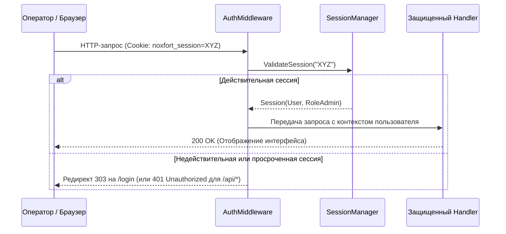

# 🔐 Безопасность, аутентификация и контроль доступа (RBAC)

Данный документ описывает систему безопасности **Noxfort Monitor™ v2.0**, включая проверку подлинности, жизненный цикл сессионных токенов, политику сложности паролей, хеширование с солью и ролевую модель (RBAC).

⬅️ [Главный Хаб](../README.md) | 🏛️ [Архитектура](architecture.md) | 🔍 [Аудит](audit_trail.md) | 📡 [API](api_reference.md)

---

## 1. Архитектура безопасности и модель RBAC

Noxfort Monitor обеспечивает строгое разграничение привилегий:

* **`RoleAdmin` ("ADMIN")**: Полные административные права: управление учетными записями, миграция БД, управление обратным туннелем и системными параметрами.
* **`RoleOperator` ("OPERATOR")**: Операторские права: просмотр телеметрии дашборда, мониторинг оборудования и просмотр инцидентов.
* **Роли маршрутизации оповещений**:
  * **`TECHNICIAN`**: Получает исключительно инциденты категории `HARDWARE`.
  * **`PROGRAMMER`**: Получает исключительно инциденты категории `SOFTWARE`.
  * **`ADMIN`**: Получает все оповещения системы.

---

## 2. Политика паролей и криптографическое хранение

### 2.1 Криптографическое хранение и соль
Пароли защищаются с помощью функции SHA-256 с уникальной солью в [`internal/security/hasher.go`](../../internal/security/hasher.go):
* Для каждого пользователя генерируется случайная 16-байтная соль через `crypto/rand`.
* Пароли и их хеши исключены из сериализации в JSON (`json:"-"`).
* Сравнение за константное время предотвращает тайминг-атаки (*timing attacks*).

### 2.2 Промышленная политика сложности паролей (`password_validator.go`)
Для защиты промышленных узлов от атак перебором [`internal/security/password_validator.go`](../../internal/security/password_validator.go) применяет обязательную проверку в `ValidatePasswordComplexity()`:
* **Минимальная длина**: Не менее 8 символов.
* **Цифра**: Как минимум одна цифра (`0-9`).
* **Заглавная буква**: Как минимум одна буква в верхнем регистре (`A-Z`).
* **Строчная буква**: Как минимум одна буква в нижнем регистре (`a-z`).
* **Специальный символ**: Как минимум один специальный знак (`!@#$%^&*()-_=+[]{}|;:'",.<>/?`~\\§¬¢£`).

Попытка регистрации или создания пользователя с паролем, не удовлетворяющим критериям, возвращает HTTP `400 Bad Request`.

### 2.3 Интерактивный индикатор надежности пароля (`password_meter.js`)
Интерфейсы управления учетными записями предоставляют обратную связь в реальном времени ([`web/static/js/password_meter.js`](../../web/static/js/password_meter.js)):
* Динамический расчет оценки (от 0 до 4) по мере ввода.
* Интерактивный чеклист требований с визуальной индикацией.
* Блокировка отправки формы до полного соответствия правилам.

---

## 3. Жизненный цикл сессий и AuthMiddleware

* **Хранение в памяти**: Потокобезопасная хеш-таблица с мьютексом.
* **Плавающее продление**: Активность пользователя автоматически продлевает сессию на 24 часа.
* **Разделение ответов**: Неавторизованные запросы к веб-интерфейсу перенаправляются на `/login` (код `303`), а вызовы API возвращают `401 Unauthorized`.

---

## 4. Защита брокера MQTT и аутентификация PBKDF2

* **Анонимный доступ отключен**: В [`mosquitto.conf`](../../mosquitto/config/mosquitto.conf) установлено `allow_anonymous false`.
* **Надежное хеширование**: Пароли в `mosquitto/config/passwd` используют PBKDF2 (SHA-512).
* **Автоматическая настройка**: Команда `make broker-auth` генерирует учетные данные и синхронизирует `.env`.
* **Защита репозитория**: Файлы паролей (`passwd*`) исключены из Git.

---

## 5. Защита окружения и аудит запуска (`env_validator.go`)

При старте приложения валидатор окружения проверяет целостность конфигурации:
* **Права доступа к файлу (`0600`)**: Ограничивает доступ к `.env` только владельцу в Linux.
* **Предупреждения о паролях по умолчанию**: Выводит критическое предупреждение, если стандартные учетные данные (`admin` / `Admin@Noxfort2026!`) используются в продакшене.
* **Проверка MQTT**: Предупреждает об отсутствии `MQTT_USER` или `MQTT_PASSWORD`.

---

## 6. Идемпотентный bootstrap суперпользователя (`superuser.go`)

При запуске система анализирует `MONITOR_ADMIN_USER` и `MONITOR_ADMIN_PASSWORD`:
* Создает учетную запись `ADMIN`, если администраторов в базе еще нет.
* Автоматически удаляет тестовую учетную запись по умолчанию при настройке пользовательских учетных данных, исключая наличие скрытых бэкдоров.

---

## 7. Предотвращение утечек секретов в CI/CD

Пайплайны CI ([`.github/workflows/ci.yml`](../../.github/workflows/ci.yml)) проверяют каждый коммит, блокируя случайное попадание файлов `.env`, приватных ключей (`*.pem`, `*.key`) и паролей Mosquitto в Git.
