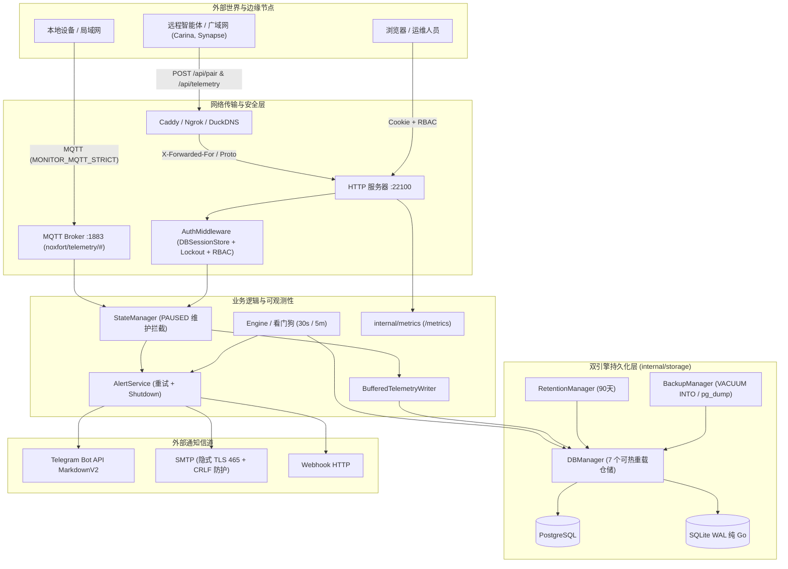

# 🏛️ Noxfort Monitor™: 系统架构与并发模型设计

本文档规范 **Noxfort Monitor™ v2.0** 的内部架构设计：事件驱动架构 (EDA)、Goroutine 并发调度、Zero-Trust 设备接入、双引擎持久化、自动化保留及优雅停机。

⬅️ [文档中心](../README.md) | 📡 [API 规范](api_reference.md) | 🗄️ [数据库](database.md) | 🔐 [安全规范](security.md) | 🧪 [测试指南](testing.md)

---

## 1. 宏观架构设计哲学

Noxfort Monitor 严格遵循**事件驱动架构 (EDA)**、**SOLID** 原则与**依赖注入 (DI)**，统一在 [`cmd/server/main.go`](../../cmd/server/main.go) 中完成组装。引导配置通过 `LoadDotEnv()` 从 `.env` 读取（已移除旧版 `configs/config.yaml`），无隐藏全局可变状态。

---

## 2. 解耦子系统分层

1. **传输层 (`internal/transport`)**：MQTT 客户端（订阅 `noxfort/telemetry/#`、执行 `MONITOR_MQTT_STRICT`、启动 5 秒重连及 `/settings` 热更新 `Reconnect(brokerURL)`）与 HTTP REST 服务（`:22100`、`AuthMiddleware`、`/api/pair`、`/api/telemetry` 与 `/metrics`）。
2. **监控逻辑与告警层 (`internal/monitor`)**：`StateManager`（遵循 `PAUSED` 维护状态并同步调用 `SaveEventReturningID`）、`Engine`（30s 心跳周期、5m 离线阈值与 `CleanupExpiredPending()`）以及 `AlertService`（`500ms`/`1500ms` 重试退避与 `Shutdown(ctx)`）。
3. **安全层 (`internal/security`)**：`PBKDF2Hasher`（10万次迭代）、`LoginAttemptTracker`（5次/15m $\rightarrow$ 5m `429` 锁定）、`DBSessionStore`（`SHA-256` 存 `sessions` 表，24h TTL）、可信代理校验（`TRUSTED_PROXIES`、`MONITOR_USE_HTTPS`）及严格只读 RBAC（`OPERATOR` 仅可自助改密）。
4. **远程隧道层 (`internal/tunnel`)**：DuckDNS 与 Ngrok 驱动管理 `/remote`，提供 HTML 秘钥遮罩。
5. **持久化层 (`internal/storage`)**：`DBManager` 统一调度 SQLite WAL 与 PostgreSQL、7 个 `ReloadableRepository`（含 `DBSessionStore`）、单事务 9 表 `MigrateData`、`BufferedTelemetryWriter`、`BackupManager`（定时/下载/恢复）与 `RetentionManager`（`MONITOR_RETENTION_DAYS=90`）。
6. **桌面、演示与指标层 (`internal/desktop`, `internal/tray`, `internal/metrics`)**：Wails v2 + WebKitGTK、Unix IPC 单实例锁、`--demo`（`RunDesktopServer()`）与 `--headless` 模式，以及原生 Prometheus `/metrics`。

---

## 3. 并发调度与优雅停机

* **主线程**：标准模式驱动 `desktopApp.Run()`；`--demo` 启动 `RunDesktopServer()`；`--headless` / `--server-only` 阻塞监听 `SIGINT`/`SIGTERM`。
* **后台 Goroutine (`bgCtx`)**：独立运行 HTTP `:22100`、MQTT 收发与重连、异步批量写入、`Engine`（30s）、每小时 `sessions` 清理、24 小时 `RetentionManager` 及定时备份（`MONITOR_BACKUP_INTERVAL_HOURS`）。
* **停机排空 (`AlertService.Shutdown`)**：关闭前等待告警分发队列排空后再释放数据库与 MQTT 连接。
