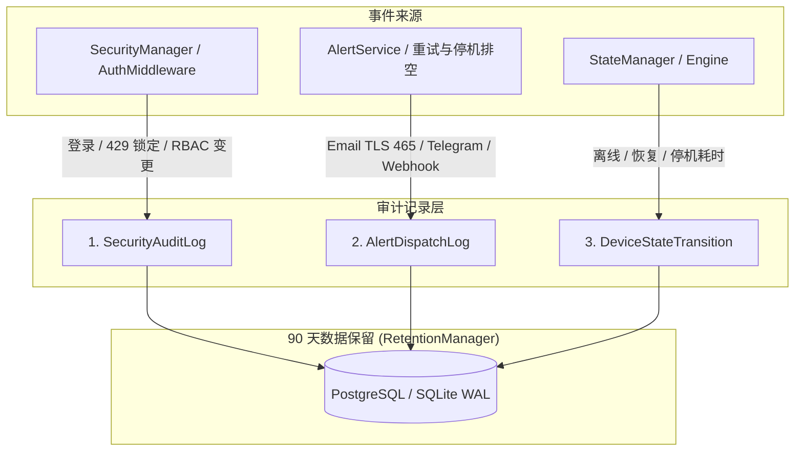

# 🔍 审计追踪与系统可观测性

本文档规范 **Noxfort Monitor™ v2.0** 的审计与合规子系统，涵盖安全事件留痕、关联遥测的告警投递记录以及设备状态跳变统计，面向 `Operator+` 用户在 `/audit` 与 `/api/audit/*` 提供只读查询。

⬅️ [文档中心](../README.md) | 🏛️ [系统架构](architecture.md) | 🔐 [安全规范](security.md)

---

## 1. 三重审计流架构

---

## 2. 数据模型与精确字段 (`internal/domain/audit.go`)

### 2.1 `SecurityAuditLog` (`security_audit_logs`)
* `id` (*int64*): 自增主键。
* `created_at` (*timestamp*): UTC 时间戳。
* `username` (*string*): 操作发起者或目标用户名。
* `action` (*string*): 规范动作标识（`AUTH_LOGIN_SUCCESS`、`AUTH_LOGIN_FAILED`、`AUTH_LOGIN_LOCKED`、`USER_CREATE`、`USER_PASSWORD_CHANGED`、`USER_ROLE_UPDATED`、`USER_UNLOCKED`、`USER_DELETE`、`DEVICE_*`、`CONTACT_*`、`SETTINGS_UPDATED`、`TUNNEL_*`、`DATABASE_*`、`POSTGRES_USER_PROVISIONED`）。
* `details` (*string*): 上下文细节与执行结果。
* `ip_address` (*string*): 经 `ExtractClientIP` 与 `TRUSTED_PROXIES` 解析后的真实客户端 IP。

### 2.2 `AlertDispatchLog` (`alert_dispatch_logs`)
追踪 `AlertService` 的每次告警发送（含 `500ms`/`1500ms` 退避重试及 `Shutdown` 期间排空）：
* `id` (*int64*): 主键。
* `telemetry_id` (*int64*): 关联至通过 `SaveEventReturningID` 落库的 `telemetry.id`。
* `channel` (*string*): `telegram`、`email` 或 `webhook`。
* `recipient` (*string*): 目标接收者。
* `role` (*string*): 目标通知角色。
* `status` (*string*): 分发结果状态。
* `error_reason` (*string*): 失败原因详述。
* `dispatched_at` (*timestamp*): 投递时间。

### 2.3 `DeviceStateTransition` (`device_state_transitions`)
记录每 `30s` 轮询检查（`5m` 离线阈值）捕获的设备状态变更：
* `id` (*int64*): 主键。
* `device_identifier` (*string*): 设备唯一标识符。
* `previous_state` (*string*): 原状态。
* `new_state` (*string*): 新状态。
* `duration_offline_sec` (*int64*): 恢复上线时结算的离线持续秒数。
* `transition_at` (*timestamp*): 状态跳变时刻。

---

## 3. 访问控制与保留生命周期
* **只读查询**：`ADMIN` 与 `OPERATOR` 均可通过 `/audit` 及 `/api/audit/{security,alerts,transitions}` 查询审计流。
* **自动清理**：`RetentionManager` 每 24 小时清除上述三张表与 `telemetry` 中超出 `MONITOR_RETENTION_DAYS`（默认 `90` 天）的过期数据。
