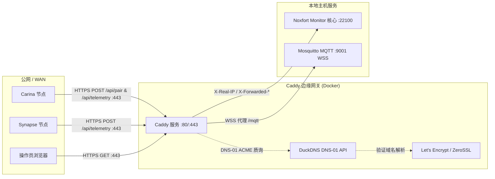

# 🛡️ Caddy 反向代理与 DuckDNS（自动 HTTPS）：Noxfort Monitor™

本文档介绍 **Caddy Server**（[`caddy/Caddyfile`](../../caddy/Caddyfile)）配合 **DuckDNS** 为 **Noxfort Monitor™ v2.0** 提供自动化 HTTPS 终结（DNS-01 ACME）、加密 WebSockets（`/mqtt`）及可信代理请求头转发的架构与验证流程。

⬅️ [文档中心](README.md) | 🌐 [远程访问](remote_access.md) | 🚀 [生产部署](deployment.md) | 📡 [API 参考](api_reference.md)

---

## 1. 架构概览



---

## 2. 配置 `TRUSTED_PROXIES` 与 `MONITOR_USE_HTTPS`

[`caddy/Caddyfile`](../../caddy/Caddyfile) 向上游转发 `X-Real-IP`、`X-Forwarded-For` 与 `X-Forwarded-Proto`。请在 `.env` 中配套设置：

```env
DUCKDNS_DOMAIN=your-subdomain
DUCKDNS_TOKEN=xxxxxxxx-xxxx-xxxx-xxxx-xxxxxxxxxxxx
ACME_EMAIL=admin@your-company.com
MONITOR_USE_HTTPS=true
TRUSTED_PROXIES=127.0.0.1/32,172.16.0.0/12
```

配置后，`ExtractClientIP` 会精准记录下游真实 IP 到 `LoginAttemptTracker` 与 `SecurityAuditLog`，`IsHTTPSRequest` 也会正确下发 `Secure` 会话 Cookie。

---

## 3. 启动网关与 Zero-Trust HTTPS 验证

```bash
make caddy-build
make services-start
make services-logs
make services-stop
```

```bash
# 1. 提交 Zero-Trust 配对请求（返回 202 Accepted，不包含 API 密钥）
curl -X POST https://your-subdomain.duckdns.org/api/pair \
  -H "Content-Type: application/json" \
  -d '{"origin":"carina-01","name":"Carina Edge 01"}'

# 2. 在 /devices 页面审批并复制临时 nox_live_ 令牌 (TTL 5m) 后发送遥测：
curl -X POST https://your-subdomain.duckdns.org/api/telemetry \
  -H "Content-Type: application/json" \
  -H "X-Device-Token: nox_live_your_copied_token" \
  -H "X-Device-Origin: carina-01" \
  -d '{"category":"HARDWARE","origin":"carina-01","level":"INFO","message":"System OK","occurred_at":"'"$(date -u +%Y-%m-%dT%H:%M:%SZ)"'"}'
```
