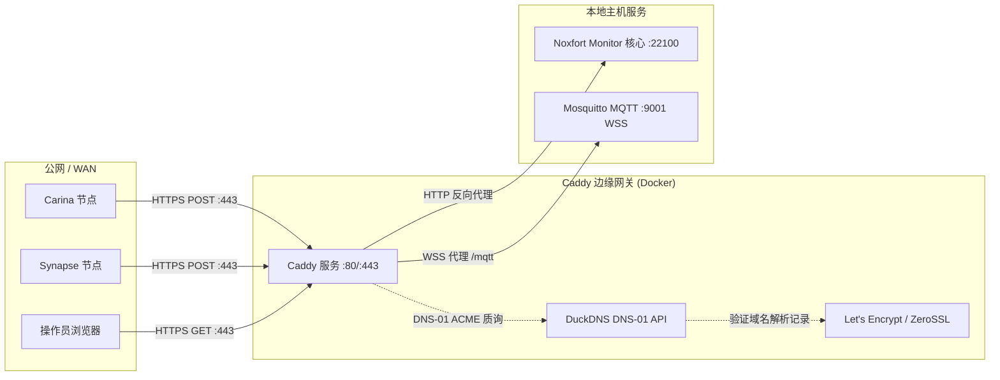

# 🛡️ Caddy 反向代理与 DuckDNS（自动 HTTPS）：Noxfort Monitor™

本文档详细介绍了 **Noxfort Monitor™ v2.0** 中集成的 **Caddy Server** 与 **DuckDNS** 的架构、部署与运维流程。此架构通过 **DNS-01 ACME 质询** 提供企业级自动化 TLS/SSL 证书终结，杜绝广域网（WAN）中的明文传输，并规范对外开放标准端口（`80`、`443` 与 `WSS`）。

⬅️ [文档中心](README.md) | 🌐 [远程访问](remote_access.md) | 🚀 [生产部署](deployment.md) | 📡 [API 参考](api_reference.md)

---

## 1. 架构概览

在工业可观测性与遥测网络中，远程边缘节点（如 **Synapse**、**Carina** 或各类传感器）需通过公网向中心服务器汇报数据。若在非标准端口（如 `:22100`）暴露裸 HTTP，既存在严重安全风险，又常被企业出站防火墙拦截。



### 核心优势：
1. **零配置 HTTPS**：Caddy 自动向 Let's Encrypt / ZeroSSL 申请并续期受信任的 TLS 证书。
2. **DNS-01 ACME 验证**：与传统 HTTP-01 验证不同，DNS-01 **无需** 对外开放入站 80 端口即可签发证书，验证过程完全通过对 DuckDNS 的出站 API 请求完成。
3. **加密 WebSockets (WSS)**：通过 `wss://your-domain.duckdns.org/mqtt` 支持 Web 端仪表板的加密 MQTT 传输。
4. **统一标准端口**：外部流量集中于 443 端口，无需对外暴露 `:22100`。

---

## 2. 目录结构

Caddy 子系统位于项目根目录下的 `caddy/` 文件夹中：

```text
MONITOR_CORE/
├── caddy/
│   ├── Dockerfile         # 包含 github.com/caddy-dns/duckdns 插件的多阶段构建
│   └── Caddyfile          # 反向代理与 TLS 配置规则
├── docker-compose.yml     # Mosquitto 与 Caddy 容器编排
└── .env                   # 环境变量（DuckDNS 令牌、域名、邮箱等）
```

---

## 3. 配置与启动

### 3.1 配置环境变量 (`.env`)
在 `.env` 中填入您的 DuckDNS 凭据：

```env
# DuckDNS 子域名（例如 my-monitor.duckdns.org 填 my-monitor）
DUCKDNS_DOMAIN=your-subdomain

# DuckDNS 账户 API 令牌（从 duckdns.org 获取）
DUCKDNS_TOKEN=xxxxxxxx-xxxx-xxxx-xxxx-xxxxxxxxxxxx

# 用于接收 Let's Encrypt 证书到期通知的邮箱
ACME_EMAIL=admin@your-company.com

# 启用 Noxfort Monitor 生成 HTTPS 格式的遥测链接
MONITOR_USE_HTTPS=true
```

### 3.2 构建 Caddy 容器镜像
编译集成了 `caddy-dns/duckdns` 插件的定制 Caddy 镜像：

```bash
make caddy-build
```

### 3.3 启动边缘网关服务
在后台启动 Mosquitto 与 Caddy：

```bash
make services-start
```

实时查看证书签发与访问日志：
```bash
make services-logs
```

停止服务：
```bash
make services-stop
```
