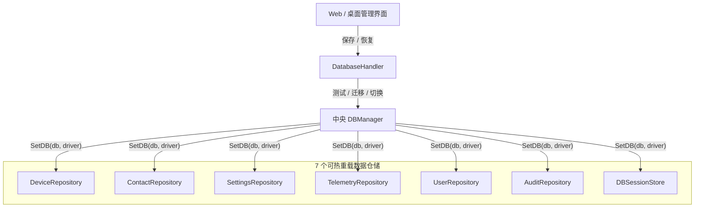

# 🗄️ 数据库架构与双引擎持久化机制

本文档说明 **Noxfort Monitor™ v2.0** 的双引擎持久化层：PostgreSQL 与 SQLite（WAL 模式）共存、运行时热切换 (`DBManager`)、9 表单事务异构迁移、热备份与验证恢复以及自动化数据保留。

⬅️ [文档中心](../README.md) | 🏛️ [系统架构](architecture.md) | 📡 [API 规范](api_reference.md) | 🔐 [安全规范](security.md)

---

## 1. 双数据库引擎与 WAL 模式

SQLite 与 PostgreSQL 在逻辑上保持完全一致的 **9 张数据表与 12 个索引**：

| 维度 | SQLite (纯 Go，WAL 模式) | PostgreSQL |
|---|---|---|
| **Go 驱动** | `modernc.org/sqlite` (无 CGO) | `github.com/lib/pq` |
| **并发与调优** | `journal_mode=WAL`、`synchronous=NORMAL`、`busy_timeout=5000` | 专属模式 (`schema_monitor`) 与连接池 |
| **应用场景** | 本地桌面站、边缘网关 | 高并发工控服务器与集群 |
| **存储位置** | `~/Documentos/Monitor/monitor_logs.db` | TCP 服务器 (端口 `5432`) |
| **依赖** | 零外部依赖（静态编译进二进制） | PostgreSQL 12+ |

---

## 2. 运行时热切换 (`DBManager`)



所有仓储均实现 `ReloadableRepository` 接口：

```go
type ReloadableRepository interface {
    SetDB(db *sql.DB, driver string)
}
```

---

## 3. 单事务异构迁移 (`MigrateData`)

在 SQLite 与 PostgreSQL 之间热切换时：
1. `Migrator.MigrateData` 在**单一数据库事务**内完整复制全部 **9 张表**（含带 `api_key`/`status`/`expires_at` 的 `devices`、含 `device_id` 的 `telemetry`、`settings`、`contacts`、`users`、`sessions`、`security_audit_logs`、`alert_dispatch_logs` 与 `device_state_transitions`）。
2. 通过 `storage.AdaptQuery()` 自动适配双引擎语法差异。
3. 任一步骤失败即整体回滚，并中止 `DBManager.Switch`，彻底杜绝部分迁移与脑裂状态。

---

## 4. 热备份、校验恢复与数据保留 (`BackupManager` & `RetentionManager`)

* **非阻塞热备份 (`BackupManager`)**：SQLite 执行 `VACUUM INTO`，PostgreSQL 执行 `pg_dump -F c`。`BackupManager.StartScheduledBackups` 按 `MONITOR_BACKUP_INTERVAL_HOURS`（默认 `24h`）定时生成并自动轮转保留最近 **`7`** 份快照（归档权限 `0600`，支持 `make backup`、`make backup-list` 与 [`scripts/backup.sh`](../../scripts/backup.sh)）。
* **安全下载与验证恢复**：
  * `GET /api/settings/database/backups/download` 使用 `ResolveBackupPath` 防御路径穿越攻击。
  * `POST /api/settings/database/restore` 在 SQLite 恢复前执行 `PRAGMA quick_check` 校验再通过 `RestoreSQLiteFile` 替换，或在 PostgreSQL 模式下调用 `pg_restore`。
* **自动数据保留 (`RetentionManager`)**：每 **`24` 小时**运行一次，自动清理 `telemetry`、`alert_dispatch_logs`、`security_audit_logs` 与 `device_state_transitions` 中超过 `MONITOR_RETENTION_DAYS`（默认 **`90` 天**）的历史记录。
